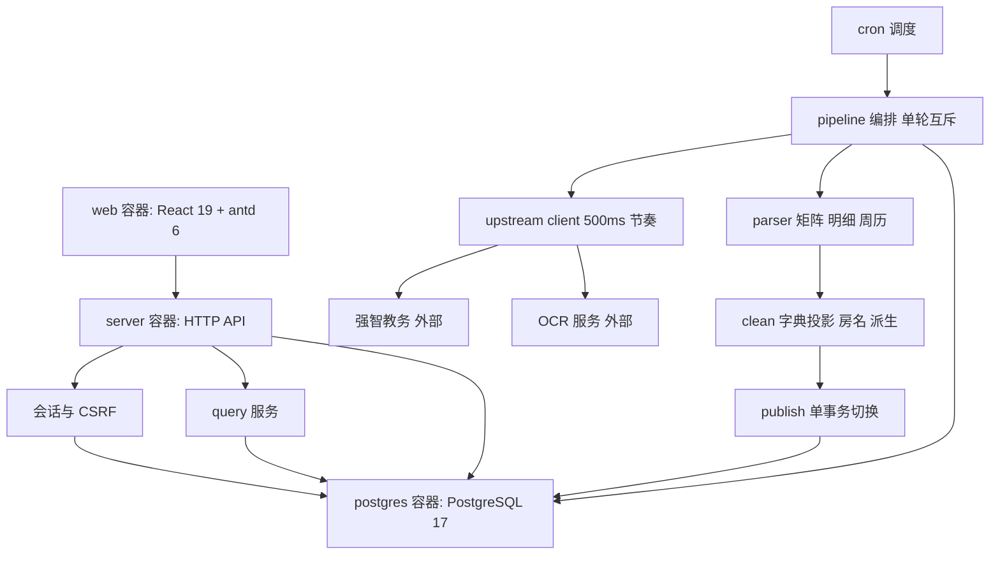

# 空教室查询服务重写（采集 + 查询 + 管理 + 前端）

Feature Name: classroom-availability-rewrite
Spec Directory: 2026-10-27-classroom-availability-rewrite
Updated: 2026-10-27

## Description

从空目录重写 `easy-qfnu-kjs`：把强智教务教师端的教室占用矩阵清洗为本地逐格数据，向校内提供按日期、节次区间、教学楼与关键词检索空教室的只读服务，并给管理员一套初始化、配置、同步、对比与回退面板。

产品口径以 [docs/prd.md](../../docs/prd.md) 为唯一基线；上游结构见 [docs/upstream-api.md](../../docs/upstream-api.md)；已知坑点见 [docs/pitfalls.md](../../docs/pitfalls.md)。需求条目见同目录 [requirements.md](requirements.md)。

## 设计决策（已确认）

| 编号 | 决策 | 取舍 |
|---|---|---|
| D1 | **后端单进程 + 采集协程**：`backend/cmd/server` 提供公开 API、管理 API 与进程内 cron；采集以 goroutine 执行，靠数据库唯一索引与行锁保证同一时刻至多一轮 | 少一套进程与内部 RPC；代价是长采集与查询共享进程，用连接池上限、分批写入与 500ms 节奏隔离 |
| D2 | **前后端分离、独立容器**：前端构建产物由单独容器托管（静态资源 + 反代 `/api`），后端只提供 JSON | 前端可单独发版、可独立加缓存头；代价是多一个容器与一份反代配置 |
| D3 | **旧实现整体归档后清空**：旧 Go 代码、旧编排（`deploy/compose.yaml`）、旧契约（`docs/contract/*`）、旧 PRD（`docs/product-requirements.md`）、`docs/upstream.md` 与 `specs/collector-full-sync/*` 归到归档分支 `legacy/go-collector`，`main` 删干净，从 0 开始写；新线只保留 `docs/prd.md`、`docs/pitfalls.md`、`docs/upstream-api.md`、`docs/decisions/` 与本 spec | 与「重写从空目录开始」一致，出问题可切回归档分支对照；代价是历史参考要靠分支切换，M0 需同步把 `docs/prd.md` 附录 B 的旧文档指向改成归档分支 |

技术栈（按项目规范，不写进 PRD）：Go 1.26.10、PostgreSQL 17、React 19 + antd 6，编排用 docker compose。

## Architecture



图渲染不出来时看下面这段同义的结构：

```text
web ──> api ──> auth ──> pg
         │ └──> query ──> pg
         └────> (浏览器请求 /api 与 /api/admin 都进 api)

cron ──> pipeline ──> upstream ──> jw / ocr
           │  └──> parser ──> clean ──> publish ──> pg
           └─────────────────────────────────────> pg
```

数据流：`upstream` 只负责 HTTP 与节奏 → `parser` 只做结构定位与字段提取 → `clean` 只做语义投影与派生 → `publish` 只做校验与事务切换；`pipeline` 负责把四段按任务顺序串起来。各段之间只传 `model` 里的结构体，不共享可变状态，便于对每段单独建夹具测试。

部署拓扑（compose）：`web`（`Dockerfile.frontend` + 构建上下文 `frontend/`，静态托管 + 反代 `/api` 到 `server`）、`server`（`Dockerfile.backend` + 构建上下文 `backend/`，单进程，API + 采集协程）、`postgres`（仅内网，不映射公网端口）；OCR 服务为外部依赖，由设置项指向。

## Components and Interfaces

### 目录结构

```
compose.yaml                    根目录编排：web + server + postgres 三个服务
Dockerfile.backend              根目录：server 镜像（构建上下文 ./backend）
Dockerfile.frontend             根目录：web 镜像（构建上下文 ./frontend）
Taskfile.yml                    根目录：运维入口，up/down/logs/db:*/backend:*/frontend:*/gate/fmt
docs/  specs/                   产品基线、上游结构、坑点、决策与本次 spec

backend/                        Go 模块根：go.mod、go.sum、.golangci.yml
backend/cmd/server/main.go      装配：store → upstream → pipeline → api → cron
backend/internal/model/         跨层实体与错误定义：Room、Cell、Observation、Release、Run、Task
backend/internal/upstream/      登录、验证码 OCR、学期/周历/楼列表/矩阵/明细请求，节奏与重试
backend/internal/parser/        纯解析：周历、矩阵、明细（不碰网络、不碰库）
backend/internal/clean/         纯变换：字典投影、房名规范化、周次求交、派生判定
backend/internal/pipeline/      编排：任务规划、单轮互斥、续跑、阶段推进、归属冲突裁决
backend/internal/publish/       发布校验 + 单事务版本切换
backend/internal/store/         仓储、迁移执行、批量写入
backend/internal/query/         只读查询：空教室聚合、全天状态、新鲜度
backend/internal/api/           HTTP 层：public/admin handlers + 中间件（会话、CSRF、限流、request_id）
backend/internal/config/        非秘密配置读取；秘密项走库
backend/migrations/             0001 基线及后续迁移，随二进制一起打包

frontend/                       Vite + React 19 + antd 6，单一构建、两套布局
frontend/src/api/               请求封装、错误码 → 文案、request_id 透传
frontend/src/lib/               时段默认、日期与周次换算、房名后缀、格式化
frontend/src/components/        通用展示组件：状态格、空态、过期提示
frontend/src/layouts/           PublicLayout（移动优先）、AdminLayout（桌面优先）
frontend/src/pages/public/      首页、空教室、全天状态、404
frontend/src/pages/admin/       初始化、登录、总览、运行详情、设置、对比回退、异常、告警
frontend/src/theme/             antd 主题：品牌色与状态视觉映射
```

前后端在顶层对称分开：`backend/` 是一个自足的 Go 模块（在 `backend/` 下跑 `go build ./cmd/server`、`go test ./...`），`frontend/` 是一个自足的 Node 工程（在 `frontend/` 下跑 `pnpm install`、`pnpm build`）。**构建与编排文件统一放仓库根目录**：`compose.yaml` 用两个独立 build context（`./backend`、`./frontend`）配合根目录的 `Dockerfile.backend` / `Dockerfile.frontend`，两个工程目录内不含 Dockerfile，也不引用对方目录。

前端保持单一 Vite 构建、两套布局壳：`/admin` 只是路由前缀，不拆第二个 SPA，避免跨域与两套发版。

运维动作统一走 `task <名字>`：编排用 `task up/down/ps/logs`，库操作用 `task db:up/db:psql/db:reset/db:dump/db:restore`，本地开发用 `task backend:run` 与 `task frontend:dev`，提交前跑 `task gate`（后端 test/vet/lint + 前端 test/lint/build）。文档与脚本里不再散落原始命令。

### 依赖方向

单向依赖，用 `golangci-lint` 的 depguard 钉在 CI 里，越层即失败：

```
api      → query, publish, pipeline, store, model
pipeline → upstream, parser, clean, store, model
publish  → store, model
query    → store, model
parser   → model            （纯函数，禁止 import store / upstream）
clean    → model            （纯函数，禁止 import store / upstream）
model    → 标准库
```

后端不内嵌前端资源：`web` 容器负责静态文件与 `/api` 反向代理，`server` 只提供 JSON，两侧通过 compose 网络互访。

### 公开 API

统一响应 `{code, message, data, request_id}`；`request_id` 前缀 `req_`；时间 RFC3339 UTC。

| 方法 | 路径 | 关键参数 | 说明 |
|---|---|---|---|
| GET | `/api/context` | — | `{date, term, week, weekday, in_calendar}` |
| GET | `/api/meta` | — | 版本、字典、轴、教学楼列表、逐周新鲜度 |
| GET | `/api/query` | `view=availability\|day`、`keyword`、`date_offset`、`building`、`start_node`、`end_node`、`limit`、`offset` | 空教室或全天状态 |

参数约束：`date_offset` 0..10；`building` 空表示全部；`start_node`/`end_node` 01..12 且起点不晚于终点；`limit` 1..200 默认 50；`offset ≥ 0`。服务端不感知时钟，默认区间只在前端（Requirement 19）。

### 管理 API

| 方法 | 路径 | 说明 |
|---|---|---|
| GET | `/api/admin/state` | `{initialized, authenticated}`，供前端决定进初始化页还是登录页 |
| POST | `/api/admin/init` | 首次初始化：`{password, password_confirm}`，返回一次性密钥导出内容 |
| GET | `/api/admin/key` | 再次导出加密密钥 |
| POST | `/api/admin/session` | 登录，设置会话 Cookie 与 CSRF 令牌 |
| DELETE | `/api/admin/session` | 退出 |
| POST | `/api/admin/password` | 改密：`{current_password, new_password}`，改后旧会话失效 |
| GET/PUT | `/api/admin/settings` | 账号、OCR、飞书、cron、白名单；秘密只写不读 |
| GET | `/api/admin/runs` | 最近轮次摘要（含归属冲突标记） |
| GET | `/api/admin/runs/{run_id}` | 单轮详情 |
| POST | `/api/admin/sync` | 手动同步，返回 `202 {run_id}` |
| GET | `/api/admin/releases` | current 与 previous |
| GET | `/api/admin/releases/diff` | 汇总 + 明细分页（含归属变化） |
| POST | `/api/admin/releases/{id}/rollback` | 交换 `is_current` |
| GET | `/api/admin/anomalies` | 未归属教室、归属冲突、未知/复合清单 |
| GET | `/api/admin/alerts` | 告警记录 |

错误码：`0` 成功、`40001` 参数错误、`40101` 未登录、`40301` CSRF/权限拒绝、`40401` 无数据、`40901` 已有同步、`40902` 已初始化、`42201` 设置校验失败、`42901` 限流、`50000` 内部错误。

## Data Models

```sql
-- 字典与轴（版本化，采集与查询都按字典投影）
CREATE TABLE dict (version integer PRIMARY KEY, note text, created_at timestamptz NOT NULL DEFAULT now());
CREATE TABLE dict_state (
  dict_version integer NOT NULL REFERENCES dict(version),
  state_key text NOT NULL, label text NOT NULL, available boolean NOT NULL,
  PRIMARY KEY (dict_version, state_key));
CREATE TABLE dict_symbol (
  dict_version integer NOT NULL, symbol text NOT NULL, state_key text NOT NULL,
  PRIMARY KEY (dict_version, symbol),
  FOREIGN KEY (dict_version, state_key) REFERENCES dict_state(dict_version, state_key));
CREATE TABLE axis (version integer PRIMARY KEY, note text);
CREATE TABLE axis_node (
  axis_version integer NOT NULL REFERENCES axis(version),
  node char(2) NOT NULL, ordinal smallint NOT NULL, block text NOT NULL, block_ordinal smallint NOT NULL,
  PRIMARY KEY (axis_version, node));

-- 学期日历（覆盖全学期；窗口仅限制矩阵采集）
CREATE TABLE term (term text PRIMARY KEY, total_weeks smallint NOT NULL, timezone text NOT NULL DEFAULT 'Asia/Shanghai');
CREATE TABLE term_week (
  term text NOT NULL REFERENCES term(term) ON DELETE CASCADE,
  week smallint NOT NULL, monday date NOT NULL, in_calendar boolean NOT NULL DEFAULT true,
  PRIMARY KEY (term, week));

-- 教室目录：全局最新归属（查询与筛选走版本快照，本表只做目录与异常视图）
CREATE TABLE room (
  room_id text PRIMARY KEY, name text NOT NULL, name_raw text,
  building_id text, building_name text, first_seen date, last_seen date);

-- 管理员与设置
CREATE TABLE admin_user (
  id smallint PRIMARY KEY DEFAULT 1 CHECK (id = 1),
  password_hash text NOT NULL, password_updated_at timestamptz NOT NULL DEFAULT now(),
  created_at timestamptz NOT NULL DEFAULT now());
CREATE TABLE settings (
  key text PRIMARY KEY, value text NOT NULL, is_secret boolean NOT NULL DEFAULT false,
  updated_at timestamptz NOT NULL DEFAULT now());

-- 发布版本：只保留 current + previous
CREATE TABLE release (
  release_id text PRIMARY KEY, term text NOT NULL REFERENCES term(term),
  generated_at timestamptz NOT NULL,
  dict_version integer NOT NULL REFERENCES dict(version),
  axis_version integer NOT NULL REFERENCES axis(version),
  has_attr_conflict boolean NOT NULL DEFAULT false,
  is_current boolean NOT NULL DEFAULT false
);
CREATE UNIQUE INDEX release_one_current ON release ((true)) WHERE is_current;

-- 归属快照：跟随版本，回退时一起回退
CREATE TABLE release_room_building (
  release_id text NOT NULL REFERENCES release(release_id) ON DELETE CASCADE,
  room_id text NOT NULL REFERENCES room(room_id),
  building_id text NOT NULL, building_name text NOT NULL,
  PRIMARY KEY (release_id, room_id)
);
CREATE INDEX release_room_building_bld ON release_room_building (release_id, building_id);

-- 逐格观测
CREATE TABLE observation (
  release_id text NOT NULL REFERENCES release(release_id) ON DELETE CASCADE,
  room_id text NOT NULL REFERENCES room(room_id), term text NOT NULL REFERENCES term(term),
  week smallint NOT NULL, weekday smallint NOT NULL, node char(2) NOT NULL,
  state_key text NOT NULL, available boolean NOT NULL, raw_text text,
  PRIMARY KEY (release_id, room_id, term, week, weekday, node),
  CHECK (weekday BETWEEN 1 AND 7));

-- 占用说明
CREATE TABLE occupancy_detail (
  detail_id bigserial PRIMARY KEY,
  release_id text NOT NULL REFERENCES release(release_id) ON DELETE CASCADE,
  room_id text NOT NULL REFERENCES room(room_id), weekday smallint NOT NULL, block text NOT NULL,
  state_key text NOT NULL, course text, week_range text, time_flag text,
  derived boolean NOT NULL DEFAULT false,
  CHECK (weekday BETWEEN 1 AND 7));

-- 轮次与任务
CREATE TABLE collect_run (
  run_id bigserial PRIMARY KEY, started_at timestamptz NOT NULL,
  updated_at timestamptz NOT NULL DEFAULT now(), finished_at timestamptz,
  status text NOT NULL CHECK (status IN ('running','success','partial','failed','blocked','skipped')),
  phase text NOT NULL DEFAULT 'login',
  term text REFERENCES term(term), window_start smallint, window_end smallint,
  weeks_total integer NOT NULL DEFAULT 0, rooms_total integer NOT NULL DEFAULT 0,
  required_total integer NOT NULL DEFAULT 0, required_done integer NOT NULL DEFAULT 0,
  optional_total integer NOT NULL DEFAULT 0, optional_done integer NOT NULL DEFAULT 0,
  unknown_cells integer NOT NULL DEFAULT 0, composite_cells integer NOT NULL DEFAULT 0,
  attr_conflict_count integer NOT NULL DEFAULT 0,
  release_id text REFERENCES release(release_id) ON DELETE SET NULL,
  error_code text, error_message text);
CREATE UNIQUE INDEX collect_run_single_running ON collect_run ((true)) WHERE status = 'running';

CREATE TABLE collect_run_week (
  run_id bigint NOT NULL REFERENCES collect_run(run_id) ON DELETE CASCADE,
  term text NOT NULL, week smallint NOT NULL, building_id text NOT NULL,
  ok boolean NOT NULL, fetched_at timestamptz, page_sha256 text, error_message text,
  PRIMARY KEY (run_id, term, week, building_id));

CREATE TABLE sync_task (
  task_id bigserial PRIMARY KEY,
  run_id bigint NOT NULL REFERENCES collect_run(run_id) ON DELETE CASCADE,
  kind text NOT NULL CHECK (kind IN ('week_matrix','cell_detail')),
  required boolean NOT NULL, building_id text NOT NULL, week smallint,
  room_id text REFERENCES room(room_id), weekday smallint, block text,
  status text NOT NULL DEFAULT 'pending' CHECK (status IN ('pending','done','failed')),
  attempt_count integer NOT NULL DEFAULT 0, error_message text,
  CHECK ((kind = 'week_matrix' AND week IS NOT NULL AND room_id IS NULL)
      OR (kind = 'cell_detail' AND week IS NULL AND room_id IS NOT NULL AND weekday IS NOT NULL AND block IS NOT NULL)));
CREATE UNIQUE INDEX sync_task_week ON sync_task (run_id, building_id, week) WHERE kind = 'week_matrix';
CREATE UNIQUE INDEX sync_task_cell ON sync_task (run_id, building_id, room_id, weekday, block) WHERE kind = 'cell_detail';

CREATE TABLE alert_log (dedupe_key text PRIMARY KEY, last_sent_at timestamptz NOT NULL, send_count integer NOT NULL DEFAULT 1);
CREATE TABLE schema_migration (version text PRIMARY KEY, applied_at timestamptz NOT NULL DEFAULT now());
```

种子：`dict` v1（含 `fully_free` 仅作展示标签、不进 `dict_symbol`）、`axis` v1（5 大节 → 12 小节）、`settings` 默认 `cron_expr='0 10 4 * * 6'` 与 `building_whitelist='[]'`。

写入策略：`observation` 与 `occupancy_detail` 用 `COPY` 分批写入，单批 ≤ 5 万行，批次之间可被打断并由事务回滚整体作废。

## Correctness Properties

1. **窗口约束**：`observation.week` 只出现在 `[window_start, window_end]`；窗口外记录一律不入库。
2. **归属唯一**：同一 `(release_id, room_id)` 在 `release_room_building` 最多一行；一个版本内不存在归属冲突残留。
3. **冲突判定确定**：冲突取首个命中，顺序为（白名单顺序, 周次升序），同一 (房号) 在一轮内只记一次冲突。
4. **可用性投影**：`observation.available` 恒等于 `dict_state.available`；未知与复合恒为 false；代码中没有第二套可用性判断。
5. **一次一格**：`(room_id, weekday, block)` 在 `sync_task` 同一轮内至多一个 `cell_detail`。
6. **单轮互斥**：`collect_run_single_running` 唯一索引保证全局至多一个 `running`。
7. **发布原子**：任一版本的数据要么整体可见，要么整体不可见；切换后至多一个 `is_current`。
8. **版本上限**：`release` 行数 ≤ 2；删除最旧版本时 `collect_run.release_id` 置空而不阻塞删除。
9. **页面不落库**：任何表都不含 HTML、账号、Cookie、验证码、申请人、任课教师。
10. **服务端无时钟依赖**：查询路径不读取当前时间用于节次判定；默认区间只属于前端。
11. **密钥不可重生**：不存在覆盖加密密钥的接口；初始化只生成一次。
12. **状态与标记分离**：`status` 取值恒为五档之一；归属冲突只体现在 `attr_conflict_count`/`has_attr_conflict`。

## Error Handling

| 场景 | 处理 | 轮次影响 |
|---|---|---|
| 登录失败（密码错误） | 立即失败，不重试，`error_code=auth_failed` | failed |
| 验证码识别错误 | 换图重试 ≤3 次，耗尽后 `ocr_failed` | failed |
| 会话失效 | 重登录一次后继续当前任务，失败则任务 failed | 视任务必需性 |
| 非 200 / 网络错误 / 读失败 | 单任务重试 ≤3 次，仍失败则任务 failed | 视任务必需性 |
| 表头/轴不一致 | `axis_changed`，整轮停止 | failed |
| 数据行结构异常、重复房号 | `matrix_structure_invalid`，整轮停止 | failed |
| 明细结构缺失（连标题表都没有） | `detail_structure_invalid`，该格任务 failed | partial |
| 明细有标题表无字段行 | 视为「该格无说明」，任务成功 | 无影响 |
| 归属冲突 | 取首个命中，计入 `attr_conflict_count`，打标记，告警 | 不阻断 |
| 候选集为空 / 必需未完成 | 拒绝发布，`validation_blocked` | failed |
| 白名单为空 | `blocked`，不发请求 | blocked |
| 窗口为空 | `skipped` | skipped |
| 过期 running 轮次 | 启动时置 failed，`stale_run` | failed |

对外错误：公开 API 只区分 `40001`/`40401`/`42901`/`50000`；管理 API 额外区分 `40101`/`40301`/`40901`/`40902`/`42201`。错误消息不含页面内容与上游原文。

## Test Strategy

- **解析夹具（最高优先）**：手写脱敏 HTML，必须覆盖 `dataListHeader` 在 `dataList` 之前、表头 36 td / 35 tdvalue、数据行 36 td、`jsbh` 三种来源、明细标题表 + 下方嵌套三列 + 全角冒号、明细空字段行。真实页面样本不入 git。
- **纯函数单测**：房名规范化、字典投影、周次范围求交、派生判定、周历换算、关键词归一与转义、节次区间校验。
- **规划与续跑**：给定窗口与矩阵结果，断言任务清单的唯一性、必需/可选分类、从第一个 pending 继续、失败不重试。
- **发布**：事务内失败回滚、只留两版、极旧版本删除后 `collect_run.release_id` 为空、归属快照随版本切换。
- **仓储集成**：对真实 PostgreSQL 17 跑迁移与查询（docker 起库），覆盖唯一索引与部分索引行为。
- **契约测试**：公开三个端点与管理工作流的请求/响应形状、错误码、越界参数。
- **前端**：`vitest` 覆盖时段默认、日期换算、空态分支、同名房号后缀；`tsc --noEmit` + `eslint`；关键页面用组件测试而非快照。
- **回归红线**：`dataListHeader` 误匹配、明细按 `tab1` 找字段、`available` 写死、过期 running 不收敛——每条都要有能复现旧缺陷的用例。

## References

[^1]: [docs/prd.md](../../docs/prd.md) - 产品基线（采集窗口、发布门槛、完全空闲口径、验收标准）
[^2]: [docs/upstream-api.md](../../docs/upstream-api.md) - 登录、周历、矩阵与明细的请求/响应结构
[^3]: [docs/pitfalls.md](../../docs/pitfalls.md) - 已确认坑点与旧结论核对
[^4]: [requirements.md](requirements.md) - 本次重写的 32 条 EARS 需求
[^5]: [docs/decisions/2026-10-23-fully-free-is-range-aggregate.md](../../docs/decisions/2026-10-23-fully-free-is-range-aggregate.md) - 「完全空闲是区间聚合而非格子状态」的决策记录
[^6]: [specs/collector-full-sync/design.md](../collector-full-sync/design.md) - 旧采集设计（已被本文件取代，仅供行为对照）
