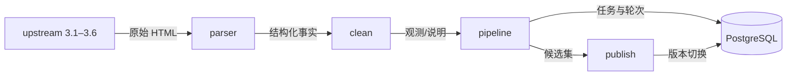

# collect-pipeline 设计

Feature Name: collect-pipeline
Spec Directory: 2026-11-03-collect-pipeline
Updated: 2026-11-03

## Description

本 spec 交付「一轮采集到发布」的后端链路：upstream（3.1–3.6 已完成）取原始页面，parser 解析成结构化事实，clean 清洗成观测与说明，pipeline 规划并执行任务、落库候选，publish 校验后在单事务内发布新版本。公开查询 API 已在前一 spec 完成，不在本 spec。

## Architecture

依赖方向：`parser` 可 import `model` 与 `goquery`（只做结构解析，不发请求）；`clean` 只 import `model`；`pipeline` import `upstream/parser/clean/store/model`；`publish` import `store/model`。`pipeline` 不 import `api`/`query`，`query` 不反向依赖采集链路。

## Components and Interfaces

- `parser.Rows(body []byte, axis []model.AxisNode) ([]model.MatrixRoom, error)`：按 `dataList` 定位目标表、校验状态格集合与顺序、行宽一致、房号三来源、重复房号判结构失败。
- `parser.Occupancy(body []byte) ([]model.OccupancyEntry, error)`：扫描整页行、只采纳三列四字段、全角冒号、多条按顺序保留、无标题表才结构失败。
- `parser.TermText(body []byte) (term, kbjcmsid string, error)` 与 `parser.WeekText(body []byte) (week, total int, error)`：权威文本解析；upstream 已做最小提取，parser 负责最终口径与校验。
- `clean.State(raw string, dict model.Dict) model.Observation`：整词命中、空文本、复合、未知，保留原文，`available` 只按字典投影。
- `clean.RoomName(raw string) string`：全半角归一、反复删容量片段、压缩空白，保留原始名。
- `clean.ExpandNodes(block string) []string`：5 大节映射 12 小节，同一大节内状态一致。
- `pipeline.Plan(window Window, buildingIDs []string, unavailable []Cell) PlanResult`：纯规划、不读时钟；窗口 `C..min(Y,C+3)`、每楼每周一条矩阵任务、占用说明任务；空窗 `skipped`、空白名单 `blocked`。
- `pipeline.Run(ctx, runID, whitelist []string, planned []Task, deps RunDeps) (RunProgress, error)`：断点续跑、归属落库、两段执行（周矩阵 → 归属 → 明细）；单轮互斥由 StartRun 的唯一索引负责，整轮失败分层见任务 9。
  - 契约：计划里的楼序列必须与白名单逐位一致，不一致在落库前拒绝，一条任务都不写（命中这种情况的是 `checkPlannedWhitelist`）。
  - 契约：`collect_run_room` 的 `conflict` 与 `conflict_building_id` 同进同出——有冲突必须有被丢弃的楼，没冲突必须留空；DB CHECK 兜最后一道，Go 侧 `normalizeRunRooms` 先挡一道。
- `publish.Build(ctx context.Context, reader Reader, runID int64, input RunInput) (Candidate, error)`：读轮次事实（学期、窗口、归属冲突）、归属快照与任务汇总，把内存里的观测/说明组装成候选集并派生状态；空候选、坏轴、窗口外观测直接拒绝。
- `publish.Validate(candidate Candidate, thresholds Thresholds) error`：候选集非空、必需任务完成、归属快照覆盖全部房号、未知/复合格数阈值；只做校验、不读库。
- `publish.Commit(ctx context.Context, committer Committer, candidate Candidate, now time.Time) (CommitResult, error)`：转成 `store.ReleaseDraft` 并交给仓储的单个事务——事务内复核必需任务完成度 → 写 release（非 current）→ 观测 → 说明 → 归属快照 → 降原 current → 抬新 current → 删更早版本 → 回写 `collect_run`（汇总、`release_id`、`released_at`、终态 success/partial、`phase=publish`、`finished_at`，partial 另写最早失败原因或丢弃说明到 `error_message`，success 清空）。轮次在事务结束时离开 `running`，调用方不再对它收口。

## Data Models

复用 `migrations/0001_baseline.sql`：`collect_run`、`collect_run_week`、`sync_task`、`release`、`release_room_building`、`observation`、`occupancy_detail`、`room`、`term`、`term_week`、`dict_state`、`dict_symbol`、`axis_node`。另新增 `migrations/0002_collect_run_room.sql` 的 `collect_run_room`（每轮房号→楼归属快照，供续跑重建累计器、任务 10 发布读取；用户已批准新增表）。`migrations/0003_collect_run_released.sql` 只新增 `collect_run.released_at`（发布标记，一轮只能发布一次；不随删旧版本的 `ON DELETE SET NULL` 重置；用户已批准新增列）。除此之外不新增表；若确实缺列，先报告再定，不擅自改 migration。

版本标识 `release.release_id` 固定为 `<UTC 秒级>Z`（例如 `20261023T071012Z`），不含轮次编号；同一秒生成的两个轮次会得到同一标识，由发布前置检查拒绝。

## Correctness Properties

- CP1：任一观测的 `week` 落在 `[window_start, window_end]` 内。
- CP2：同一房号在同一版本只属于一栋楼。
- CP3：两楼同房号冲突只记一次，后续楼该房号整行丢弃。
- CP4：未知与复合恒不可用；可用性只按字典投影，代码里没有第二套判断。
- CP5：同一楼同一周、同一格至多一条任务。
- CP6：同一时刻至多一个 `running` 轮次。
- CP7：发布事务任一步失败后，原 current 仍可用。
- CP8：连续发布三次后 `release` 只保留当前与上一版。「上一版」= 生成时间次新的版本（按 `generated_at` 倒序取非当前版本的第一条，同一生成时刻用 `release_id` 定序），不是「上一次发布的那一版」。发布事务同时把 `collect_run` 写成终态（success/partial）、`phase=publish` 与 `released_at`，轮次不再 `running`。

## Error Handling

- 矩阵结构失败 → `matrix_structure_invalid`，整轮 failed。
- 明细结构失败 → `detail_structure_invalid`，该格任务 failed，轮次 partial。
- 必需任务失败 → 轮次 failed，不发布，保留线上版本。
- 可选任务失败 → 继续，轮次 partial。
- 候选集空或必需未完成 → 拒绝发布，记录校验拦截原因。
- 学期/周历非法 → `calendar_invalid`（3.3 已定义）。

## Test Strategy

- parser：手写脱敏 HTML 夹具，覆盖同名前缀表在目标表之前、表头 36 单元格/35 状态格、数据行 36 单元格、房号三来源、重复房号、明细标题表兜底。
- clean：属性测试，任意状态原文的 `available` 与字典一致；房名规范化幂等；5→12 节次展开。
- pipeline：假时钟 + 假上游，覆盖窗口、任务唯一性、续跑、冲突、失败分层。
- publish：真实 PostgreSQL 事务测试，覆盖 CP7/CP8；连续发布与回退。
- 检查点：起库 + stubbed 上游，跑一轮到发布，再用公开查询验证。

## References

- `specs/2026-10-27-classroom-availability-rewrite/requirements.md`（Requirement 4–11）
- `specs/2026-10-27-classroom-availability-rewrite/design.md`
- `docs/upstream-api.md`
