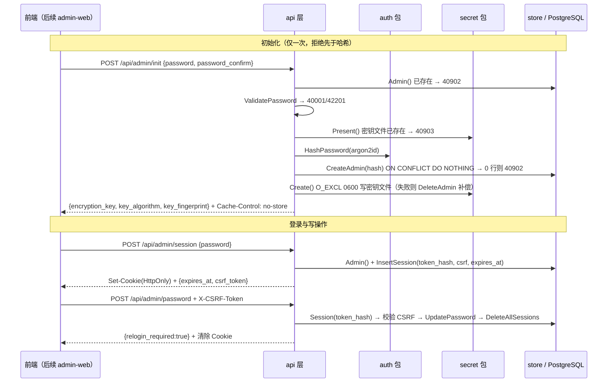

# admin-bootstrap 设计

Feature Name: admin-bootstrap
Spec Directory: 2026-11-05-admin-bootstrap
Updated: 2026-11-06

## Description

本 spec 交付管理端的引导与鉴权后端：`POST /api/admin/init` 设置管理员密码并生成一次性导出的加密密钥，`POST /api/admin/session` 登录并下发 12 小时服务端会话，`DELETE /api/admin/session` 退出，`GET /api/admin/state` 供前端路由与取回 CSRF 令牌，`POST /api/admin/password` 改密并收回全部会话。密码用 argon2id 哈希，业务秘密用 AES-256-GCM 加密，密钥只在初始化时生成一次、明文只在初始化响应里出现一次。

前端页面、设置项读写、同步与版本回退不在本 spec。需求条目见同目录 [requirements.md](requirements.md)，产品口径见 [docs/prd.md](../../docs/prd.md) 5.1、7.4、8.5。

## 设计决策（已确认）

| 编号 | 决策 | 取舍 |
|---|---|---|
| D1 | **只做后端 API**：五个端点 + 迁移 + 仓储 + 三个新包；不建 `frontend/` 目录 | 本轮可独立验收，前端可并行后做；代价是初始化与登录暂时只能用 curl 验收 |
| D2 | **密钥存文件（`SECRET_KEY_PATH`），不入库** | 数据库备份与密钥备份分开保管，导出的密钥才有灾备价值（PRD 5.1「密钥丢失则秘密无法解密」只有在密钥不在库里时才成立）；代价是多一份需备份的文件，容器要挂一个可写卷（由 deploy-ops 负责） |
| D3 | **AES-256-GCM**（放弃 XChaCha20-Poly1305） | 标准库自带、无新依赖、amd64/arm64 有 AES 加速；12 字节随机 nonce 配 32 字节密钥，本系统加密次数以「管理员改设置」计，nonce 碰撞概率可忽略；XChaCha20 的 24 字节 nonce 优势要在高频随机加密场景才体现，这里不值得为它引入 `golang.org/x/crypto/chacha20poly1305` |
| D4 | **argon2id m=19456 KiB, t=2, p=1, salt 16B, key 32B**（OWASP 2024 最低推荐档） | 单次约 19 MiB / 50 ms，单机 25 条连接的小部署可承受；并发哈希用容量 2 的信号量封顶，最坏多占 38 MiB，避免多个来源同时登录把内存打爆 |
| D5 | **会话服务端存储**：`admin_session` 只存会话令牌的 SHA-256 | 退出、改密可立即失效；库被看到也不含可用 Cookie；代价是每次管理请求多一次主键查询（可忽略） |
| D6 | **12 小时绝对过期，不滑动续期** | 过期时刻可预测、实现与测试简单；代价是连续操作跨过 12 小时会被踢回登录，属可接受体验 |
| D7 | **CSRF 用同步器令牌**：令牌随会话存服务端，客户端经 `X-CSRF-Token` 头回传 | 令牌不与 Cookie 同源，跨站读不到；比双提交 Cookie 少一个 Cookie 与一套校验；代价是前端要保存令牌，刷新后从 `GET /api/admin/state` 取回 |
| D8 | **固定账号 `admin`，登录只提交密码** | 对齐 PRD 5.1 的单管理员设定，少一个可枚举字段；代价是换账号名要改代码 |
| D9 | **密钥一次性导出** | 用户拍板：明文只出现在初始化响应；与 PRD 5.1「设置页随时再次导出」不同，PRD 需按本 spec 修订（见「与既有文档的差异」） |
| D10 | **初始化固定顺序：查管理员（40902）→ 校验密码 → 查密钥文件（40903）→ 哈希 → 插记录 → 独占创建密钥文件，文件写失败则删记录补偿** | 拒绝先于哈希，被拒请求不烧 CPU；并发初始化只有一个赢家，输家不碰文件系统；代价是极窄的崩溃窗口可能留下「有管理员、无密钥」，恢复步骤写进错误处理 |

## Architecture



图渲染不出来时的同义结构：

```text
init:   Admin()? → 40902 | ValidatePassword → 40001/42201 | Present()? → 40903 | hash → INSERT admin_user → CREATE key file (O_EXCL)
login:  Admin() → VerifyPassword → INSERT admin_session → Set-Cookie + csrf_token
write:  Cookie → Session(token_hash) → 过期判定 → CSRF 头比对 → 业务写入
```

### 依赖方向

```
api    → auth, secret, store, model, query（既有）
auth   → model, golang.org/x/crypto/argon2
secret → model
store  → model, pgx（既有）
model  → 标准库
```

`auth` 不 import `store`：`auth.AdminStore` 是消费侧接口，`store.AdminRepo` 用同名方法结构匹配，和 `pipeline.RunStore` 与 `store.CollectRunRepo` 的既有做法一致。SQL 只出现在 `store`。

`backend/.golangci.yml` 的 depguard 需要补两条规则（否则 lint 直接失败）：

- `auth`：`$gostd`、`internal/model`、`golang.org/x/crypto/argon2`
- `secret`：`$gostd`、`internal/model`

`api` 的 allow 列表补 `internal/auth` 与 `internal/secret`。

## Components and Interfaces

### 目录结构（本轮新增）

```
backend/migrations/0004_admin_session.sql   管理会话表
backend/internal/model/auth.go              AdminUser、AdminSession、auth 相关错误
backend/internal/auth/password.go           密码规则、argon2id 哈希与校验（PHC）
backend/internal/auth/session.go            会话令牌、CSRF 令牌、过期判定
backend/internal/auth/store.go              AdminStore 消费侧接口
backend/internal/auth/password_test.go
backend/internal/auth/session_test.go
backend/internal/secret/key.go              密钥文件读写（0600、O_EXCL）与内存持有
backend/internal/secret/envelope.go         AES-256-GCM 信封（v1: 前缀、AAD）
backend/internal/secret/key_test.go
backend/internal/secret/envelope_test.go
backend/internal/store/admin.go             AdminRepo
backend/internal/store/admin_integration_test.go
backend/internal/api/admin.go               GET state、POST init
backend/internal/api/admin_session.go       登录、退出、改密
backend/internal/api/admin_middleware.go    会话中间件、CSRF 校验、no-store、体大小限制
backend/internal/api/failurelimit.go        失败计数限流器
backend/internal/api/admin_test.go          管理端契约测试
backend/internal/api/failurelimit_test.go
```

`cmd/server/main.go` 追加装配：`secret.NewManager(cfg.SecretKeyPath)` → `keys.Load()` → `store.NewAdminRepo(pool)` → `api.WithAdmin(...)`。

### 接口签名

```go
// internal/auth —— 纯逻辑，可脱离 HTTP 与数据库单测
const (
    MinPasswordRunes  = 12      // 密码下限，按 Unicode 码点计
    MaxPasswordRunes  = 256     // 上限，挡住超长输入
    Argon2MemoryKiB   = 19456   // m
    Argon2Time        = 2       // t
    Argon2Parallelism = 1       // p
    Argon2SaltLen     = 16
    Argon2KeyLen      = 32
    SessionTokenBytes = 32
    SessionTTL        = model.SessionTTL // 12h，唯一定义在 internal/model，这里只引用
)

var (
    ErrPasswordMismatch = errors.New("两次密码不一致")
    ErrPasswordTooShort = errors.New("密码长度不足")
    ErrPasswordTooLong  = errors.New("密码过长")
)

func ValidatePassword(password, confirm string) error          // 长度与一致性，返回上面三个哨兵之一
func HashPassword(password string) (string, error)             // 返回 PHC 串
func VerifyPassword(phc, password string) (bool, error)        // 解析 PHC → 重算 → 常量时间比对
func HashCallCount() int64                                     // 测试用：本次进程内哈希次数（atomic）

func NewSessionToken() (raw, tokenHash string, err error)      // 32B 随机；sha256 hex
func HashSessionToken(raw string) string                        // 查询会话时用
func NewCSRFToken() (string, error)                             // 32B 随机 base64url
func CompareCSRFToken(expected, got string) bool                // subtle.ConstantTimeCompare
func SessionExpiry(now time.Time) time.Time                     // now.Add(SessionTTL)
func SessionActive(s model.AdminSession, now time.Time) bool    // now.Before(s.ExpiresAt)
```

```go
// internal/auth/store.go —— 消费侧接口，store 结构匹配即可
type AdminStore interface {
    Admin(ctx context.Context) (model.AdminUser, bool, error)
    CreateAdmin(ctx context.Context, passwordHash string, now time.Time) (model.AdminUser, bool, error)
    DeleteAdmin(ctx context.Context) error
    UpdatePassword(ctx context.Context, passwordHash string, now time.Time) error
    InsertSession(ctx context.Context, s model.AdminSession) error
    Session(ctx context.Context, tokenHash string) (model.AdminSession, bool, error)
    DeleteSession(ctx context.Context, tokenHash string) error
    DeleteAllSessions(ctx context.Context) (int64, error)
    DeleteExpiredSessions(ctx context.Context, now time.Time) (int64, error)
}
```

```go
// internal/secret —— 密钥生命周期与信封；Key 是值类型，拷贝不会泄漏引用
type Key [32]byte

type Manager struct { /* path + 内存中的 Key + RWMutex */ }

func NewManager(path string) *Manager
func (m *Manager) Load() (bool, error)      // 启动时调用；文件不存在返回 (false, nil)
func (m *Manager) Present() bool            // 是否已有可用密钥
func (m *Manager) Create() (Key, error)     // O_EXCL + 0600 写文件并装入内存；已存在 → model.ErrKeyExists
func (m *Manager) Current() (Key, error)    // 未装载 → model.ErrKeyUnavailable
func (m *Manager) Path() string

func (k Key) Export() string                // base64url 无填充，43 字符
func (k Key) Fingerprint() string           // sha256(key) 前 8 字节 → 16 位小写十六进制
func (k Key) Seal(aad string, plaintext []byte) (string, error)   // "v1:" + base64url(nonce||ciphertext)
func (k Key) Open(aad, envelope string) ([]byte, error)           // 校验前缀、nonce 长度、AAD 与 GCM tag
```

```go
// internal/store/admin.go —— 结构匹配 auth.AdminStore，store 不 import auth
type AdminRepo struct { /* querier */ }

func NewAdminRepo(q adminQuerier) AdminRepo
// Admin / CreateAdmin / DeleteAdmin / UpdatePassword /
// InsertSession / Session / DeleteSession / DeleteAllSessions / DeleteExpiredSessions
```

```go
// internal/api —— 装配与管理端处理器（unexported，路由在 Handler 里注册）
func WithAdmin(store auth.AdminStore, keys *secret.Manager) Option

// Server 新增字段：admin auth.AdminStore、keys *secret.Manager、
// loginLimiter *failureLimiter、initLimiter *failureLimiter

type failureLimiter struct { /* 来源 → {windowStart, fails}，上限 4096 个来源 */ }
func newFailureLimiter(limit int, window time.Duration) *failureLimiter
func (l *failureLimiter) Blocked(source string, now time.Time) (blocked bool, retryAfter time.Duration)
func (l *failureLimiter) Fail(source string, now time.Time)
func (l *failureLimiter) Reset(source string)
```

`failureLimiter` 与公开查询的 `rateLimiter` 分开实现：后者数「请求」，登录限流必须数「失败」；两者的来源判定共用 `clientSource(r, s.trustProxy)`，来源表上限与淘汰策略照抄（`rateLimitMaxSources = 4096`）。

### 管理 API 契约

统一响应仍是 `{code, message, data, request_id}`；时间 RFC3339 UTC；Cookie 名 `eqk_admin_session`。

| 方法 | 路径 | 鉴权 | 说明 |
|---|---|---|---|
| GET | `/api/admin/state` | 无（走公开 60 次/分钟限流） | `{initialized, authenticated, expires_at?, csrf_token?, key_fingerprint?}`，未登录时后三项为 `null` |
| POST | `/api/admin/init` | 无（失败计数限流） | `{password, password_confirm}` → `{encryption_key, key_algorithm, key_fingerprint}` |
| POST | `/api/admin/session` | 无（失败计数限流） | `{password}` → `{expires_at, csrf_token}` + `Set-Cookie` |
| DELETE | `/api/admin/session` | 会话 + CSRF | → `{logged_out: true}` + 清除 Cookie |
| POST | `/api/admin/password` | 会话 + CSRF | `{current_password, new_password, new_password_confirm}` → `{relogin_required: true}` + 清除 Cookie |

初始化响应示例（明文密钥只在此出现）：

```json
{
  "code": 0,
  "message": "success",
  "data": {
    "encryption_key": "nQ3...43 个字符...",
    "key_algorithm": "AES-256-GCM",
    "key_fingerprint": "3f9c1d8a5b2e4c07"
  },
  "request_id": "req_6f1c..."
}
```

约束：

- **初始化顺序**固定：管理员存在 → 40902（不读密钥文件、不哈希）；密码不合法 → 40001/42201；密钥文件存在 → 40903；随后才哈希与插入记录。这样被拒请求的代价只有一次主键查询，CP3/CP4 也各自成立。
- 所有管理端响应（含错误）带 `Cache-Control: no-store`；初始化响应另带 `Pragma: no-cache`。
- 写请求体解析前先 `http.MaxBytesReader` 限 8 KiB，再要求 `Content-Type: application/json`（缺一即 `40001`）。
- 401 响应同时下发清除 Cookie 的 `Set-Cookie`（`Max-Age=0`），避免前端在死 Cookie 上反复重试；正常下发用 `Max-Age=43200`。
- `GET /api/admin/state` 未登录时返回 200 + `authenticated=false`，不返回 401：前端靠它决定进初始化页、登录页还是面板。
- 登录成功顺手 `DeleteExpiredSessions(now)`（best effort，失败只记日志），过期行不依赖外部定时任务清理。
- 时间一律取自 `s.clock()`（既有字段），测试注入假时钟；不读 `time.Now()`。
- 未装配 `WithAdmin` 时管理端路由仍注册，按 `50000` 返回（与 `WithMeta` 未装配即内部错误的既有做法一致），让 `main.go` 漏装配立刻暴露而不是 404。

### 配置项（`internal/config`）

| 环境变量 | 默认 | 校验 |
|---|---|---|
| `SECRET_KEY_PATH` | `/var/lib/easy-qfnu-kjs/secret.key` | 非空；目录不存在时在初始化写入前 `MkdirAll 0700` |
| `ADMIN_COOKIE_SECURE` | `true` | 只接受 true/false/1/0，拼错即拒绝启动（照 `TRUST_PROXY_HEADERS` 的写法）；本地 http 开发需显式设 `false`，否则浏览器拒收 Cookie |

`go.mod` 只新增一个直接依赖 `golang.org/x/crypto`（仅用 `argon2`），`go 1.26.10` 与「不写 toolchain 行」保持不变。

## Data Models

`migrations/0004_admin_session.sql`，只新增一张表；0001–0003 已应用，不改。

```sql
-- 0004 管理会话：登录态由服务端持有，库里只留令牌摘要。
CREATE TABLE admin_session (
  token_hash  text PRIMARY KEY,           -- 会话令牌的 SHA-256（hex），明文只在客户端 Cookie
  csrf_token  text NOT NULL,              -- 同步器令牌：单独的随机值，泄露也无法单独使用
  created_at  timestamptz NOT NULL DEFAULT now(),
  expires_at  timestamptz NOT NULL,
  CONSTRAINT admin_session_expiry_after_created CHECK (expires_at > created_at)
);

CREATE INDEX admin_session_expires ON admin_session (expires_at);

COMMENT ON TABLE admin_session IS
  '管理会话：token_hash 为会话令牌的 SHA-256，明文令牌只存在于浏览器 Cookie';
```

不给 `admin_session` 加 IP、User-Agent、来源列：单管理员场景用不上，加上反而要求本 spec 定义它们的留存与脱敏口径。`created_at` 由应用写入 `now`，`DEFAULT now()` 只作兜底，保证手工插入也有值。`admin_user`（0001）已有 `CHECK (id = 1)`，无需改动。

```go
// internal/model/auth.go
type AdminUser struct {
    ID                int16
    PasswordHash      string
    PasswordUpdatedAt time.Time
    CreatedAt         time.Time
}

type AdminSession struct {
    TokenHash string
    CSRFToken string
    CreatedAt time.Time
    ExpiresAt time.Time
}

var (
    ErrAdminExists      = errors.New("管理员已存在")      // CreateAdmin 撞已有行
    ErrKeyExists        = errors.New("加密密钥已存在")    // 密钥文件已存在
    ErrKeyUnavailable   = errors.New("加密密钥不可用")    // 未装载或文件不可读
    ErrAdminStoreFailed = errors.New("管理数据读写失败")  // 仓储失败，映射 50000
)
```

**密钥文件格式**：32 字节原始密钥，`base64url` 无填充文本 + 换行（44 字节文件），便于运维直接 `cat` 备份；`Load` 逐层校验长度与解码，任一不符返回 `ErrKeyUnavailable`。

**密文信封格式**：`v1:` + `base64url(nonce(12) || ciphertext || tag(16))`，AAD 传业务键名（约定 `settings/<key>`，例如 `settings/jw_password`），把密文绑定到设置项，防止把 A 项的密文挪到 B 项还能解开。信封带版本前缀，将来换算法可以并存。

## Correctness Properties

- CP1 **单账号**：`admin_user` 行数恒 ≤ 1（`CHECK (id = 1)`）；初始化只创建 `id = 1`。
- CP2 **明文密码不落库不落日志**：库里只有 PHC 串；日志字段是白名单（`request_id`、方法、路径、状态码、业务码）。
- CP3 **初始化一次性**：管理员记录存在时初始化恒返回 40902，且不触碰密钥文件；并发 N 个初始化恰好 1 个成功，其余 40902。
- CP4 **密钥一次性**：密钥只在初始化成功路径生成；密钥文件存在时初始化恒返回 40903 且文件内容不变；除初始化响应外任何响应体不含明文密钥，只含指纹。
- CP5 **令牌不可从库还原**：`admin_session.token_hash` 是 SHA-256，库里没有可用于认证的原文；Cookie 原文不落库、不落日志。
- CP6 **过期确定**：会话有效当且仅当 `now < expires_at`，且 `expires_at = created_at + 12h`；无滑动续期、无「最后一次访问」依赖。
- CP7 **写操作双校验**：写端点在解析业务体之前完成「有效会话 → CSRF 一致」两步；任一步失败时 store 的写方法调用次数为 0（替身断言）。
- CP8 **改密全量失效**：改密成功后 `admin_session` 行数为 0；改密前签发的任一 Cookie 在后续请求返回 40101。
- CP9 **限流只数失败**：窗口内第 6 次失败起返回 42901；成功登录把该来源计数清零；被限流的请求不触发密码哈希（`HashCallCount` 不增长）。
- CP10 **来源口径一致**：限流与公开查询共用 `clientSource`；伪造 `X-Forwarded-For` 最左值既不改变桶也不放宽限制。
- CP11 **响应白名单**：管理端响应的 `data` 只出现设计表列的键；每个管理端响应（含 4xx/5xx）都带 `Cache-Control: no-store`。
- CP12 **信封完整**：`Seal` → `Open` 往返一致；同一明文两次 `Seal` 的 nonce 不同；篡改任意字节、AAD 不匹配、缺 `v1:` 前缀都让 `Open` 失败。
- CP13 **密钥文件属性**：创建用 `O_EXCL`、权限 0600；已存在时 `Create` 返回 `ErrKeyExists` 且不覆盖。
- CP14 **密钥缺失可降级**：管理员已初始化但密钥文件缺失时，进程仍启动，公开查询、`GET /api/admin/state` 与登录照常；该响应的 `key_fingerprint` 为 `null`，管理端其余能力不受影响。
- CP15 **写路由唯一**：公开 mux 除探针只注册 `GET`；全部写方法注册在 `/api/admin/` 前缀下（用路由表枚举断言）。

## Error Handling

| 场景 | HTTP | 业务码 | 处理 |
|---|---|---|---|
| 请求体不是合法 JSON、字段缺失、超过 8 KiB | 400 | 40001 | 不进入业务逻辑 |
| `Content-Type` 不是 `application/json` | 400 | 40001 | 同上（防表单型 CSRF 的兜底层） |
| 两次密码不一致 / 少于 12 码点 / 超过 256 码点 | 422 | 42201 | 响应文案指出「两次不一致」或「长度不足」，不含提交值 |
| 已存在管理员记录 | 409 | 40902 | 保持原记录；前端切到登录页 |
| 密钥文件已存在 | 409 | 40903 | 保持原密钥；提示运维先移除密钥文件再重新初始化 |
| 密码错误 / 未初始化时登录 / 无会话 / 会话过期 / 哈希串损坏 | 401 | 40101 | 统一文案「凭据无效或会话已过期」，并清 Cookie |
| 当前密码错误 | 401 | 40101 | 保持哈希与会话不变 |
| 写请求没有有效会话（缺失、过期、记录不存在） | 401 | 40101 | 不执行业务写入，并清 Cookie |
| CSRF 令牌缺失或与会话不一致 | 403 | 40301 | 不执行业务写入，保留会话 |
| 登录或初始化失败达到 5 次/分钟 | 429 | 42901 | 带 `Retry-After`；不计算密码哈希 |
| 仓储失败、密钥写入失败 | 500 | 50000 | 日志只记错误类别与 `request_id`，响应回固定文案 |

初始化失败补偿：`CreateAdmin` 成功后 `Create()` 写密钥文件失败时，调用 `DeleteAdmin` 回滚，返回 50000；回滚本身失败则记 `init_compensation_failed` 并保留管理员记录，运维按「删管理员记录 + 删密钥文件」重置。

启动期降级：`keys.Load()` 失败（不可读/内容非法）记 ERROR 但继续启动；`admin_user` 有行而密钥文件缺失记 WARN `secret_key_missing`。两种情况都只影响依赖密钥的能力（本 spec 只有指纹展示受影响），公开查询与登录照常。

## Test Strategy

- **auth 纯函数**：密码规则边界（11/12/13 码点、两次不一致、超长）；PHC 串前缀与字段；`VerifyPassword` 对错误密码、损坏哈希、截断哈希分别返回失败而不 panic；`SessionExpiry` 恒为 `now+12h`；`SessionActive` 在 `expires_at` 前后 1 秒的边界。
- **secret 纯函数**：`Seal/Open` 往返（含空明文、1 KiB 明文）；两次 `Seal` 的 nonce 不同；逐字节篡改（nonce、密文、tag）与错误 AAD 全部失败；信封前缀缺失/未知版本失败；`Fingerprint` 长度固定 16 且随密钥变化。
- **密钥文件**：`Create` 建出 0600 文件、第二次 `Create` 返回 `ErrKeyExists` 且内容不变；`Load` 对缺失文件返回 `(false, nil)`、对截断文件返回 `ErrKeyUnavailable`；临时目录下验证 `MkdirAll` 行为。
- **限流器**：假时钟下第 6 次失败被拦、`Retry-After` 落在 `(0, 60s]`；窗口到期恢复；成功清零；来源表满时淘汰最旧且不影响其他来源；伪造最左 XFF 不换桶。
- **管理端契约（httptest + 替身 `AdminStore` + 临时目录 `*secret.Manager` + 假时钟）**：五个端点的状态码、业务码、`data` 键集合、`Cache-Control`、Cookie 属性（HttpOnly/SameSite=Lax/Path/Secure 随配置）、401 的清除 Cookie；写请求缺 CSRF/缺会话时替身写方法调用次数为 0。
- **并发初始化**：50 个 goroutine 同时 `POST /api/admin/init`，断言恰好 1 个 200、其余 40902，密钥文件只出现一次且内容等于成功响应的 `encryption_key`。
- **仓储集成（真实 PostgreSQL 17，`KJS_TEST_DSN` 未设置则跳过）**：迁移到 0004；`CreateAdmin` 冲突返回 created=false；`InsertSession` 主键冲突；`Session` 查得到/查不到；`DeleteAllSessions` 影响行数；`DeleteExpiredSessions` 只删过期行。
- **端到端检查点**：干净库 → 迁移 → init（拿密钥与指纹）→ state 报 initialized → login（拿 CSRF 与 Cookie）→ 写操作带/不带 CSRF → 改密 → 旧 Cookie 401 → 登出 → 清管理员记录与密钥文件 → 重新 init 成功。
- **日志脱敏**：用唯一哨兵字符串（如 `sentinel-pw-<随机>`）作为密码提交，捕获 `slog` 输出，断言整段日志不含哨兵、不含 Cookie 值、不含 `csrf_token` 与 `encryption_key`。
- **门禁**：`go build ./...`、`go vet ./...`、`go test ./...`、`golangci-lint run`（含新增 depguard 规则）四条全绿；`go.mod` 只多 `golang.org/x/crypto`。

## 与既有文档的差异

| 位置 | 旧口径 | 本 spec | 原因 |
|---|---|---|---|
| `docs/prd.md` 5.1 | 设置页可「随时再次导出」密钥 | 明文只在初始化响应出现一次 | 用户拍板的一次性导出；PRD 需同步修订 |
| `specs/2026-10-27-.../requirements.md` 20.4 | 「提供后续再次导出入口」 | 同上，删除该入口 | 同上 |
| 旧 design 管理 API | `GET /api/admin/key` 再次导出 | 端点取消 | 同上 |
| 旧 design 管理 API | `GET /api/admin/state` 只返回 `{initialized, authenticated}` | 增补 `expires_at`、`csrf_token`、`key_fingerprint` | 前端刷新后需要取回 CSRF 令牌；指纹用于核对密钥备份 |
| `docs/pitfalls.md` §8 | 密钥来自 `SETTINGS_ENCRYPTION_KEY`、管理员密码来自 `ADMIN_PASSWORD`、会话用「签名 Cookie」 | 密钥初始化时生成并存文件、密码入库哈希、会话服务端存储 | 那三条是旧实现的结论，已被 PRD 5.1 与本 spec 取代；pitfalls 该节待更新 |
| 旧 design 数据模型 | 无 `admin_session` | 新增 `migrations/0004_admin_session.sql` | 服务端会话需要落库；不改已应用的 0001–0003 |

## 待确认事项（已按本文件决策实现，改判则修订本文件）

1. **密钥放文件还是放库**（D2）：选文件是为了让「一次性导出」有意义、让数据库备份不含密钥；若用户希望「备份即全量恢复」，则改为入库并取消导出仪式。
2. **一次性导出是否接受不可再导出**（D9）：密钥丢了只能从宿主机上的密钥文件备份恢复；若用户要保留「随时再导出」，需在设置页加受会话保护的导出端点，与 Requirement 3.6 冲突。
3. **初始化入口无引导令牌**：沿用 PRD 5.1，`POST /api/admin/init` 不需要额外凭据，先到先得。内网部署窗口期短时可接受；若要堵住「抢注管理员」，需加一次性 boot token 或限制来源网段，属新增需求。

## References

[^1]: [docs/prd.md](../../docs/prd.md) - 5.1 管理员初始化与会话、7.4 安全与隐私、8.5 管理验收
[^2]: [specs/2026-10-27-classroom-availability-rewrite/requirements.md](../2026-10-27-classroom-availability-rewrite/requirements.md) - Requirement 20、21、30
[^3]: [specs/2026-10-27-classroom-availability-rewrite/design.md](../2026-10-27-classroom-availability-rewrite/design.md) - 管理 API、数据模型、错误码表、CP11
[^4]: [docs/pitfalls.md](../../docs/pitfalls.md) - §8 安全与隐私（其中三条旧结论已被本 spec 取代）
[^5]: [backend/.golangci.yml](../../backend/.golangci.yml) - depguard 依赖方向规则
[^6]: [backend/migrations/0001_baseline.sql](../../backend/migrations/0001_baseline.sql) - `admin_user`、`settings` 基线结构
