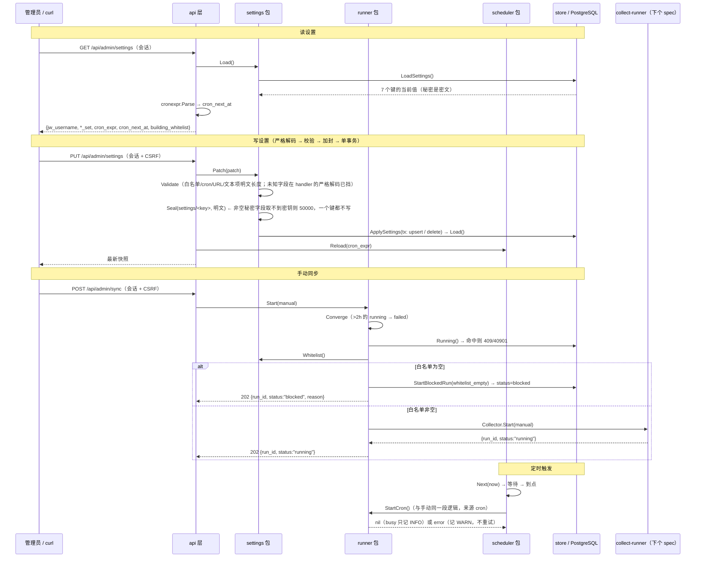

# admin-settings-sync 设计

Feature Name: admin-settings-sync
Spec Directory: 2026-11-08-admin-settings-sync
Updated: 2026-11-08

## Description

本 spec 交付管理端的**控制面**：七个设置项的读写（秘密只写不读）、教学楼白名单与 cron 校验、最近轮次与单轮详情读取、手动同步的冲突判定与启动、以及进程内 `Asia/Shanghai` 定时触发。五个新端点全部挂在 `/api/admin/` 下，复用 `admin-bootstrap` 的服务端会话、CSRF、no-store 与失败日志白名单。

采集执行链（登录 → 学期周历 → 周矩阵 → 占用说明 → 校验 → 发布）**不在本 spec**：仓库里 `upstream`、`parser`、`clean`、`pipeline`、`publish` 已各自完成，缺的是把它们串起来并落窗口/候选的编排层（`internal/e2e/collect_pipeline_test.go` 里已把它标成「尚未接线的编排层」）。本 spec 只定义**启动端口**与空白名单的`阻止`路径，把编排层留给下一个 spec `collect-runner`（见 D6）。

需求条目见同目录 [requirements.md](requirements.md)；产品口径见 [docs/prd.md](../../docs/prd.md) 5.2、5.3、4.3、4.7。

## 设计决策（已确认）

| 编号 | 决策 | 取舍 |
|---|---|---|
| D1 | **只做后端 API**：五个端点 + 四个新包（`cronexpr`/`settings`/`scheduler`/`runner`）+ 两个仓储 + 调度循环；不建 `frontend/` 目录 | 与本轮已谈定的边界一致；前端可后做，验收用 curl 与契约测试；代价是设置页暂时不可视 |
| D2 | **不新增结构迁移，只补一版数据迁移**：复用 0001 的 `settings(key, value, is_secret, updated_at)`，默认行已由 0001 种下（`building_whitelist='[]'`；`cron_expr` 的旧值是 6 段 `0 10 4 * * 6`，由 0005 就地改写成 5 字段 `10 4 * * 6`） | 秘密密文与白名单 JSON 都能塞进 `value`，`is_secret` 列已存在；不加结构迁移就少一版不可回退的 schema 变更。0005 只改数据、WHERE 钉住旧值，重复执行与管理员自定义值都不受影响。代价是秘密与明文共表，靠键名约定区分（CP1/CP4 用类型与键名双重兜底） |
| D3 | **cron 自己写 5 字段解析器**（`internal/cronexpr`，约 200 行 + 位图匹配），不引 `robfig/cron/v3` | 只要一条「周末 04:10」式表达式：不需要秒级、`@every`、描述符、任务队列与 Entry 管理；而**校验与调度必须共用同一套语法**，用 robfig 还得先把它多接受的写法挡在 API 外，等于在它上面再包一层。自写换来：零新依赖（`go.mod` 不动）、确定性 `Next`（注入时刻即可断言）、错误消息能精确到「第 3 个字段（日）超出 1–31」。代价是区间/列表/步进的边界要自己测（表驱动 + 属性测试，见 Test Strategy） |
| D4 | **秘密复用 `secret.Manager`**：`AES-256-GCM` 信封，AAD 固定 `settings/<key>`；设置快照类型**没有**秘密明文字段 | 信封已有 `v1:` 版本前缀与逐字节篡改测试；AAD 把密文绑到具体键，防止把 A 项密文挪到 B 项还能解开。快照不带明文字段是编译期保证：handler 拿不到可回显的秘密（CP1） |
| D5 | **`blocked` 轮次直接以终态插入**（不借用 `StartCollectRun`） | 建轮需要学期，空白名单时通常还没有学期（一次成功采集前 `term` 表可能为空），`StartCollectRun` 会因空学期报 `ErrRunStoreFailed`；而 `collect_run.term` 本身可空、`status`/`phase` 的 CHECK 都允许 `blocked`/`finished`。直接插入既满足「白名单为空立刻阻止」，又不占 `collect_run_single_running` 唯一索引（CP12），代价是这条路径不写学期（面板显示 `term: null`，符合「还没跑到学期阶段」） |
| D6 | **采集启动器是端口，不是本 spec 的实现**：`runner.Collector` 由 `collect-runner` 注入；未装配时白名单非空的手动同步与定时触发返回 `50000` 且**不建轮次** | 编排层需要先定三件本 spec 无权决定的事：窗口由谁写（`collect_run.window_start` 目前没有写入口）、明细任务的「不可用格」列表从哪来、断点续跑时内存候选如何重建。硬塞进本 spec 会让一个 spec 覆盖两条交付线，也违反「一次一个最小功能」。过渡态是可观察的：启动日志一条 WARN，接口返回 `50000`，库中不留假轮次（CP16） |
| D7 | **触发来源只进日志，不落库** | 没有验收条目要求按来源筛选；加一列就要一版迁移。日志字段 `trigger=manual\|cron` 足以排障；将来要按来源统计再加下一版迁移 |
| D8 | **启动前先收敛过期轮次**：复用 `pipeline.ConvergeStaleRuns`（装配层注入为 `runner.Converge`），口径「超过 2 小时的 running 置 failed + `stale_run`」只有一份 | 否则进程在长跑期间崩溃留下的 running 会永久占住唯一索引，之后每次手动同步都只能 409（Requirement 8.3）。把函数注入而不是在 runner 里重算 cutoff，是为了让「2 小时」与 `started_at <` 的边界不会出现第二份实现 |
| D9 | **手动同步不复用进行中轮次**：先判冲突（409），冲突时不调用采集启动器 | `pipeline.StartRun` 撞唯一索引时会把已有轮次返回给调用方（`Reused=true`），那是「进程重启后续跑」的语义，不是「管理员点了第二次」。两者混用会让手动同步静默接上别人的轮次，面板看到的状态与管理员的操作对不上（CP13） |
| D10 | **设置写入严格且原子**：`DisallowUnknownFields` + 64 KiB 体上限 + 单事务 | 拼错键名（如 `cron_express`）静默不生效最难排；严格解码直接 `40001`。白名单 200 条时大约几 KiB，`adminWrite` 的 8 KiB 是给密码留的，不够，所以设置用 64 KiB 的独立上限。原子性按 PRD 5.2「校验失败时整次不保存」 |
| D11 | **白名单顺序即归属裁决顺序**，保存时按提交顺序落库、不排序、不去重后重排 | 归属冲突的「首个命中」按白名单顺序（原 spec Requirement 5.3），保存时排序会悄悄改变裁决结果（CP6） |
| D12 | **单实例进程内调度**：compose 部署单副本；多副本时各实例都会触发，靠唯一索引只让一轮启动 | 与 D1 单进程 + 采集协程一致。多副本下「保存后立即重排」只发生在处理该请求的实例，其余实例要等重启；这条限制写进 CP17，不假装已解决 |
| D13 | **管理端读接口不套公开 60 次/分钟限流** | 面板会轮询轮次列表，60 次/分钟是给公开查询的；管理端读已经由会话门槛保护，再叠一层会让正常刷新误伤 429。`admin-bootstrap` 的 `state` 继续走公开限流，本 spec 不改既有行为 |

## Architecture



图渲染不出来时的同义结构：

```text
settings: GET → LoadSettings → {明文项, 秘密 "已设置"} + cron_next_at
          PUT → 严格解码 → Validate → Seal(settings/<key>) → 单事务 upsert/delete → 回读 → scheduler.Reload
sync:     Converge(>2h) → Running()? 409/40901 : Whitelist() 空? 202+blocked : Collector.Start() → 202
cron:     Load expr → Next → wait(timer) → StartCron() → 记日志，不重试
runs:     Recent/ByID + Weeks + TaskSummary → 原样输出 collect_run 列
```

### 依赖方向

```
api        → settings, runner, cronexpr, store, model, auth, secret（后两者既有）
runner     → model, store                    （采集执行器由接口注入，不 import upstream）
settings   → model, secret, cronexpr         （不 import store：消费侧接口自持）
scheduler  → model, cronexpr                 （触发器是函数，不 import runner）
cronexpr   → model                           （只放业务时区与解析，不碰 HTTP/SQL）
store      → model, pgx（既有）
model      → 标准库
```

`settings.Store` 是消费侧接口，`store.SettingsRepo` 用同名方法结构匹配，与 `auth.AdminStore` 的既有做法一致；装配层放 `var _ settings.Store = store.SettingsRepo{}`。SQL 只出现在 `store`。

`backend/.golangci.yml` 的 depguard 需要补四条规则（否则 lint 直接失败）：

- `settings`：`$gostd`、`internal/model`、`internal/secret`、`internal/cronexpr`
- `cronexpr`：`$gostd`、`internal/model`
- `scheduler`：`$gostd`、`internal/model`、`internal/cronexpr`
- `runner`：`$gostd`、`internal/model`、`internal/store`

`api` 的 allow 列表补 `internal/settings`、`internal/runner`、`internal/cronexpr`（`internal/store` 已在列表里）。

## Components and Interfaces

### 目录结构（本轮新增）

```
backend/internal/model/settings.go             设置键常量、Building、SettingRow/SettingChange、TriggerSource、业务时区
backend/internal/model/errors.go               追加 ErrSettingInvalid / ErrSettingStoreFailed / ErrRunBusy / ErrRunNotFound / ErrCollectorUnavailable
backend/internal/cronexpr/cronexpr.go          5 字段解析、Matches、Next
backend/internal/cronexpr/cronexpr_test.go
backend/internal/settings/settings.go          快照、Patch 语义、校验、加封、单事务写
backend/internal/settings/settings_test.go
backend/internal/scheduler/scheduler.go        进程内调度循环、Reload、Next
backend/internal/scheduler/scheduler_test.go
backend/internal/runner/runner.go              启动端口、冲突判定、blocked 直通、来源日志
backend/internal/runner/runner_test.go
backend/internal/store/settings.go             SettingsRepo（LoadSettings / ApplySettings）
backend/internal/store/runstatus.go            RunStatusRepo（Recent/ByID/Weeks/Running/TaskSummary/StartBlockedRun）
backend/internal/store/settings_integration_test.go
backend/internal/store/runstatus_integration_test.go
backend/internal/api/admin_settings.go         GET/PUT /api/admin/settings
backend/internal/api/admin_runs.go             GET runs、GET runs/{id}、POST sync
backend/internal/api/admin_read.go             adminRead / adminWriteLimit / adminWriteNoBody（或并入 admin_middleware.go）
backend/internal/api/admin_settings_test.go    契约测试
backend/internal/api/admin_runs_test.go
backend/internal/e2e/admin_settings_sync_test.go  端到端检查点
```

`cmd/server/main.go` 追加装配：`store.NewSettingsRepo(pool)` → `settings.New(repo, keys, nil)` → `store.NewRunStatusRepo(pool)` → `runner.New(runner.Deps{...})` → `scheduler.New(...)` → `go sched.Run(ctx)` → `api.WithAdminSettings(settingsSvc, sched.Reload)`、`api.WithRunStatus(runStatusRepo)`、`api.WithSync(syncSvc)`；启动日志新增 `collector_wired`、`settings_cron` 两个非敏感字段（`settings_cron` 只打表达式本身，不打任何设置值）。

### 接口签名

```go
// internal/model/settings.go —— 纯数据与常量，不依赖任何内部包
const (
    SettingJWUsername        = "jw_username"
    SettingJWPassword        = "jw_password"
    SettingOCRBaseURL        = "ocr_base_url"
    SettingFeishuWebhook     = "feishu_webhook"
    SettingFeishuSignSecret  = "feishu_sign_secret"
    SettingCronExpr          = "cron_expr"
    SettingBuildingWhitelist = "building_whitelist"

    DefaultCronExpr      = "10 4 * * 6" // 5 字段；0005 已把 0001 的旧种子改写成同值
    MaxWhitelistEntries  = 200             // 4 周窗口 × 200 楼 = 800 条周结果，详情响应仍可控
    MaxSettingValueBytes = 4096            // 五项文本项的明文上界（含两个 URL 项）；白名单看条数、cron 看语法
)

// Building 是白名单条目；JSON 键名沿用上游 jxlbh 与展示名 name（与 meta 的存储形状一致）。
type Building struct {
    ID   string `json:"jxlbh"`
    Name string `json:"name"`
}

// SettingRow / SettingChange 是消费侧接口的传输结构：定义在 model 让 settings 与 store 都只依赖 model。
type SettingRow struct {
    Key       string
    Value     string
    Secret    bool
    UpdatedAt time.Time
}
type SettingChange struct {
    Key    string
    Value  string
    Secret bool
    Delete bool // true 表示删除该键（清除语义）
}

type TriggerSource string

const (
    TriggerManual TriggerSource = "manual"
    TriggerCron   TriggerSource = "cron"
)

// SettingKeys 返回七个业务设置键的副本；两个计划调用点（任务 4/5）——LoadSettings 的 IN 取键与快照组装——都从这里取集合。漏掉一项会读不出。
func SettingKeys() []string

// SecretSetting 报告某键是否为秘密设置项；GET 的回显判定只认它（Requirement 3.4）。
func SecretSetting(key string) bool

// BusinessLocation 返回业务时区 +08:00。与 pipeline 的固定偏移口径一致：
// 2026 年后中国无夏令时，固定偏移与 Asia/Shanghai 等价，且不依赖容器 tzdata。
func BusinessLocation() *time.Location
```

```go
// internal/cronexpr —— 纯函数，只依赖模型与标准库
var ErrInvalid = errors.New("cron 表达式非法")

// Schedule 是解析后的 5 字段表达式：每个字段是位图，另记「日/周是否受限」。
type Schedule struct { /* minute, hour, dom, month, dow uint64; domStar, dowStar bool */ }

// Parse 解析 5 字段表达式。字段只接受 *、*/n、a、a-b、a-b/n 与逗号列表；
// 分钟 0–59、小时 0–23、日 1–31、月 1–12、周 0–7（7 归一为 0=周日）。
// 错误文案指出第几个字段与原因，供 42201 直接透出给管理员。
func Parse(expr string) (Schedule, error)

// Matches 报告时刻（换算到业务时区后）是否命中；用于属性测试与调试。
func (s Schedule) Matches(t time.Time) bool

// Next 返回严格晚于 after 的第一个命中时刻（业务时区）；5 年内无命中返回 false
// （例如 2 月 30 日）。实现按「月 → 日 → 时 → 分」逐级跳，不逐分钟穷举 5 年。
func (s Schedule) Next(after time.Time) (time.Time, bool)

// String 返回规范化后的表达式（保留管理员原写法，仅供日志与测试）。
func (s Schedule) String() string
```

```go
// internal/settings —— 设置读写；消费侧接口，store 结构匹配
type Store interface {
    LoadSettings(ctx context.Context) ([]model.SettingRow, error)
    ApplySettings(ctx context.Context, changes []model.SettingChange, now time.Time) error
}

// Sealer 是 secret.Manager 的消费侧窄接口；只取当前密钥，不持有 Manager 的其余能力。
type Sealer interface {
    Current() (secret.Key, error)
}

// Patch 是局部更新请求。指针用于区分「省略」（nil）与「提交空串」（指向 ""）。
type Patch struct {
    JWUsername        *string           `json:"jw_username"`
    JWPassword        *string           `json:"jw_password"`
    OCRBaseURL        *string           `json:"ocr_base_url"`
    FeishuWebhook     *string           `json:"feishu_webhook"`
    FeishuSignSecret  *string           `json:"feishu_sign_secret"`
    CronExpr          *string           `json:"cron_expr"`
    Whitelist         *[]model.Building `json:"building_whitelist"`
}

// Snapshot 是可回显的全部设置：没有秘密明文字段，回显由类型保证（CP1）。
type Snapshot struct {
    JWUsername          string
    JWPasswordSet       bool
    OCRBaseURL          string
    FeishuWebhookSet    bool
    FeishuSignSecretSet bool
    CronExpr            string
    Whitelist           []model.Building
}

type FieldError struct { Field, Message string }
func (e *FieldError) Error() string
func (e *FieldError) Unwrap() error   // 恒为 model.ErrSettingInvalid，供 errors.Is 判定 → 42201

// Validate 是纯校验：白名单、cron、URL、五项文本项明文 ≤ 4096 字节。不碰密钥与数据库。
func Validate(p Patch) error

type Service struct { /* store + sealer + clock */ }
// clock 为 nil 时退回 time.Now；同一批写入的 updated_at 用同一个时刻。
func New(store Store, keys Sealer, clock func() time.Time) *Service

func (s *Service) Load(ctx context.Context) (Snapshot, error)
func (s *Service) Patch(ctx context.Context, p Patch) (Snapshot, error)
// Reveal 解封一个秘密项供内部使用（collect-runner 与测试）；键不是秘密项、未设置、
// 密钥不可用或解封失败都返回错误。它是唯一能拿到秘密明文的出口，名字刻意可 grep。
func (s *Service) Reveal(ctx context.Context, key string) (string, error)
func (s *Service) Whitelist(ctx context.Context) ([]model.Building, error) // 供 runner 判空
func (s *Service) CronExpr(ctx context.Context) (string, error)            // 缺少该键时返回 DefaultCronExpr
```

```go
// internal/store/settings.go
type settingsQuerier interface {
    Query(ctx context.Context, sql string, args ...any) (pgx.Rows, error)
    QueryRow(ctx context.Context, sql string, args ...any) pgx.Row
    Begin(ctx context.Context) (pgx.Tx, error)
}

type SettingsRepo struct { q settingsQuerier }
func NewSettingsRepo(q settingsQuerier) SettingsRepo
func (r SettingsRepo) LoadSettings(ctx context.Context) ([]model.SettingRow, error)
func (r SettingsRepo) ApplySettings(ctx context.Context, changes []model.SettingChange, now time.Time) error
```

```go
// internal/store/runstatus.go —— 只读 collect_run / collect_run_week，外加 blocked 直插
type RunSummary struct {
    RunID             int64
    Status            string
    Phase             string
    StartedAt         time.Time
    FinishedAt        *time.Time
    UpdatedAt         time.Time
    Term              *string   // blocked 轮次没有学期，必须用指针
    WindowStart       *int
    WindowEnd         *int
    WeeksTotal        int
    RoomsTotal        int
    RequiredTotal     int
    RequiredDone      int
    OptionalTotal     int
    OptionalDone      int
    UnknownCells      int
    CompositeCells    int
    AttrConflictCount int
    ReleaseID         *string
    ReleasedAt        *time.Time
    ErrorCode         *string
    ErrorMessage      *string
}

type RunWeekResult struct {
    Week         int
    BuildingID   string
    OK           bool
    FetchedAt    *time.Time
    ErrorMessage *string
}

type RunStatusRepo struct { q runStatusQuerier }
func NewRunStatusRepo(q runStatusQuerier) RunStatusRepo

func (r RunStatusRepo) Recent(ctx context.Context, limit, offset int) ([]RunSummary, int, error)
func (r RunStatusRepo) ByID(ctx context.Context, runID int64) (RunSummary, bool, error)
func (r RunStatusRepo) Running(ctx context.Context) (RunSummary, bool, error)
func (r RunStatusRepo) Weeks(ctx context.Context, runID int64) ([]RunWeekResult, error)
func (r RunStatusRepo) TaskSummary(ctx context.Context, runID int64) (RunTaskSummary, error) // 直接调包内既有 LoadRunTaskSummary
func (r RunStatusRepo) StartBlockedRun(ctx context.Context, reason string, now time.Time) (int64, time.Time, error)
```

```go
// internal/runner —— 启动端口与冲突判定
type RunStore interface {
    Running(ctx context.Context) (store.RunSummary, bool, error)
    StartBlockedRun(ctx context.Context, reason string, now time.Time) (int64, time.Time, error)
}
type WhitelistSource interface {
    Whitelist(ctx context.Context) ([]model.Building, error)
}

// Collector 由 collect-runner 实现。契约：
//   - Start 建立一轮采集并把执行放后台，返回时轮次已落库、HTTP 可以立刻响应；
//   - 已有一轮进行中必须返回包装 model.ErrRunConflict 的错误，不得复用该轮（D9）；
//   - 其它失败返回包装了具体哨兵的错误，由本包映射成 50000（collect-runner 可细化）。
// 本包收到 ErrRunConflict 时重读一次 Running：读得到就转成 BusyError（409）；
// 读不到说明冲突窗口内那轮刚好结束，按 50000 让管理员重试，不猜一个轮次编号。
type Collector interface {
    Start(ctx context.Context, source model.TriggerSource) (StartResult, error)
}

type StartResult struct {
    RunID     int64
    Status    string    // running 或 blocked
    StartedAt time.Time
    Reason    string    // blocked 原因；其它状态为空
}

type BusyError struct { Run store.RunSummary }
func (e *BusyError) Error() string
func (e *BusyError) Unwrap() error // 恒为 model.ErrRunBusy，供 errors.Is 判定；errors.As 取 Run 拼 409 文案

type Converge func(ctx context.Context, now time.Time) ([]int64, error) // 装配层用 pipeline.ConvergeStaleRuns 实现

type Deps struct {
    Runs     RunStore
    Settings WhitelistSource
    Collect  Collector      // 可为 nil：只放行 blocked 路径（D6）
    Converge Converge
    Log      *slog.Logger
    Clock    func() time.Time
}

func New(deps Deps) (*Service, error)   // Runs/Settings/Converge/Log 缺一即报错
func (s *Service) Start(ctx context.Context, source model.TriggerSource) (StartResult, error)
func (s *Service) StartCron(ctx context.Context) error  // busy 记 INFO 并返回 nil；其余错误原样返回
```

`runner.Service` 内部用一把 `sync.Mutex` 串行化 `Start`：单进程内「读 running → 建轮」不会互相穿插，多副本之间仍靠 `collect_run_single_running` 唯一索引兜底。串行化只覆盖「建立轮次」这一小段，采集执行在后台，不占锁。

```go
// internal/scheduler —— 进程内调度；不 import runner，触发器是函数
type Trigger func(ctx context.Context) error
type ExprSource interface { CronExpr(ctx context.Context) (string, error) }

type Scheduler struct { /* schedule, next, source, clock, wait, reloadCh, mu */ }
// clock 为 nil 时退回 time.Now；wait 为 nil 时退回 time.After（只有测试需要注入这两项）。
func New(log *slog.Logger, trigger Trigger, src ExprSource, clock func() time.Time, wait func(time.Duration) <-chan time.Time) *Scheduler

func (s *Scheduler) Run(ctx context.Context)      // 阻塞循环：装载 → 算 next → 等待 → 触发 → 重算
func (s *Scheduler) Reload(expr string) error     // 解析成功才替换；失败返回 ErrInvalid 且保留旧计划
func (s *Scheduler) Next() (time.Time, bool)      // 供测试与启动日志
```

```go
// internal/api —— 新增装配项与中间件
func WithAdminSettings(svc *settings.Service, reloadCron func(expr string) error) Option
func WithRunStatus(reader RunReader) Option
func WithSync(svc *runner.Service) Option

type RunReader interface {
    Recent(ctx context.Context, limit, offset int) ([]store.RunSummary, int, error)
    ByID(ctx context.Context, runID int64) (store.RunSummary, bool, error)
    Weeks(ctx context.Context, runID int64) ([]store.RunWeekResult, error)
    TaskSummary(ctx context.Context, runID int64) (store.RunTaskSummary, error)
}

// 中间件：既有 adminWrite 由 no-store → 体门(8 KiB) → 会话 → CSRF 组成。
func (s *Server) adminRead(next http.HandlerFunc) http.HandlerFunc                 // no-store → 会话
func (s *Server) adminWriteLimit(limit int64, next http.HandlerFunc) http.HandlerFunc // no-store → 体门(limit) → 会话 → CSRF
func (s *Server) adminWriteNoBody(next http.HandlerFunc) http.HandlerFunc          // no-store → 会话 → CSRF（sync 无请求体）
func (s *Server) withJSONBodyLimit(limit int64, next http.HandlerFunc) http.HandlerFunc // withJSONBody 参数化，8 KiB 仍由旧调用点传入
```

`adminWriteLimit` 之外还要一个 `decodeAdminBodyStrict`（`dec.DisallowUnknownFields()`）与既有的 `decodeAdminBody` 并列：严格解码只用于 `PUT /api/admin/settings`，避免影响 `admin-bootstrap` 已定的密码端点契约。

### 管理 API 契约

统一响应仍是 `{code, message, data, request_id}`；时间 RFC3339 UTC；所有响应带 `Cache-Control: no-store`。

| 方法 | 路径 | 鉴权 | 说明 |
|---|---|---|---|
| GET | `/api/admin/settings` | 会话 | 设置快照；秘密只给「已设置」 |
| PUT | `/api/admin/settings` | 会话 + CSRF | 局部更新；`Content-Type: application/json`，体 ≤ 64 KiB |
| GET | `/api/admin/runs` | 会话 | `limit`（1–100，默认 20）、`offset`（≥0） |
| GET | `/api/admin/runs/{run_id}` | 会话 | 单轮详情 + 任务汇总 + 逐周结果 |
| POST | `/api/admin/sync` | 会话 + CSRF | 无请求体；202 / 409 |

`GET /api/admin/settings` 成功响应：

```json
{
  "code": 0,
  "message": "success",
  "data": {
    "jw_username": "teacher01",
    "jw_password_set": true,
    "ocr_base_url": "http://ocr:8000",
    "feishu_webhook_set": false,
    "feishu_sign_secret_set": false,
    "cron_expr": "10 4 * * 6",
    "cron_next_at": "2026-11-13T20:10:00Z",
    "building_whitelist": [{ "jxlbh": "Q10", "name": "综合教学楼" }]
  },
  "request_id": "req_6f1c..."
}
```

`cron_next_at` 是「2026-11-14 04:10 +08:00」的 UTC 写法（2026-11-08 是周日，下一个周六是 11-14）；前端自行标注 `Asia/Shanghai`（原 spec Requirement 27.3）。

`PUT /api/admin/settings` 请求体（省略即不变，空串即清除）：

```json
{
  "jw_username": "teacher01",
  "jw_password": "******",
  "ocr_base_url": "http://ocr:8000",
  "feishu_webhook": "https://open.feishu.cn/open-apis/bot/v2/hook/xxxx",
  "feishu_sign_secret": "******",
  "cron_expr": "10 4 * * 6",
  "building_whitelist": [
    { "jxlbh": "Q10", "name": "综合教学楼" },
    { "jxlbh": "Q03", "name": "老文史楼" }
  ]
}
```

`GET /api/admin/runs?limit=2` 成功响应：

```json
{
  "code": 0,
  "message": "success",
  "data": {
    "runs": [
      {
        "run_id": 14, "status": "running", "phase": "week_matrix",
        "started_at": "2026-11-08T12:00:00Z", "finished_at": null, "updated_at": "2026-11-08T12:03:11Z",
        "term": "2026-2027-1", "window_start": 9, "window_end": 12,
        "weeks_total": 4, "rooms_total": 0,
        "required_total": 8, "required_done": 3, "optional_total": 5, "optional_done": 1,
        "unknown_cells": 0, "composite_cells": 0, "attr_conflict_count": 0,
        "release_id": null, "released_at": null, "error_code": null, "error_message": null
      },
      {
        "run_id": 13, "status": "blocked", "phase": "finished",
        "started_at": "2026-11-08T11:59:00Z", "finished_at": "2026-11-08T11:59:00Z", "updated_at": "2026-11-08T11:59:00Z",
        "term": null, "window_start": null, "window_end": null,
        "weeks_total": 0, "rooms_total": 0,
        "required_total": 0, "required_done": 0, "optional_total": 0, "optional_done": 0,
        "unknown_cells": 0, "composite_cells": 0, "attr_conflict_count": 0,
        "release_id": null, "released_at": null,
        "error_code": "whitelist_empty", "error_message": "教学楼白名单为空，未发起采集"
      }
    ],
    "total": 14, "limit": 2, "offset": 0
  },
  "request_id": "req_..."
}
```

`GET /api/admin/runs/14` 成功响应在摘要之外多两块：

```json
{
  "run": { "...": "同上单条摘要" },
  "tasks": {
    "required_total": 8, "required_done": 3, "required_failed": 0,
    "optional_total": 5, "optional_done": 1, "optional_failed": 0,
    "first_failure_message": ""
  },
  "weeks": [
    { "week": 9, "building_id": "Q10", "ok": true, "fetched_at": "2026-11-08T12:01:02Z", "error_message": null }
  ]
}
```

`POST /api/admin/sync` 的三种结果：

```json
// 202：启动成功
{ "code": 0, "message": "success",
  "data": { "run_id": 15, "status": "running", "started_at": "2026-11-08T12:10:00Z" } }

// 202：白名单为空，轮次已阻止
{ "code": 0, "message": "success",
  "data": { "run_id": 16, "status": "blocked", "started_at": "2026-11-08T12:10:00Z",
            "reason": "教学楼白名单为空，未发起采集" } }

// 409：已有进行中轮次
{ "code": 40901, "message": "已有一轮采集进行中（run_id=14, phase=week_matrix），请等待其结束",
  "data": null, "request_id": "req_..." }
```

409 的冲突轮次信息不塞进 `data`：`admin-bootstrap` 的失败响应 `data` 恒为 `null`，改它会动到既有契约；冲突轮次已经能从 `GET /api/admin/runs` 首条读到，所以文案里点名 `run_id` 与 `phase` 就够了。

约束：

- `POST /api/admin/sync` 不读请求体、不要求 `Content-Type`：`curl -X POST` 就能用（Requirement 8.7）。
- 参数越界（`limit=0`、`limit=101`、`offset=-1`、`run_id=abc`）一律 `40001`，沿用公开查询那套「入口解析、越界即拒」的分页写法。
- 设置写入的顺序固定：**严格解码（40001）→ 字段校验（42201）→ 取密钥（50000）→ 事务写（50000）→ 回读 → `scheduler.Reload`**。取密钥放在校验之后、写之前：非法请求不必碰密钥文件，而任何合法请求都不会在拿不到密钥时写进半个秘密。成功响应与 `GET /api/admin/settings` **同一形状**（含重算后的 `cron_next_at`），前端保存后不必再发一次 GET。
- `scheduler.Reload` 失败（理论上不可达：校验与调度共用同一个 `cronexpr.Parse`）只记 ERROR，不回滚已保存的设置；下一次启动会按库里的表达式装载。`reloadCron` 回调为 nil 时跳过（此时 `WithAdminSettings` 未装配，端点已经返回 `50000`）。
- 时间一律取自 `s.clock()`；store 侧由 `settings.Service` 传入 `now`，不在 SQL 里写 `now()`。
- 未装配 `WithAdminSettings` / `WithRunStatus` / `WithSync` 时端点仍注册，按 `50000` 返回（与 `WithAdmin`/`WithMeta` 的既有做法一致），让 `main.go` 漏装配立刻暴露。

### 配置项（`internal/config`）

本 spec 不新增环境变量：cron 表达式来自库，白名单来自库，调度时区是常量，执行器装配取决于 `collect-runner`。`go.mod` 不新增任何依赖（D3）。

## Data Models

**本 spec 只新增一版数据迁移，不动 schema**。`migrations/0001_baseline.sql` 已有 `settings`（L77）与种子行（L304–306：`cron_expr='0 10 4 * * 6'`、`building_whitelist='[]'`）；`collect_run` / `collect_run_week` 的列足够表达运行状态；`blocked` 与 `finished` 都在 CHECK 允许的取值内，`term` 可空。

0001 的种子把 cron 写成 6 段（多一个秒字段），而 `cronexpr` 只认 5 字段，库里这条默认值会被启动流程判非法并回落——设置页显示的表达式与实际调度会对不上。修正落在 `migrations/0005_default_cron_5_fields.sql`：

```sql
UPDATE settings
   SET value = '10 4 * * 6', updated_at = now()
 WHERE key = 'cron_expr' AND value = '0 10 4 * * 6';
```

只改数据，且 WHERE 钉住旧值：重复执行时不再命中，管理员自定义的表达式也不会被覆盖。0001–0004 已应用，一个字节都不改。

### 设置项

| 键 | 秘密 | 值形状 | 校验 |
|---|---|---|---|
| `jw_username` | 否 | 文本，trim 后存 | TrimSpace 后计 ≤ 4096 字节；空串或 TrimSpace 后为空 = 清除 |
| `jw_password` | **是** | `v1:` 信封密文 | 明文 ≤ 4096 字节；空串 = 清除；不加封不落库 |
| `ocr_base_url` | 否 | `http(s)://` URL | 非空时必须是 http/https 绝对地址；明文 ≤ 4096 字节（TrimSpace 后计）；空串或 TrimSpace 后为空 = 清除 |
| `feishu_webhook` | **是** | `v1:` 信封密文 | 加封之前按明文校验：http/https 绝对地址且 ≤ 4096 字节；空串 = 清除 |
| `feishu_sign_secret` | **是** | `v1:` 信封密文 | 明文 ≤ 4096 字节；空串 = 清除 |
| `cron_expr` | 否 | 5 字段表达式 | 空串非法；`cronexpr.Parse` 通过才保存 |
| `building_whitelist` | 否 | JSON 数组 `[{"jxlbh","name"}]` | 楼编号非空且唯一、展示名非空、≤ 200 条；`[]` 合法 |

`MaxSettingValueBytes`（4096）作用于五项文本项的**明文**字节数：`jw_username`、`jw_password`、`ocr_base_url`、`feishu_webhook`、`feishu_sign_secret`（非秘密文本项 `jw_username`、`ocr_base_url` 按 `TrimSpace` 后计，口径见下一段）。`building_whitelist` 按条数（≤ `MaxWhitelistEntries`）与每条字段规则、`cron_expr` 按 5 字段语法校验，都不套这个字节上界。

`feishu_webhook` 虽按 URL 形状校验，也必须受这个上界：它是秘密项，落库是 `v1:` 信封，明文字节数与信封长度线性相关。信封长度 ≤ `3 + 4·ceil((p+28)/3)`：`v1:` 前缀在 base64 之外（单独 3 字节），`p+28` 是 nonce 12 + 密文 + GCM tag 16 的载荷长度；无填充 base64url 每 3 字节编成 4 字符、末组不足 3 字节也按整组 4 字符计，因此这个式子是上界、取等只在 `(p+28) % 3 == 0` 时成立（`p=4096` 时该式给 5503，实际 5502）。`secret.Open` 的 64 KiB 长度门要求 `3 + 4·ceil((p+28)/3) ≤ 65536`，即 `p_max = 49121`；明文超过 49121 字节就成了「加封存得进、`Reveal` 读不出」。对 `ocr_base_url` 这类非秘密文本项，上界只是统一口径、挡住误贴的整段网页，不是凭据的强度规则。

秘密项的明文**不 trim**（密码可能以空格结尾，trim 会改掉凭据）；非秘密文本项 trim 后保存，处理顺序固定为**先 TrimSpace → 再做 URL 形状校验与字节计数 → 存储 trim 后的值**：顺序反过来，前后空白既会撑大 4096 的计数，也会让形状校验去判带空白的原文。`feishu_webhook` 的 URL 形状在加封之前按明文校验，不需要为了校验先存后读。

`settings` 的读写 SQL（参数化，不拼串）：

```sql
-- LoadSettings：一次取七个键，避免七次往返
SELECT key, value, is_secret, updated_at
  FROM settings
 WHERE key = ANY($1)
 ORDER BY key;

-- ApplySettings：每个变更一条 upsert；Delete 走 DELETE
INSERT INTO settings (key, value, is_secret, updated_at)
VALUES ($1, $2, $3, $4)
ON CONFLICT (key) DO UPDATE
   SET value = EXCLUDED.value,
       is_secret = EXCLUDED.is_secret,
       updated_at = EXCLUDED.updated_at;

DELETE FROM settings WHERE key = $1;
```

`ApplySettings` 在单个事务里逐条执行，任一条失败整体回滚（Requirement 6.4）。`updated_at` 由服务层传入同一时刻，同一批变更的时间戳一致。

### 轮次只读视图

```sql
-- Recent：按开始时刻倒序；同刻按 run_id 倒序，排序稳定
SELECT run_id, status, phase, started_at, finished_at, updated_at, term,
       window_start, window_end, weeks_total, rooms_total,
       required_total, required_done, optional_total, optional_done,
       unknown_cells, composite_cells, attr_conflict_count,
       release_id, released_at, error_code, error_message
  FROM collect_run
 ORDER BY started_at DESC, run_id DESC
 LIMIT $1 OFFSET $2;

-- total：与列表同一次请求内计数；collect_run 行数很小，不做近似
SELECT count(*) FROM collect_run;

-- ByID / Running 复用同一段列表列，分别加 WHERE run_id = $1 与 WHERE status = 'running'
-- Weeks：逐楼逐周结果
SELECT week, building_id, ok, fetched_at, error_message
  FROM collect_run_week
 WHERE run_id = $1
 ORDER BY week, building_id;

-- StartBlockedRun：建立即终态；term 留空，不参与 running 唯一索引
INSERT INTO collect_run (started_at, updated_at, finished_at, status, phase, error_code, error_message)
VALUES ($1, $1, $1, 'blocked', 'finished', 'whitelist_empty', $2)
RETURNING run_id, started_at;
```

`TaskSummary` 直接调用 `store.LoadRunTaskSummary`（`runphase.go` 里已有的包级函数，`RunPhaseRepo` 也走它），不让「失败数怎么算」出现第二份实现。`Running` 只在判冲突时用一次，取首条（唯一索引保证至多一条）。

`RunSummary.Term` / `WindowStart` / `WindowEnd` / `ReleaseID` / `ErrorCode` 等一律用指针：`blocked` 轮的 `term` 是 NULL，扫进 `string` 会直接报错。`store/screen.go` 与 `store/freshness.go` 的既有查询不选 `term`，插入 `blocked` 轮次不会打挂公开大屏与新鲜度。

`blocked` 轮次对公开查询的影响是明确的：`freshnessLastRunSQL` 只看状态，`query` 只在状态为 `failed` 时把周标成过期，所以一条 `blocked` 轮次不会误伤新鲜度；它会成为大屏的 `last_run`（状态 `blocked`），这才是运维想看到的「最近一轮没跑成」。

## Correctness Properties

- CP1 **秘密永不回显**：`settings.Snapshot` 没有秘密明文字段，GET 响应只出现 `*_set` 布尔；日志白名单里没有任何设置值。用哨兵字符串写入秘密后，响应、日志、错误消息都不含该串。
- CP2 **密文绑定设置项**：秘密以 `secret.Key.Seal("settings/<key>", …)` 写入；换键名无法解开（`secret` 包既有 AAD 测试已锁住），明文只在 `Reveal` 的返回值里出现。
- CP3 **密钥不可用即拒写**：`Patch` 含任一**非空**秘密字段时先 `Current()` 取密钥；取不到时整请求 `50000`、零行写入，不存在「密钥坏了就存明文」的退化路径。只把秘密设为空串（清除）不需要密钥，照常删除。
- CP4 **回显判定只认键名**：是否秘密由 `model.SecretSetting(key)` 决定，`settings.is_secret` 列只作记录；手工插一行 `is_secret=false` 的 `jw_password` 也不会被回显。
- CP5 **写入原子**：一次保存的 upsert/delete 在同一事务；校验失败、密钥不可用、任一条 SQL 失败时，`settings` 行的键集合与值都与保存前逐字节相同。
- CP6 **局部更新语义**：省略 = 保持；空串 = 删除该键（回显空串 / `false`）；提供 = 替换。白名单按提交顺序保存，不排序、不按编号重排。
- CP7 **白名单可用性**：保存成功后的 `building_whitelist` 恒为合法 JSON 数组，每条 `jxlbh` 非空唯一、`name` 非空、条数 ≤ 200；`meta` 的 `parseBuildingWhitelist` 能原样解析它（写入形状与读取形状同一套键名）。
- CP8 **表达式单一判据**：API 校验与调度装载共用 `cronexpr.Parse`；`PUT` 成功 ⇒ `Reload` 必成功。不存在「存进去却排不了」或「能排的表达式存不进去」的组合。
- CP9 **时区确定**：`Next` 恒在 `Asia/Shanghai`（+08:00）日历上求值；同一表达式与同一 `after` 恒得同一结果。日/周字段都受限时按「任一命中」触发（Vixie 语义，`*` 之外的 `*/n` 也算受限）；5 年内无命中返回 `false`（`0 0 30 2 *`）。
- CP10 **调度不堆积**：到点触发失败或撞上进行中轮次时只记一条日志，不重试、不排队；下一个计划时刻照常评估。同一进程内不存在两个调度循环。
- CP11 **单轮互斥**：`collect_run_single_running` 仍是最终判据；`runner.Service` 的互斥锁让单进程内的「读 running → 建轮」不互相穿插，跨进程由唯一索引兜底，输家映射成 `40901`。
- CP12 **blocked 不占 running 槽**：`blocked` 轮次直接以终态插入，不触发部分唯一索引；紧接着的第二次同步仍可正常启动（或得到 409，取决于是否真有 running）。
- CP13 **409 只在真有进行中轮次时出现**：判冲突前先收敛超过 2 小时（严格 `<`）的 running；`stale_run` 被收敛后同一请求继续按无轮次处理，不返回 409，也不调用采集启动器。
- CP14 **冲突不产生副作用**：返回 409 的请求不新建轮次、不调用 `Collector.Start`（替身断言调用次数为 0）。
- CP15 **运行状态只读且忠实**：轮次字段原样来自 `collect_run` / `collect_run_week` / `sync_task` 聚合，不做推算；未知 `run_id` → `40401`；一条轮次都没有时是空列表而不是错误。
- CP16 **未装配不留脏数据**：`Collector` 为 nil 且白名单非空时返回 `50000`，`collect_run` 行数不变；装配缺失只记日志，不写假轮次。
- CP17 **单实例前提**：调度在进程内，单副本部署下「保存即重排」成立；多副本时其它实例要等重启，且同一计划时刻每个实例都会触发一次，靠唯一索引只让一轮成立——这是已知限制，不是本 spec 的保证。
- CP18 **响应键白名单**：设置响应的 `data` 只有 8 个键（`jw_username`、`jw_password_set`、`ocr_base_url`、`feishu_webhook_set`、`feishu_sign_secret_set`、`cron_expr`、`cron_next_at`、`building_whitelist`）；轮次响应只有设计表列的键；所有新响应（含 4xx/5xx）带 `Cache-Control: no-store`。

## Error Handling

| 场景 | HTTP | 业务码 | 处理 |
|---|---|---|---|
| 请求体不是 JSON / `Content-Type` 不符 / 超过 64 KiB | 400 | 40001 | 不进入业务逻辑，不写设置 |
| 请求体含未定义字段 | 400 | 40001 | 严格解码失败；消息点名该字段 |
| `limit`/`offset`/`run_id` 非法 | 400 | 40001 | 参数门在查库之前 |
| 无会话 / 会话过期 | 401 | 40101 | 清 Cookie，统一文案（沿用既有中间件） |
| CSRF 缺失或与会话不一致 | 403 | 40301 | 不执行业务写入，保留会话 |
| 白名单编号为空/重复、展示名为空、超过 200 条 | 422 | 42201 | 消息点名 `building_whitelist` 与原因，整次不保存 |
| cron 字段数、取值、区间、步进非法 | 422 | 42201 | 消息点名 `cron_expr` 与字段位置，整次不保存 |
| `ocr_base_url` / 飞书地址不是 http(s) URL | 422 | 42201 | 消息点名字段，整次不保存 |
| 指定 `run_id` 不存在 | 404 | 40401 | 固定文案「采集轮次不存在」 |
| 已有进行中轮次（≤ 2 小时） | 409 | 40901 | 消息点名 `run_id` 与阶段；不建轮次 |
| 密钥不可用且请求体含非空秘密字段 | 500 | 50000 | 零行写入；消息「加密密钥不可用，无法保存秘密」 |
| 设置/轮次仓储失败、事务回滚 | 500 | 50000 | 日志只记错误类别与 `request_id`，响应固定文案 |
| 采集启动器未装配（白名单非空） | 500 | 50000 | 不建轮次；启动期已记一条 WARN |
| 装配缺失（`WithAdminSettings`/`WithRunStatus`/`WithSync` 未调用） | 500 | 50000 | 与既有 `WithAdmin` 未装配同口径，不以 404 掩盖 |
| cron 存量表达式非法（启动期） | — | — | 记 ERROR 后回落 `DefaultCronExpr`，服务照常启动（Requirement 9.6） |
| 到点触发撞上进行中轮次（cron 来源） | — | — | 记 INFO `cron_skipped_busy`，返回 nil，不重试 |
| 到点触发其它失败（cron 来源） | — | — | 记 WARN（含类别与 `run_id` 若已有），等待下一个计划时刻 |

`40902`、`40903`、`42901` 三种既有业务码不由本 spec 产生：没有第二个初始化入口、没有第二把密钥、管理端读不套公开限流（D13）。`50000` 的响应一律固定文案，不把 SQL 或密钥路径细节透给客户端。

### 哨兵的包装关系

五个哨兵都在 `model`，其中三个有包装关系必须写死被谁包装、哪一层认哪个；`ErrCollectorUnavailable` 由 `runner.Start` 直接返回（不包装）；`ErrRunNotFound` 当前保留、不返回。不写清的话，上层会把「未找到」当读库失败，或者用哨兵顶替 `bool`，同一件事出现两种判定。

- `model.ErrRunBusy` 由 `runner.BusyError{Run store.RunSummary}` 包装，`Unwrap` 恒返回它。错误值里就带着冲突轮次的 `RunID` 与 `Phase`，API 层 `errors.As` 取到 `*runner.BusyError` 后直接拼 409 / `40901` 文案，不再查一次库；需要只判类别时 `errors.Is(err, model.ErrRunBusy)` 即可。`runner.Start` 只在两种情况下返回它：读到进行中轮次，或 `Collector.Start` 返回包装了 `model.ErrRunConflict` 的错误且重读 `Running` 命中。
- `model.ErrSettingInvalid` 由 `settings.FieldError{Field, Message}` 包装：`FieldError.Unwrap` 恒返回它，`Error()` 的文案点名字段与原因。API 层既用 `errors.As` 取 `*settings.FieldError` 拿字段名拼 `42201`，也用 `errors.Is(err, model.ErrSettingInvalid)` 只判类别；`Validate` 只返回包装后的 `*FieldError`，不直接返回裸哨兵，否则错误文案里就少了具体是哪个字段。
- `model.ErrSettingStoreFailed` 由 `store.SettingsRepo` 在 SQL 或事务失败（含回滚）时用 `%w` 映射；`settings.Service` 不吞不换，原样上抛；API 层据此映射 `50000` 并固定文案。
- `model.ErrRunNotFound` 保留（reserved），当前没有调用点：`store.RunStatusRepo.ByID` 的 `(RunSummary, bool, error)` 用 `bool` 承载「没有这一轮」，`false` 就是「未找到」，由 handler 映射 404 / `40401`，`error` 只承载真正的读库失败；`ByID` 自己不返回这个哨兵，也不把「未找到」写进 `error`。将来只回单个 `error`、没有 `bool` 通道的读取路径再用它。
- `model.ErrCollectorUnavailable` 不包装：`runner.Start` 在白名单非空而 `Deps.Collect == nil` 时直接返回它，没有错误类型承载额外字段；API 层 `errors.Is` 命中即 `50000`。不要为它再造一层包装，那只会让判定多一跳，换不来任何上下文。

## Test Strategy

- **cronexpr 表驱动**：合法（`* * * * *`、`*/5 * * * *`、`10 4 * * 6`、`30 8-18/2 * * 1-5`、`0,30 * * * *`、`1,* * * * *`、周 `7` 归一为周日）与非法（字段数 4/6、`*/0`、`*/+5`、`1-2/+1`、`5-1`、`1,,2`、`60 * * * *`、`0 24 * * *`、`0 0 32 * *`、`0 0 * 13 *`、`0 0 * * 8`、`@every 1h`、`MON`、空串、前后多余空格）。错误文案断言含字段位置。另有一条用例直接解析 `model.DefaultCronExpr`：字段数必须是 5，`Next` 必须落在周六 04:10——默认值退回 6 段时它先红。
- **cronexpr 属性测试**：对随机 `after` 与随机合法表达式，断言 `Matches(Next(after))` 为真且 `(after, Next(after))` 区间内无命中；`Next` 严格晚于 `after`（同一分钟不重复触发）。
- **cronexpr 时间边界**：23:59→次日 00:00、月末→次月 1 日、12 月 31 日→次年 1 月 1 日、闰年 2 月 29 日、`0 0 30 2 *` 返回 `false`、日/周同时受限的 OR 语义（例如 `0 0 1 * 1` 在「每月 1 日」与「每周一」都触发）、`*/2` 在日字段视为受限。
- **settings 纯校验**：白名单空编号 / trim 后重复 / 空展示名 / 201 条；cron 非法；URL 非 http(s)；五项文本项 `jw_username`/`jw_password`/`ocr_base_url`/`feishu_webhook`/`feishu_sign_secret` 的明文各测「恰好 4096 字节通过、4097 字节拒绝」（`jw_username` 按 `TrimSpace` 后计；`ocr_base_url` 另测带前后空白的口径：trim 后恰好 4096 字节通过、trim 后 4097 字节拒绝，前后空白不计入这 4096）；反向用例钉住上界的作用范围：≤200 条白名单序列化后超过 4096 字节仍然合法，`cron_expr` 只按 5 字段语法判定、不量字节，而 4097 字节的合法 URL 形状 `feishu_webhook` 仍被拒——说明拒绝来自字节上界而不是 URL 形状；`Whitelist: &[]` 合法。`Patch` 指针的三种状态（省略、空串、值）各有用例。
- **settings 服务（替身 Store + 临时密钥）**：合法保存把所有变更放进**一次** `ApplySettings` 调用；校验失败与「非空秘密 + 密钥不可用」时 `ApplySettings` 调用次数为 0；只把秘密设为空串时不碰 `Current()` 且照常删除；秘密 `Seal` 用的 AAD 是 `settings/<key>`（替身记录参数）；`Reveal` 能取回明文、换键名与篡改密文都失败；`Load` 的 `*_set` 只由库中键存在性决定。
- **settings 仓储集成（真实 PostgreSQL 17，`KJS_TEST_DSN` 未设置则跳过）**：迁移到 0005 后 `ApplySettings` 的 upsert/delete、`updated_at`、事务回滚（注入一条超长值或让第二条失败）；`LoadSettings` 只返回七个键。
- **迁移集成**：`schema_migration` 记满 0001–0005 五行；0005 的三条路径各一条断言——全新迁移后 `cron_expr='10 4 * * 6'`、旧库（还原旧值并抹掉 0005 记账）重跑后被改写且 `updated_at` 前进、值已就位时重跑不再命中（值与 `updated_at` 都不变），管理员自定义的表达式不被覆盖。
- **runner（替身）**：白名单为空 → 不调用 `Collector`、`StartBlockedRun` 调用一次、结果 `blocked`；有 running → `BusyError` 且 `Collector` 调用 0 次；`Converge` 先于 `Running` 调用（记录顺序）；`Converge` 报错时不继续；`Collector` 返回 `model.ErrRunConflict` 映射成 `BusyError`；`Collector` 为 nil 且白名单非空 → `ErrCollectorUnavailable` 且零建轮；10 个并发 `Start` 中 `Collector.Start` 至多被调 1 次（互斥锁 + 假 Collector 的冲突响应）。
- **scheduler（假时钟 + 注入 `wait`）**：到点触发一次；`Reload` 后按新表达式；触发返回错误只记日志并在下一时刻继续；`ctx` 取消后 `Run` 返回；存量表达式非法时回落默认值；`Next` 与 cronexpr 结果一致。
- **api 契约（httptest + 替身 Reader/Service）**：五个端点的状态码、业务码、`data` 键集合、`Cache-Control: no-store`；GET 响应不含秘密哨兵；PUT 非法字段整次不变；PUT 未知字段 40001；64 KiB 边界（恰好通过、+1 拒绝）；`limit`/`offset`/`run_id` 越界；409 消息含 `run_id`；未装配三件依赖时 50000。
- **并发同步**：50 个 `POST /api/admin/sync` 同时打（假 Collector 用互斥模拟唯一索引，并发输家返回 `ErrRunConflict`），断言恰好 1 个 202 `running`，其余 409/40901，且 `collect_run` 只多一行。
- **端到端检查点（真实库 + 假 Collector）**：init → login → `GET /api/admin/settings`（默认 cron、空白名单）→ `PUT` 白名单 + cron + 三个秘密 → `GET`（`*_set=true`、无明文、`cron_next_at` 正确）→ 空名单手动 sync → 202 `blocked` → 配好名单后手动 sync → 202 `running` → 再 sync → 409 → `GET /api/admin/runs` 与 `/runs/{id}` → `PUT` 非法 cron → 42201 且设置逐字节不变 → 库里 `jw_password` 以 `v1:` 开头且不等于明文。
- **日志脱敏**：用唯一哨兵作为秘密与密码提交，捕获 `slog` 输出，断言整段日志不含哨兵、不含密文、不含 Cookie 与 CSRF 值。
- **门禁**：`go build ./...`、`go vet ./...`、`go test ./...`、`golangci-lint run`（含新增四条 depguard 规则）四条全绿；`go.mod` 不变。

## 与既有文档的差异

| 位置 | 旧口径 | 本 spec | 原因 |
|---|---|---|---|
| `specs/2026-10-27-.../requirements.md` 22.1 | 「校验白名单楼编号非空且唯一、执行时间表达式格式合法」 | 增加展示名非空、≤200 条、5 字段语法与越界说明、`42201` 逐字段消息 | 把「格式合法」落到可验收的语法与错误码 |
| `specs/2026-10-27-.../requirements.md` 23.2 | 「已有一轮进行中，拒绝手动同步并返回冲突提示」 | 明确 HTTP 409 + 业务码 `40901`，并给出「超过 2 小时的 running 先收敛」 | 旧条目没说 stale 轮次怎么处理，会让面板永久 409 |
| 旧 design 管理 API `POST /api/admin/sync` | `202 {run_id}` | 增加 `status`、`started_at`；空白名单返回 `blocked` 轮次 | 面板要能区分「已启动」与「已阻止」 |
| 旧 design 错误码表 | 含 `40901`、`40401` 但未分配端点 | 本 spec 正式使用 `40901`（同步冲突）与 `40401`（轮次不存在） | 用户给的错误码清单只列了 admin-bootstrap 已用到的那些，两个新码需要显式落位 |
| `specs/2026-11-05-admin-bootstrap/requirements.md` 9.2 | `data` 只允许 9 个键 | 追加本 spec 的 8 个设置键与轮次响应的键 | 该条约束的是「管理端响应的键集合」，新端点必须显式扩充 |
| 旧 design 数据模型 `settings` | 只有建表语句 | 明确七个键、秘密判定、JSON 形状与 `[]` 语义 | 旧文档没写键名，`meta` 与 `pipeline` 已各自依赖 `building_whitelist` 与 `cron_expr` 两个键 |
| `specs/2026-11-03-easy-qfnu-kjs/roadmap.md` | `admin-settings-sync — 设置、手动同步与运行状态` | 本次交付控制面；采集执行另开 `collect-runner`，roadmap 需补一行并把它排在 `admin-release` 之前 | 采集编排是本 spec 的前置依赖（D6），不说明会让「手动同步能跑多久」被误读成已完成 |
| `docs/prd.md` 5.2 | 「账号与密码」 | 键名 `jw_username` 覆盖「教务账号（学号）」；文案用「教务账号」 | PRD 与 `docs/pitfalls.md` 都写「教师账号」，用户口径写「学号」；同一字段（上游 `username`），键名统一，界面文案取不易混淆的一种 |

## 待确认事项（已按本文件决策实现，改判则修订本文件）

1. **采集执行器是否并入本 spec**（D6）：本文件按「控制面 + 启动端口」交付，白名单为空的手动同步在本 spec 内端到端可用，非空白名单要等 `collect-runner`。若希望本轮就能真正采集，需要把登录/学期/窗口写入/候选累计/发布一起纳入——那会超过 10 个顶层任务，且「窗口由谁写」「明细的不可用格从哪来」两个决策尚未拍板，建议另开 spec。
2. **两个新增业务码**（40901、40401）：来自旧 design 的错误码表，用户给的复用清单里没有这两个。若要求严格只用清单内的码，替代方案是冲突用 `40902`（语义错）、不存在用 `404` + `50000`（语义更差）；本文件按旧 design 保留专用码。
3. **cron 语法范围**：只接受标准 5 字段（秒级、`@every`、`JAN`/`MON` 名称一律 `42201`）。若运维需要秒级或别名，语法与错误文案要一起改，并影响 `Next` 的最小粒度。
4. **发起同步的前置条件**：本 spec 只在「白名单为空」时阻止；账号、密码、OCR 地址未配齐时仍会调用采集启动器，由 `collect-runner` 决定是建一条 `failed` 轮次还是返回 `42201`。若希望「未配齐就拒绝发起」，需要在本 spec 增加一条校验，并把错误码落在 40901/42201 之间做选择。

## References

[^1]: [requirements.md](requirements.md) - 本 spec 的 10 条 EARS 需求
[^2]: [docs/prd.md](../../docs/prd.md) - 5.2 业务设置、5.3 运行状态与手动同步、4.3 失败中断与恢复（2 小时过期轮次、单轮互斥）、4.7 调度（默认每周六 04:10、`Asia/Shanghai`）
[^3]: [specs/2026-10-27-classroom-availability-rewrite/requirements.md](../2026-10-27-classroom-availability-rewrite/requirements.md) - Requirement 14、22、23
[^4]: [specs/2026-10-27-classroom-availability-rewrite/design.md](../2026-10-27-classroom-availability-rewrite/design.md) - 管理 API、`settings`/`collect_run` 数据模型、错误码表
[^5]: [specs/2026-11-05-admin-bootstrap/design.md](../2026-11-05-admin-bootstrap/design.md) - 会话、CSRF、`adminWrite`、`secret.Manager`
[^6]: [backend/migrations/0001_baseline.sql](../../backend/migrations/0001_baseline.sql) - `settings` 建表与默认行、`collect_run` 列与部分唯一索引
[^7]: [backend/internal/store/collectrun.go](../../backend/internal/store/collectrun.go) - `StartCollectRun` 的复用语义与过期收敛
[^8]: [backend/internal/pipeline/run.go](../../backend/internal/pipeline/run.go) - `ConvergeStaleRuns`、`StaleRunTTL`
[^9]: [backend/internal/store/meta.go](../../backend/internal/store/meta.go) - `building_whitelist` 的既有 JSON 形状与解析
[^10]: [backend/internal/secret/envelope.go](../../backend/internal/secret/envelope.go) - `v1:` 信封与 `settings/<key>` AAD
[^11]: [backend/.golangci.yml](../../backend/.golangci.yml) - depguard 依赖方向规则
[^12]: [backend/internal/e2e/collect_pipeline_test.go](../../backend/internal/e2e/collect_pipeline_test.go) - 编排层尚未接线的既有记录
