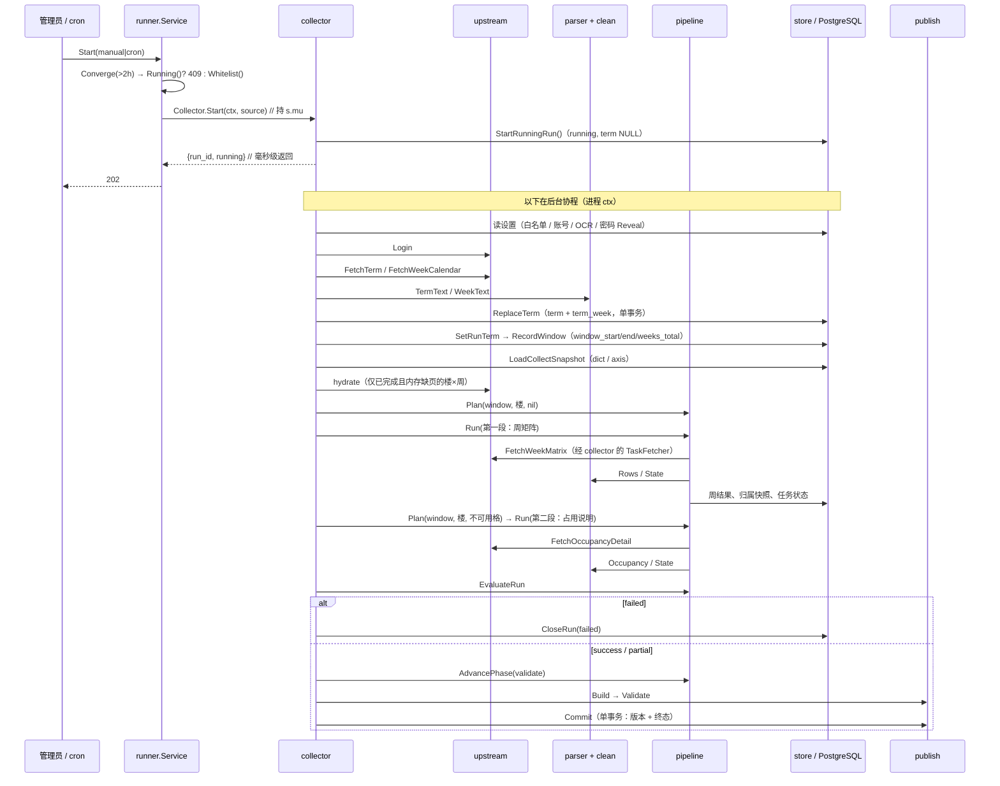

# collect-runner 设计

Feature Name: collect-runner
Spec Directory: 2026-11-09-collect-runner
Updated: 2026-11-09

## Description

本 spec 交付 `runner.Collector` 的生产实现 `internal/collector`：从 `Collector.Start` 建立轮次开始，到一轮 `collect_run` 落成 `success` / `partial` / `failed` / `skipped` / `blocked` 为止。

它把已经各自完成、但从未被串起来的三层接上：

- `upstream`（登录、学期页、周历页、楼列表、周矩阵、占用说明）与 `parser`（学期/周历文本、矩阵行、明细三列）与 `clean`（状态投影、房名规范化）；
- `pipeline`（`Plan` 规划、`Run` 两段执行与断点续跑、归属裁决与冲突、`EvaluateRun`/`CloseRun` 失败分层、`AdvancePhase` 阶段推进）；
- `publish`（`Build` 组装候选集、`Validate` 发布门槛、`Commit` 单事务版本切换）。

同时补齐三处「设计里写了、代码里没有入口」的缺口：`collect_run` 的窗口写入、明细任务的不可用格来源、续跑时的内存候选重建。**不新增任何 migration**：`collect_run`、`collect_run_week`、`collect_run_room`、`sync_task`、`term`、`term_week`、`dict_*`、`axis_*`、`release*` 的列都已够用（见「Data Models」）。

不在本 spec：公开查询与前端（已交付）、管理端设置与运行状态读接口（`admin-settings-sync` 已交付）、告警（后续）、版本对比与回退（`admin-release`）、启动后续跑入口（`runner` 的 409 语义不动，见 D5 与「待确认事项」1）。

## 设计决策（已确认）

| 编号 | 决策 | 取舍 |
|---|---|---|
| D1 | **新包 `internal/collector`，不塞进 `pipeline`**：`pipeline` 保持「不读时钟、不发请求」的纯编排层，`collector` 是唯一的「有副作用的总装」 | `pipeline` 的单元测试至今不需要数据库与网络，这条性质很值钱；把 HTTP、设置、发布塞进去会让它的测试全部变成集成测试。代价是多一个包与一层调用，但依赖方向仍是单向（`collector → pipeline → store`） |
| D2 | **建轮前置、学期后绑**：`Collector.Start` 先插一条 `status=running`、`term` 为 NULL 的轮次并立刻返回，登录与学期读取都在后台协程里，拿到学期后再 `UPDATE collect_run.term` | `runner.Service.startLocked` 在**持有 `s.mu` 的情况下**调用 `Collector.Start`（`runner/runner.go:324`），所以 `Start` 必须毫秒级返回；登录至少两次网络往返加 500ms 节奏，放进锁里会让并发的第二次同步与同刻的 cron 触发一起排队。代价是 `collect_run.term` 有一小段时间是 NULL，且要新增一条建轮 SQL（`StartRunningRun`），因为既有的 `store.StartCollectRun` 把「term 非空」写死在入口（`store/collectrun.go:97`） |
| D3 | **两段式 `Plan` → `Run`：先跑周矩阵，再据矩阵结果规划明细** | `pipeline.Plan` 的 `unavailable []Cell` 必须由调用方给出，而「哪些格不可用」只有抓完矩阵才知道。两段式让 `pipeline` 一行不改、请求数不翻倍（矩阵只抓一次），代价是 `Run` 被调用两次、`cell_detail` 阶段在两次调用之间会短暂显示 0 条可选任务（两次调用之间只有一次纯函数规划，间隔是毫秒级；阶段只前进，见 CP2） |
| D4 | **内存候选用「按 key 覆盖」的追加器**：矩阵按 `(楼, 周)` 覆盖、明细按 `(房, 天, 大节)` 覆盖 | 发布前 `observation` / `occupancy_detail` 没有表可落（主键含 `release_id`），候选只能攒在进程里。`pipeline.Run` 的落库顺序是「先写结果再改任务状态」，两者之间崩溃会让任务保持 pending 并续跑重做；用追加而不是 append 才能保证重做不产出重复观测行（否则 `publish.Build` 会以「重复观测」拒绝整轮，见 CP5） |
| D5 | **续跑重建 = 归属从库里读 + 已完成的周补抓**：Accepted 房间以 `collect_run_room` 为唯一权威；内存缺哪个「楼 × 周」就补抓哪个页 | `pipeline.Run` 只在内部持有 `Attribution`，不向外返回 Accepted，也不返回「跳过的是哪几周」。`collect_run_room` 正是「裁决后的有效归属」的持久副本（`migrations/0002_collect_run_room.sql`），直接读它即可，不必改 `pipeline`。观测没有持久副本（原始页面按 CP12 不落库），所以已完成的周只能重抓一次页——正常轮次这一步请求数为 0（CP10） |
| D6 | **一轮只发布一次、发布就在 `collector` 里同步做完**：`Build` → `Validate` → `Commit` 顺序调用，不引入第二个事务边界 | `publish.Commit` 已经在同一个事务里写版本、观测、说明、归属快照、`release_id` 与轮次终态（`publish/commit.go:79`），再包一层事务只会让「发布失败但轮次已收口」这类中间态多出来 |
| D7 | **`collector` 不写 SQL**：新增的四条 SQL 全在 `store`，`collector` 只调窄接口；`pipeline` 只加四个薄封装（`RecordTerm` / `RecordWindow` / `FailRun` 与新 `WindowStore`、`TermSetter` 接口） | 依赖方向由 `backend/.golangci.yml` 的 depguard 钉住（`store` 只依赖 `model` 与 pgx）。薄封装放在 `pipeline` 是因为「空学期不落库」「空窗/超宽窗口不落库」「终态只能由收口写」这三条判断属于轮次语义，不该散到执行器里 |
| D8 | **错误码沿用旧 design 的错误表，只新增一个 `settings_incomplete`** | 旧表已有 `auth_failed`、`ocr_failed`、`calendar_invalid`、`matrix_structure_invalid`、`axis_changed`、`detail_structure_invalid`、`validation_blocked`、`stale_run`、`whitelist_empty`，但 `auth_failed` / `ocr_failed` / `validation_blocked` 至今没有任何写入点——本 spec 补上。`settings_incomplete` 是旧表没有的（账号/密码/OCR 未配齐），见 D8 的下一段与「待确认事项」2 |
| D9 | **后台用进程生命周期上下文**（`Deps.RunCtx`），`Start(ctx, source)` 的 `ctx` 只用于建轮那一次写库 | `http.Request.Context()` 在响应写出后立刻取消，用它跑 70 分钟的采集会让每一轮都在第一次请求后就中断。装配层传 `main.go` 里那个信号 ctx，进程退出时采集随之取消（未完成任务保持 pending，见 CP8） |

`settings_incomplete` 的取舍：`admin-settings-sync` 的「待确认事项 4」把「账号/密码/OCR 未配齐时怎么办」留给本 spec。三条路——`Collector.Start` 直接返回错误（→ `50000`，库里零记录）、建 `blocked` 轮次、建轮后 `failed`——选第三条：面板的轮次列表能显示「这一轮因为没配账号失败了」，`error_message` 点名缺失的键（不写值、不写密文），而 `50000` 只会给管理员一句「内部错误」。`blocked` 在语义上属于「白名单为空」，借用来表达配置缺失会让两条完全不同的原因在状态上不可分。

## 三个未决项的取舍

### 1. `window_start` / `window_end` 的写入口

**问题**：`publish.Build` 要求 `collect_run.window_start/end` 非空（`publish/build.go:241`），但全仓只有读，没有写（`grep window_start` 的写点只出现在 e2e 的测试 shim 里：`backend/internal/e2e/collect_pipeline_test.go:139`）。

**方案对比**：

| 方案 | 做法 | 代价 |
|---|---|---|
| A（选用） | 新增 `store.SetRunWindow` + `pipeline.RecordWindow`，在规划前写一次 | 一次 UPDATE、一个薄封装；窗口口径仍只有 `WindowFor` 一份 |
| B | 让 `pipeline.Run` 顺手写窗口 | `Run` 的入参里没有窗口；要把 `Window` 塞进 `RunDeps`，等于让「执行」知道「规划」的产物，且续跑时会被重写一遍 |
| C | 给 `publish.Build` 的 `RunInput` 加窗口字段，不落库 | 管理端 `GET /api/admin/runs` 的 `window_start/end` 永远是 `null`（`internal/api/admin_runs.go:102` 已经在输出它）；面板看不到本轮窗口 |

选 A。写入内容是一次 UPDATE 的三列：`window_start`、`window_end`、`weeks_total = window_end - window_start + 1`。`publish.Commit` 发布时还会再写一次 `weeks_total`（`publish/build.go:286` 算出的同一个值），两处口径相同、幂等。守卫写进 `WHERE`：`run_id = $1 AND status = 'running'`，0 行更新即报错——已收口的轮次不允许被改窗口。

**不写 `required_total` 等计数**：那四列由 `pipeline` 的 `SetRunPhase` 在每次推进阶段时按 `sync_task` 现状重算（`store/runphase.go:71`），多一个写入者只会让计数有两份来源。

### 2. 明细任务的「不可用格」从哪来

**问题**：`pipeline.Plan(window, buildingIDs, unavailable []Cell)` 的第三个参数（`pipeline/plan.go:85`）在两份 spec 里都没有说明来源；`pipeline.TaskFetcher` 的返回值只有 `Page` 与 `Rooms`（`pipeline/execute.go:25`），没有 `Cells` / `Details`。

**方案对比**：

| 方案 | 做法 | 代价 |
|---|---|---|
| A（选用） | 两段式：`Plan(window, 楼, nil)` → `Run` 只跑周矩阵；执行器在 `TaskFetcher` 里把清洗后的格攒进内存；再把不可用格交给第二次 `Plan` → `Run` | 两次 `Run`、`cell_detail` 阶段短暂空转；`pipeline` 一行不改，矩阵请求数不变 |
| B | 给 `pipeline.TaskFetcher` 的 `TaskFetch` 加 `Cells` / `Details`，由 `Run` 自己规划明细 | 要改已交付且测试完备的 `pipeline`（`execute.go` 723 行 + 2118 行测试）；把「候选集从哪来」塞进执行循环，`pipeline` 会开始依赖 `publish` 的类型 |
| C | 先独立抓一遍全部矩阵算不可用格，再单次 `Plan` → `Run` | 矩阵请求翻倍（26 楼 × 4 周 ≈ 104 次 → 208 次，多约 1 分钟；200 楼上限时多约 7 分钟），且要把页面缓存下来给第二次用 |

选 A。**不可用格的判定**：矩阵响应里 `clean.State(cell.StateRaw, dict).Available == false` 的格（未知与复合也投影为不可用，与旧 spec 的 CP4「可用性只按字典投影」一致）；按「房号 × 星期 × 大节」去重，窗口内任一周不可用即算一格（Requirement 6.2）。**归属楼不是「响应所在的楼」，而是 `collect_run_room` 里该房号的楼**：明细请求本身只带 `xnxqh` / `jsbh` / `kcsj` / `xq` / `kbjcmsid`（`docs/upstream-api.md` 第 8 节），楼编号只用于 `pipeline` 的归属过滤；用快照里真实的归属楼填进去，`attributedCellInputs` 就一条都不会丢，`Dropped()` 恒为 0。没有归属的房号（`collect_run_room` 里查不到）不规划、不下钻，只计入诊断计数。

### 3. 续跑时的内存候选重建

**问题**：`pipeline.Run` 不返回 Accepted 房间（只返回计数），也不返回「这次跳过了哪几周」；观测在发布前没有表可落，原始页面按 CP12 不落库。所以「同一个 run 被再次执行」时，内存里没有已完成周的矩阵结果，直接发布就会得到一个「少了几周却记 success」的版本。

**拆成两件事**：

1. **Accepted 房间**：读 `collect_run_room`（`store.LoadRunRooms`，`store/room.go:205`）。它是裁决后的有效归属 + 冲突标记的持久副本，`pipeline` 续跑时自己也用它重灌累计器（`pipeline/execute.go:410`）。执行器用它做两件事：过滤矩阵格（只留归属楼 == 响应楼的行）、给不可用格填归属楼。
2. **缺周的观测**：对每个「`sync_task` 里 `week_matrix` 状态为 `done`、而内存里没有该 (楼, 周) 页面」的组合，补抓一次页面并只累计到内存候选——**不写 `collect_run_week`、不碰 `sync_task`**。这一步叫 hydrate。

**为什么不是「重跑全部矩阵」**：hydrate 只补缺失的键，正常轮次（所有周都是本轮抓的）请求数为 0；重跑全部会让每一轮都多花一分钟。

**hydrate 失败怎么办**：收口 `failed`（无错误码，原因是「重建第 X 周 / 楼 Y 的矩阵失败」）。理由：这一周的 `sync_task` 是 `done`，`publish.Validate` 只校验「必需任务都完成」，看不到观测缺失；放着不管就会发布一个缺周的 `success`。宁可让这一轮失败、保留线上版本（CP9）。

**跨进程续跑仍然不可达**：`runner.Service.Start` 读到进行中轮次就返回 409（`runner/runner.go:328`，D9），`>2h` 由 `Converge` 收敛成 `stale_run`。所以 hydrate 在今天的生产路径上**永远命中 0 个键**，它是给「同一轮被再次执行」（同一进程内的重试、将来若有启动续跑入口）准备的不变式。本 spec 不加启动续跑入口——那要改 `runner` 的启动语义，超出「复用 `runner.Collector` 接口、不改造 runner」的前提（见「待确认事项」1）。

## 接线时暴露的两个新缺口

### 4. 学期日历的写入口

`term` 与 `term_week` 全仓只有读（`store/term.go:23` 的 `TermWeekAt`），而 `collect_run.term`、`collect_run_week.term`、`release.term` 三处都是外键，学期日历不写进去，这一轮连轮次都建不出来（`collect_run.term` 的 FK 会直接拒绝）。

- **锚点公式**取自 `docs/pitfalls.md` 第 2 节：第 1 周周一 = 采样日所在周周一 − 7×(C−1)，日期按 `Asia/Shanghai`（固定 +08:00，与 `pipeline.shanghai`、`upstream.businessZone` 同一口径）。
- **整体替换在单事务内**（原 spec Requirement 3.2）：`UPSERT term(total_weeks)` → 逐周 `UPSERT term_week(term, week, monday, in_calendar=true)` → 删掉 `week > Y` 的残留行。
- **锚点冲突不改历史**：库里已有该学期的日历且第 1 周周一不同时，回滚并返回 `store.ErrTermAnchorConflict`，本轮 `failed(calendar_invalid)`。理由：`term_week` 决定「日期 → 周次」的换算，而 `observation.week` 是周次；静默改锚点会让已经发布的版本（按旧锚点算出的周次）从此指向错误的日期，且旧版本按 `generated_at` 排第二、随时可能被回退成 current。要让锚点漂移可接受，需要另一版设计（例如 `term_week` 版本化），不在本 spec。

### 5. 字典与轴快照的读取入口

`clean.State` 要 `model.Dict`（`dict_symbol` + `dict_state`），`parser.Rows` 要 `[]model.AxisNode`，`publish.Build` 还要这两个版本号。现有的 `store.Meta`（`store/meta.go:100`）读的是**当前版本对应的**字典/轴、且返回的是 `MetaDictState` / `MetaAxisNode` 两套展示用结构，不是 `model.Dict` / `model.AxisNode`。

新增一个只读入口 `store.LoadCollectSnapshot`：取 `dict` / `axis` 的**最大版本**，一次读回 `DictVersion`、`model.Dict`（符号表 + 状态表）、`AxisVersion`、`[]model.AxisNode`（按 `ordinal` 排序）。没有版本行时返回错误——空字典会把所有格判成未知、空轴会让 `parser.Rows` 直接 `ErrAxisInvalid`，两者都该在发请求之前就失败。

## Architecture



图渲染不出来时的同义结构：

```text
Start:  StartRunningRun(running, term=NULL) → {run_id, running} → 202
后台:   设置 → Login → FetchTerm/WeekCalendar → TermText/WeekText
        → ReplaceTerm(term+term_week) → SetRunTerm → RecordWindow
        → LoadCollectSnapshot(dict/axis) → 楼列表(仅 WARN)
        → hydrate(只补 done 且缺页的 楼×周) → Plan1(无明细) → Run1(周矩阵)
        → EvaluateRun? failed → CloseRun
        → Plan2(带不可用格) → Run2(占用说明) → EvaluateRun
        → failed? CloseRun : AdvancePhase(validate) → Build → Validate → Commit
```

### 依赖方向

```
collector → pipeline, publish, upstream, parser, clean, store, settings, model, runner
pipeline  → upstream, parser, clean, store, model      （既有，不变）
publish   → store, model                                （既有，不变）
store     → model, pgx                                  （既有，不变）
```

`backend/.golangci.yml` 需要补一条包规则（不补则新包不受任何约束：lint 照样绿，越层不会被拦，与 `admin-settings-sync` 交付时欠四条规则的情形同理）：

```yaml
collector:
  files:
    - "**/internal/collector/**"
  allow:
    - $gostd
    - github.com/w1ndys/easy-qfnu-kjs/internal/model
    - github.com/w1ndys/easy-qfnu-kjs/internal/upstream
    - github.com/w1ndys/easy-qfnu-kjs/internal/parser
    - github.com/w1ndys/easy-qfnu-kjs/internal/clean
    - github.com/w1ndys/easy-qfnu-kjs/internal/pipeline
    - github.com/w1ndys/easy-qfnu-kjs/internal/publish
    - github.com/w1ndys/easy-qfnu-kjs/internal/store
    - github.com/w1ndys/easy-qfnu-kjs/internal/settings
    - github.com/w1ndys/easy-qfnu-kjs/internal/runner
```

`collector` 不 import `secret`：秘密明文只从 `settings.Service.Reveal` 出来（`settings/service.go:253`），执行器拿不到密钥与密文。

## Components and Interfaces

### 目录结构（本轮新增与增量）

```
backend/internal/collector/collector.go        New / Deps / Start / 收口与失败码
backend/internal/collector/execute.go          execute 的阶段顺序（登录 → 学期 → 窗口 → 两段执行 → 发布）
backend/internal/collector/fetch.go            Upstream 接口、页面缓存、TaskFetcher、明细抓取
backend/internal/collector/candidate.go        内存候选追加器（矩阵 / 明细 / 不可用格 + 按归属过滤）
backend/internal/collector/window_test.go      窗口与日历锚点的纯函数用例
backend/internal/collector/collector_test.go   编排顺序、失败收口、错误码（替身）
backend/internal/collector/fetch_test.go       页面缓存、重放覆盖、hydrate
backend/internal/collector/candidate_test.go   追加器与归属过滤
backend/internal/store/collectrun.go           + StartRunningRun / SetRunTerm / SetRunWindow
backend/internal/store/term.go                 + ReplaceTerm（term + term_week 单事务）
backend/internal/store/collectsnapshot.go      新增：LoadCollectSnapshot（dict / axis）
backend/internal/store/synctask.go             + LoadWeekMatrixTasks
backend/internal/pipeline/window.go            + WindowStore / RecordWindow
backend/internal/pipeline/run.go               + TermSetter / RecordTerm
backend/internal/pipeline/phase.go             + FailRun
backend/internal/config/config.go              + UpstreamBaseURL（UPSTREAM_BASE_URL，默认 http://zhjw.qfnu.edu.cn）
backend/cmd/server/main.go                     装配 upstream → collector → runner
backend/.golangci.yml                          + collector 包规则
```

`collector` 内部按职责分文件，但只有 `Collector` 一个导出类型、`New` 与 `Start` 两个导出方法；其余是包内函数，测试同包。

装配层用 `var _ collector.RunLifecycle = store.CollectRunRepo{}` 这一类断言把「接口方法集与仓储实现」钉在编译期（与 `main.go` 里既有的 `var _ settings.Store = store.SettingsRepo{}`、`var _ auth.AdminStore = store.AdminRepo{}` 同一做法）：`tasklist.md` 第 11 项落实的三条断言分别对应 `RunLifecycle`（`store.CollectRunRepo`）、`TermCalendar`（`store.TermRepo`）、`SnapshotReader`（`store.SnapshotRepo`）。

### 接口签名

```go
// internal/collector/collector.go

// Deps 是执行器的全部注入点。除 RunCtx/Log 外都可有替身：
// 生产用 store 的仓储与 *upstream.Client，测试用真实 parser/clean/pipeline/publish + 假上游。
type Deps struct {
    Runs      RunLifecycle          // 建轮、补学期、写窗口（store.CollectRunRepo）
    Terms     TermCalendar          // 学期日历整体替换（store.TermRepo）
    Snapshots SnapshotReader        // 字典与轴版本快照（store.SnapshotRepo）
    Phases    pipeline.PhaseStore   // 阶段、计数、收口（store.RunPhaseRepo）
    Tasks     pipeline.TaskStore    // 任务与周结果（store.SyncTaskRepo）
    TaskRead  TaskReader            // 读周矩阵任务状态（store.SyncTaskRepo 的增量）
    Rooms     pipeline.RoomStore    // 归属快照、冲突计数（store.RoomRepo）
    Reader    publish.Reader        // 发布组装（store.PublishRepo）
    Committer publish.Committer     // 发布事务（store.ReleaseRepo）
    Settings  SettingsSource        // 白名单、账号、OCR、密码（*settings.Service）
    Upstream  Upstream              // 教务 HTTP 客户端（*upstream.Client）
    RunCtx    context.Context       // 进程生命周期上下文，必填（D9）
    Log       *slog.Logger          // 必填
    Clock     pipeline.Clock        // 当前时刻；nil 退回 time.Now
}

func New(deps Deps) (*Collector, error) // 依赖缺失 → 包装 model.ErrConfigInvalid，入口拒绝启动

// Start 实现 runner.Collector。返回时轮次已落库；执行在后台（D2、D9）。
// 已有进行中轮次 → 包装 model.ErrRunConflict（runner 会重读 Running 折成 409）。
func (c *Collector) Start(ctx context.Context, source model.TriggerSource) (runner.StartResult, error)
```

```go
// 执行器对存储的四个窄接口。方法集由 store 的既有/新增方法结构匹配，
// 装配层用 var _ collector.RunLifecycle = store.CollectRunRepo{} 之类的断言钉在编译期。

type RunLifecycle interface {
    // StartRunningRun 插入一条 status=running、term 为 NULL 的轮次；
    // 撞 collect_run_single_running 唯一索引 → 包装 model.ErrRunConflict。
    StartRunningRun(ctx context.Context, startedAt time.Time) (store.CollectRun, error)
    // SetRunTerm 补写学期；守卫 status='running'，0 行更新报错。
    SetRunTerm(ctx context.Context, runID int64, term string, now time.Time) error
    // SetRunWindow 写 window_start / window_end / weeks_total；守卫 status='running'。
    SetRunWindow(ctx context.Context, runID int64, start, end, weeksTotal int, now time.Time) error
}

type TermCalendar interface {
    // ReplaceTerm 在单事务内写 term 与 term_week；锚点与已有日历不一致时
    // 返回 store.ErrTermAnchorConflict（不改任何行）。
    ReplaceTerm(ctx context.Context, term string, totalWeeks int, firstMonday, now time.Time) error
}

type SnapshotReader interface {
    // LoadCollectSnapshot 取 dict / axis 的最大版本与内容；没有版本行即报错。
    LoadCollectSnapshot(ctx context.Context) (store.CollectSnapshot, error)
}

type TaskReader interface {
    // LoadWeekMatrixTasks 按 task_id 升序返回本轮全部周矩阵任务（含状态），
    // 供 hydrate 找出「已完成但内存缺页」的楼×周。
    LoadWeekMatrixTasks(ctx context.Context, runID int64) ([]store.SyncTask, error)
}
```

```go
// 上游只声明执行器真正消费的六个方法；*upstream.Client 结构匹配。
type Upstream interface {
    Login(ctx context.Context, opts upstream.LoginOptions) error
    FetchTerm(ctx context.Context) (*upstream.TermSnapshot, error)
    FetchWeekCalendar(ctx context.Context, at time.Time) (*upstream.WeekCalendar, error)
    FetchBuildings(ctx context.Context, campusID string) ([]upstream.Building, error)
    FetchWeekMatrix(ctx context.Context, params upstream.WeekMatrixParams) ([]byte, error)
    FetchOccupancyDetail(ctx context.Context, params upstream.OccupancyDetailParams) ([]byte, error)
}

// 设置只声明读的两个方法：白名单、账号与 OCR 地址来自 Load，密码只有 Reveal 一条路。
type SettingsSource interface {
    Load(ctx context.Context) (settings.Snapshot, error)
    Reveal(ctx context.Context, key string) (string, error)
}
```

```go
// internal/pipeline 的三处增量。都只是薄封装 + 语义守卫，不含 SQL。

// window.go
type WindowStore interface {
    SetRunWindow(ctx context.Context, runID int64, start, end, weeksTotal int, now time.Time) error
}
// RecordWindow 校验窗口非空、跨度不超过 4 周，再落库 window_start/end/weeks_total。
// 参数名用 windows 而不是 store：避免与包名 store 同名（该文件不 import store，但保持可读）。
func RecordWindow(ctx context.Context, windows WindowStore, runID int64, w Window, clock Clock) error

// run.go
type TermSetter interface {
    SetRunTerm(ctx context.Context, runID int64, term string, now time.Time) error
}
// RecordTerm 只去两侧空白并拒绝空学期，然后落库。
func RecordTerm(ctx context.Context, terms TermSetter, runID int64, term string, clock Clock) error

// phase.go
// FailRun 把一轮按失败收口：status=failed、phase=finished、finished_at、
// error_code（可空）、error_message（cause 为 nil 时写一句固定说明）。
// 与 FailCalendar 的区别只在于错误码由调用方给：calendar_invalid 仍走 FailCalendar。
func FailRun(ctx context.Context, phases PhaseStore, runID int64, code string, cause error, clock Clock) error
```

```go
// internal/store 的四处增量。

// collectrun.go
func StartRunningRun(ctx context.Context, q collectRunQuerier, startedAt time.Time) (CollectRun, error)
func SetRunTerm(ctx context.Context, q collectRunQuerier, runID int64, term string, now time.Time) error
func SetRunWindow(ctx context.Context, q collectRunQuerier, runID int64, start, end, weeksTotal int, now time.Time) error
// 三个方法都挂在 CollectRunRepo 上（它已经实现 pipeline.RunStore）。

// term.go —— 新增一个小仓储类型，方法集与 collector.TermCalendar 结构匹配
var ErrTermAnchorConflict = errors.New("学期日历锚点与已存日历不一致")
type TermRepo struct{ q termQuerier }
func NewTermRepo(q termQuerier) TermRepo
func (r TermRepo) ReplaceTerm(ctx context.Context, term string, totalWeeks int,
    firstMonday, now time.Time) error

// collectsnapshot.go（新文件）
type CollectSnapshot struct {
    DictVersion int
    Dict        model.Dict        // Symbols 与 States 两个映射
    AxisVersion int
    Axis        []model.AxisNode  // 按 ordinal 升序
}
type SnapshotRepo struct{ q snapshotQuerier }
func NewSnapshotRepo(q snapshotQuerier) SnapshotRepo
func (r SnapshotRepo) LoadCollectSnapshot(ctx context.Context) (CollectSnapshot, error)

// synctask.go —— 挂在既有的 SyncTaskRepo 上（它已经实现 pipeline.TaskStore）
func LoadWeekMatrixTasks(ctx context.Context, q syncTaskQuerier, runID int64) ([]SyncTask, error)
func (r SyncTaskRepo) LoadWeekMatrixTasks(ctx context.Context, runID int64) ([]SyncTask, error)
```

```go
// internal/config/config.go 增量：上游根地址。
type Config struct {
    // ...既有字段
    UpstreamBaseURL string // UPSTREAM_BASE_URL；缺省 http://zhjw.qfnu.edu.cn
}
// 只做「缺省值 + 透传」：http/https 与主机名的校验只有 upstream.New 一处
// （upstream/client.go:133），不在 config 里再写一份。
```

### 一轮的阶段顺序（`execute`）

顺序固定，每一步的位置都有理由：

1. **读设置**：`Settings.Load` 一次拿到白名单、`jw_username` 与 `ocr_base_url`（后两者的明文就在 `Snapshot` 里，不是秘密项）；密码只有 `Reveal(jw_password)` 一条路。任一为空或 `Reveal` 报错 → `FailRun(settings_incomplete)`，`error_message` 点名键（只点名、不写值、不写密文）。
2. **登录**：`Upstream.Login`。`ErrUpstreamAuthFailed` → `auth_failed`；`ErrUpstreamOCRFailed` → `ocr_failed`；其余（网络/超时）→ 无码，原因取错误文案。
3. **阶段 `calendar`**：`pipeline.AdvancePhase(PhaseCalendar)`。
4. **学期页与周历页**：`FetchTerm` + `parser.TermText(Raw)`、`FetchWeekCalendar(now)` + `parser.WeekText(Raw)`。两处 parser 调用是权威口径（与 `parser/calendar.go:45`、`:79` 的同名函数一致）；upstream 侧的最小提取只用于兜底，两者不一致按 `calendar_invalid` 失败。`FetchWeekCalendar` 传入执行时刻（一次 `c.clock()`，不重复取），由 upstream 按 `Asia/Shanghai` 取 `rq`；第 5 步的日历锚点用同一个时刻推算「采样日所在周周一」。
5. **学期日历**：`Terms.ReplaceTerm(term, Y, anchor(now, C))`。`ErrTermAnchorConflict` → `FailCalendar`。**必须在 `SetRunTerm` 之前**：`collect_run.term` 有外键指向 `term`，先绑学期会撞外键。
6. **绑定学期**：`pipeline.RecordTerm`。
7. **窗口**：`window := pipeline.WindowFor(C, Y)`；`window.Empty()` → `FinishRun(skipped)` 并返回（Requirement 2.3）；否则 `pipeline.RecordWindow`。
8. **字典与轴**：`Snapshots.LoadCollectSnapshot`。
9. **楼列表**（advisory）：`FetchBuildings(upstream.CampusQufu)`；失败只记 WARN；白名单里不在列表内的楼逐个记 WARN。这一步对采集结果没有贡献，所以**不阻断**（见「待确认事项」4）。
10. **hydrate（续跑才命中）**：`TaskRead.LoadWeekMatrixTasks` 取 `done` 的 `(楼, 周)`，凡页面缓存里没有的补抓一次（只累计内存候选：不写 `collect_run_week`、不改 `sync_task`）。放在第一段之前，阶段因此仍停在 `week_matrix`，进度条与实际动作一致；补抓失败 → `FailRun` 并返回。
11. **规划第一段**：`plan1 := pipeline.Plan(window, buildings, nil)`。`StatusBlocked` → `FinishRun(blocked, whitelist_empty)`（防御；runner 已经挡过空白名单，但白名单可能在两次读之间被清空）；`StatusSkipped` → `FinishRun(skipped)`。
12. **执行第一段**：`pipeline.Run(ctx, runID, buildings, plan1.Tasks, deps)`，`Fetch` 是执行器的闭包（矩阵页 + 清洗 + 累计）。已 `done` 的周矩阵在这里被跳过，它们的候选由第 10 步补上。
13. **收口判定一**：`pipeline.EvaluateRun(ctx, phases, runID, progress1.Dropped())`（第一段没有明细任务，丢弃数恒为 0，仍按同一口径传）。`failed` → `CloseRun` 并返回，**不再下钻明细**（Requirement 10.7：必需矩阵已经失败时继续跑 70 分钟明细没有意义）。
14. **规划第二段**：`unavailable` 由内存候选导出（已按归属快照重写楼），`plan2 := Plan(window, buildings, unavailable)`。这是纯函数调用，不产生请求。
15. **执行第二段**：`pipeline.Run`，`dropped := progress.Dropped()`。第二段里周矩阵任务全部 `done` → 跳过，`Completed` 只统计明细。
16. **收口判定二**：`EvaluateRun(ctx, phases, runID, dropped)`。
    - `failed` → `CloseRun(ctx, phases, runID, dropped, clock)` 并返回；
    - `success` / `partial` → 进入发布。
17. **发布**：`AdvancePhase(PhaseValidate)` → `publish.Build(ctx, Reader, runID, RunInput{...})` → `publish.Validate(candidate, publish.Thresholds{})` → `publish.Commit(ctx, Committer, candidate, now)`。`Build` / `Validate` 的拒绝 → `FailRun(validation_blocked, err)`；`Commit` 失败 → `FailRun("", err)`（事务已回滚，轮次还在 running，必须收口，否则会一直占着唯一索引）。`Commit` 成功后轮次已是终态，**不再调用任何收口函数**。

`RunInput` 的字段来源：

| 字段 | 来源 |
|---|---|
| `DictVersion` / `AxisVersion` / `AxisNodes` | `LoadCollectSnapshot` |
| `Buildings` | 白名单（`ID` + `Name` 原样） |
| `Cells` | 内存候选：矩阵格按 `(房, 周, 天, 大节)` 摊平，只留归属快照里的房号与楼 |
| `Details` | 内存候选：明细按格摊平（明细任务已被 `pipeline` 按归属过滤） |
| `DroppedRequired` / `DroppedOptional` | 第二段的 `RunProgress.Dropped()`（与 `CloseRun`/`EvaluateRun` 传的是同一个值，CP7） |
| `GeneratedAt` | `Clock()`，晚于轮次开始（不早于 `started_at`） |

`publish.Thresholds{}` 传零值：未知与复合只计数、不阻断（PRD 4.5），而库里没有阈值设置项。

### 内存候选的形状（`candidate.go`）

```go
// weekKey 是「楼 × 周」；cellKey 是「房号 × 星期 × 大节」；roomWeek 是「房号 × 周」。
type weekKey struct {
    BuildingID string
    Week       int
}

type cellKey struct {
    RoomID  string
    Weekday int
    Block   string
}

// bank 是一轮的内存候选。三个 map 的 key 都是「业务身份」，写入即覆盖（D4）。
type bank struct {
    pages       map[weekKey]matrixPage      // (楼,周) → 页面 + 解析结果 + 清洗后的格；也充当「已抓」守卫
    unavailable map[cellKey]struct{}        // (房,天,大节) → 该格在窗口内至少一周不可用
    details     map[cellKey][]cellDetailRow // (房,天,大节) → 一次明细响应的全部说明
}

// matrixPage 是一次矩阵抓取的全部产物：页面正文（只用于算 sha256）、解析出的房号行、
// 以及已经投影好的格。三者同生同灭，重放时整片覆盖。
type matrixPage struct {
    Page  []byte
    Rooms []model.MatrixRoom
    Cells []cellRow // 房号 × 星期 × 大节 × 状态（已按字典投影）
}

type cellRow struct {
    RoomID  string
    Weekday int
    Block   string
    State   model.Observation
}
```

- `pages` 同时是「每 (楼, 周) 每轮至多一次请求」的守卫（CP10）。体积按实测页面 ~30–60KB 估：26 楼 × 4 周 ≈ 5MB，200 楼上限 ≈ 40MB，与候选集本身（数十万到数百万观测）相比不是峰值。
- `pages[(楼,周)]` 整片覆盖：同一楼同一周被重放时不产生第二批观测（CP5）。
- `unavailable[(房,天,大节)]` 只记「不可用」这一事实，归属楼在导出时按 `collect_run_room` 重写（D5、第 2 节）；没有归属的格在导出时丢弃并计入 `orphanCells`。
- `details[(房,天,大节)]` 整片覆盖：同一格被重放时不追加第二份。
- 导出顺序固定：`pages` 按白名单楼顺序 × 周次升序；`unavailable` / `details` 按 `(房号, 星期, 大节)` 升序。顺序固定才能让「同一份上游返回同一份候选集」（便于断言与复查）。

## Data Models

**不新增 migration。** 用到的既有列：

| 表 / 列 | 用途 | 谁写 |
|---|---|---|
| `collect_run.status` / `phase` / `finished_at` | 轮次终态与阶段 | `pipeline.FinishRun` / `CloseRun` / `FailRun`、`publish.Commit`、`store.StartBlockedRun`（既有） |
| `collect_run.term` | 学期（先 NULL，登录后补） | 新增 `SetRunTerm` |
| `collect_run.window_start` / `window_end` / `weeks_total` | 采集窗口 | 新增 `SetRunWindow`；`publish.Commit` 会再写一次 `weeks_total` |
| `collect_run.error_code` / `error_message` | 失败原因 | `FailRun` / `CloseRun` / `publish.Commit` |
| `collect_run.released_at` | 「一轮只发布一次」守卫（0003） | `publish.Commit` |
| `term` / `term_week` | 学期日历 | 新增 `ReplaceTerm` |
| `collect_run_week` | 每楼每周抓取结果（`fetched_at` + 页面 sha256） | `pipeline.Run`（既有） |
| `collect_run_room` | 本轮归属快照（Accepted + 冲突标记） | `pipeline.Run`（既有） |
| `sync_task` | 任务与状态 | `pipeline.Run`（既有） |
| `dict` / `dict_state` / `dict_symbol` / `axis` / `axis_node` | 字典与轴快照 | 只读（新增 `LoadCollectSnapshot`） |
| `release` / `observation` / `occupancy_detail` / `release_room_building` | 发布写入 | `publish.Commit`（既有） |

### 错误码

| `error_code` | 触发 | 写入者 | 轮次终态 |
|---|---|---|---|
| `settings_incomplete` | 账号 / 密码 / OCR 未配齐或解封失败 | 新增 `pipeline.FailRun` | failed |
| `auth_failed` | 上游判定密码错误（`model.ErrUpstreamAuthFailed`） | `FailRun` | failed |
| `ocr_failed` | 验证码识别耗尽 3 次（`model.ErrUpstreamOCRFailed`） | `FailRun` | failed |
| `calendar_invalid` | 学期/周历文本解析失败、日历锚点冲突 | `pipeline.FailCalendar`（既有） | failed |
| `matrix_structure_invalid` | 矩阵结构失败、响应内重复房号 | `pipeline.failTask`（既有） | failed（必需）/ partial（仅可选） |
| `axis_changed` | 表头状态格与轴不一致 | `pipeline.failTask`（既有） | 同上 |
| `detail_structure_invalid` | 明细页连标题表都没有 | `pipeline.failTask`（既有） | partial |
| `validation_blocked` | 候选集为空、必需未完成、归属快照不完整、阈值超限 | `FailRun` | failed |
| `whitelist_empty` | 空白名单 | `runner.StartBlockedRun`（既有）/ 执行器的防御路径 | blocked |
| `stale_run` | 超过 2 小时的 running | `store.FailStaleRuns`（既有） | failed |
| （空） | 网络/超时导致的必需任务失败、hydrate 失败、发布事务失败、内部 panic | `CloseRun` / `FailRun` | failed |

非结构失败不编业务码这条规则沿用 `pipeline/phase.go:181` 的 `errorCodeFor`：给超时编一个 `matrix_structure_invalid` 会让管理端误判成「页面结构变了」。

`collect_run.error_code` 列没有 CHECK 约束（`migrations/0001_baseline.sql`），新增 `settings_incomplete` 不需要迁移。

### 容量

- 观测数 ≈ 房间数 × 窗口周数 × 7 × 12（大节展开）。26 楼 × 100 间 × 4 周 × 84 ≈ 87 万行/版本，与 PRD 5.4 的量级一致；`publish.Commit` 内按 5 万行一批 COPY（`store/publish.go:110`）。
- 可选任务数 = 不可用格数（按「房 × 天 × 大节」去重后，不是按周）。实测全校约 8516 个内容格，明细约 71 分钟（`docs/pitfalls.md` 第 7 节）。
- 执行器自己只新增两块内存：页面缓存（≤ 40MB 上界）与候选集（`publish` 既有口径）。

## Correctness Properties

- **CP1 窗口唯一来源**：写入 `collect_run` 的窗口恒等于 `pipeline.WindowFor(周历页 C, 周历页 Y)`；空窗轮次 `skipped` 且零任务；候选集里不出现窗口外的周（`publish.Build` 的第二道拒绝）。
- **CP2 轮次身份与唯一收口**：`Start` 返回前 `collect_run` 已存在且 `status=running`；同一轮的终态只会被写一次（`FinishRun` 的 `WHERE status='running'`、`publish.Commit` 的 `released_at IS NULL`、`collect_run_single_running` 唯一索引三者共管）。阶段只前进：两段式之间可能出现 `phase=cell_detail` 而可选任务数为 0 的短暂状态，这是「阶段只前进」的直接后果，不表示快照错误。
- **CP3 学期一致**：`collect_run.term`、`collect_run_week.term`、`release.term` 三者恒等于本轮学期页读到的学期；学期日历按该学期写入。
- **CP4 日历幂等**：同一学期重复执行 `ReplaceTerm` 后 `term_week` 的行数与周一日期不变；锚点与已有日历不一致时不改任何行（事务回滚）。
- **CP5 候选无重复**：同一「楼 × 周」的矩阵页重放、同一「房 × 天 × 大节」的明细重放都不产生第二份候选行；`publish.Build` 的重复观测拒绝因此在正常路径上不可达（可测：把同一个任务人为执行两次再发布）。
- **CP6 归属唯一**：候选集里每个房号都在 `collect_run_room` 里，且归属楼与快照一致；跨楼被丢弃的响应行不进候选集（按快照过滤，不是按响应顺序猜）。
- **CP7 明细覆盖与计数同源**：每个不可用格恰有一条明细任务（`Plan` 的 `(房, 天, 大节)` 去重 + 归属重写）；交给 `EvaluateRun`、`CloseRun` 与 `RunInput.DroppedRequired/Optional` 的是同一个 `Dropped()` 值。
- **CP8 失败必收口、成功不收口**：任一轮次离开 `running` 时 `finished_at` 非空；失败轮次 `error_code` 属于错误码表或为空；`publish.Commit` 成功之后不再调用任何收口函数（否则撞 `FinishRun` 守卫并报错）。调用方取消/进程退出时轮次保持 `running`，未完成任务保持 `pending`。
- **CP9 不发布半成品**：只有 `EvaluateRun ∈ {success, partial}` 且 `Validate` 通过才调用 `Commit`；hydrate 缺周、必需任务失败、候选集为空一律不发布，线上 `is_current` 版本不变。
- **CP10 请求数守恒**：每「楼 × 周」每轮至多一次 `FetchWeekMatrix` 调用（`pages` 守卫 + `upstream` 内部 3 次重试）；hydrate 只补「`done` 且内存缺页」的键，正常轮次为 0 次。
- **CP11 HTTP 取消不影响轮次**：`Start(ctx)` 的 `ctx` 只用于 `StartRunningRun`；后台协程用 `Deps.RunCtx`，请求结束后继续执行（可测：取消请求 ctx 后轮次仍跑到终态）。
- **CP12 原始页面不落库**：页面只在 `pages` 缓存与 `collect_run_week.page_sha256` 里；日志字段固定为 `run_id` / `stage` / `building_id` / `week` / `task_id` / `code`，不写页面片段、账号、密码、密文。

## Error Handling

每个失败点都必须落到「轮次终态 + 错误码 + 原因」，不允许只在日志里消失：

| 阶段 | 失败 | 终态 | `error_code` | 处理 |
|---|---|---|---|---|
| 建轮 | 唯一索引被占 | 无（不建） | — | 返回 `model.ErrRunConflict`，runner 折成 409 |
| 读设置 | 账号/密码/OCR 缺失或解封失败 | failed | `settings_incomplete` | `FailRun`，原因点名键 |
| 登录 | `ErrUpstreamAuthFailed` | failed | `auth_failed` | `FailRun`，不重试 |
| 登录 | `ErrUpstreamOCRFailed` | failed | `ocr_failed` | `FailRun`，不重试 |
| 登录 | 网络/超时（`ErrUpstreamFailed`） | failed | 空 | `FailRun`，原因取错误文案 |
| 学期/周历 | parser 文本非法 | failed | `calendar_invalid` | `FailCalendar`，学期日历不变 |
| 学期日历 | 锚点冲突 | failed | `calendar_invalid` | `FailCalendar`，日历不变 |
| 学期日历 | 写库失败 | failed | 空 | `FailRun`（事务已回滚，日历不变） |
| 快照 | dict / axis 没有版本行 | failed | 空 | `FailRun`，不发任何矩阵请求 |
| 规划 | 窗口为空 | skipped | 空 | `FinishRun(skipped)` |
| 规划 | 白名单为空（防御） | blocked | `whitelist_empty` | `FinishRun(blocked)`，文案与 runner 相同 |
| 周矩阵 | 结构失败 | failed / partial | `matrix_structure_invalid` / `axis_changed` | `pipeline.failTask` + `CloseRun` |
| 周矩阵 | 网络失败 | failed / partial | 空 | `pipeline.failTask` + `CloseRun` |
| 周矩阵 | 必需任务已失败 | failed | 见上 | 第一段后立即 `CloseRun`，跳过明细 |
| hydrate | 补抓失败 | failed | 空 | `FailRun`，点名楼与周，不发布 |
| 明细 | 结构失败 | partial | `detail_structure_invalid` | `pipeline.failTask` + `publish.Commit` 写 partial |
| 明细 | 网络失败 | partial | 空 | 同上 |
| 组装 | 候选集为空 / 输入非法 | failed | `validation_blocked` | `FailRun`，原 current 不动 |
| 校验 | 阈值/归属/必需未完成 | failed | `validation_blocked` | `FailRun`，原 current 不动 |
| 发布 | 事务失败 | failed | 空 | `FailRun`，事务已回滚，原 current 不动 |
| 后台 | panic | failed | 空 | `recover` 后 `FailRun("内部错误")`，并记 ERROR |
| 后台 | ctx 取消 / 进程退出 | 保持 running | — | 不写终态，留给下一次执行 |

两个细节：

- **`FailRun("")` 不写码**：`error_code` 用 `NULLIF($4,'')` 折成 NULL（`store/runphase.go:305` 的既有口径），与「非结构失败不编码」一致。
- **`FailCalendar` 与 `FailRun(calendar_invalid)` 不并行**：日历相关失败统一走既有的 `pipeline.FailCalendar`，别的地方不要再用 `calendar_invalid` 调 `FailRun`——同一个码两条写入路径，文案与默认消息迟早分叉。

## Test Strategy

- **纯函数（无库无网）**：窗口与锚点——`WindowFor(9,16)=9..12`、`WindowFor(16,16)=16..16`、`WindowFor(0,16)` 为空、`WindowFor(17,16)` 为空；`anchorMonday(2026-11-04, 9)` = 2026-09-07（第 9 周周一），跨月/跨年各一条；白名单规范化（去空白、去重、保序）与 `Plan` / `Run` 收到同一份序列。
- **追加器（`candidate_test.go`）**：同一 (楼,周) 写两次只留后一次；同一 (房,天,大节) 的明细写两次只留后一次；`unavailable` 在归属重写后指向快照的楼；没有归属的房号被丢弃并计入 `orphanCells`；导出顺序稳定（同一输入两次导出逐项相等）。
- **编排（替身，`collector_test.go`）**：用假 `Upstream`、假 `SettingsSource` + **真实** `pipeline`/`publish`/`parser`/`clean` + 内存版存储替身，断言调用顺序（设置 → 登录 → 学期 → 周历 → 替换日历 → 绑学期 → 写窗口 → 快照 → 规划 → 执行 → 发布）；每个失败码各一条：`settings_incomplete`、`auth_failed`、`ocr_failed`、`calendar_invalid`（parser 与锚点各一条）、`validation_blocked`、发布事务失败、hydrate 失败；`Start` 在后台完成前就返回（用 channel 卡住假上游，断言 `Start` 先返回）；取消请求 ctx 后轮次仍跑完（CP11）；panic 后轮次 `failed`。
- **仓储单测（替身 queryer）**：`StartRunningRun` 的 SQL 只写 `started_at` 与 `status`，唯一索引冲突映射成 `ErrRunConflict`（只认 `collect_run_single_running` 的 23505）；`SetRunTerm` / `SetRunWindow` 的 `WHERE run_id = $1 AND status = 'running'` 与 0 行更新的报错；`ReplaceTerm` 的「先读锚点 → 不一致即回滚」分支与三条写语句（upsert term、逐周 upsert、删 `week > Y`）；`LoadCollectSnapshot` 取最大版本、按 `ordinal` 排序、无版本即报错；`LoadWeekMatrixTasks` 只选 `kind='week_matrix'` 且按 `task_id` 升序。
- **集成（真实 PostgreSQL 17，`KJS_TEST_DSN` 未设置则跳过）**：一轮 happy path（假上游 + 真实 parser/clean/pipeline/publish）→ 断言 `collect_run` 的窗口/学期/计数/终态/`release_id`/`released_at`、`term_week` 的 16 行与锚点、`release` 与 `observation` 行数、`collect_run_room` 的房号数；归属冲突轮（两楼同房号）→ 候选只含赢家的房号、`attr_conflict_count>0`、`has_attr_conflict=true`、明细任务无一条被丢弃；续跑轮（预置 `running` 轮次 + 若干 `done` 的周矩阵任务 + 已写 `collect_run_week`，内存为空）→ hydrate 补抓后发布成功且观测覆盖窗口内全部周；重复执行同一 run → 不产生重复观测（`publish.Build` 不报错、`observation` 行数与一次执行相同）；明细结构失败 → `partial` 且版本仍发布；必需矩阵全失败 → `failed` 且 `release` 行数不变。
- **端到端（真实库 + 假上游 HTTP 客户端）**：从 `collector.Start` 起跑到 202 + 轮次终态 + 公开查询可见（复用 `internal/e2e` 的装配与夹具，新增 `e2e/collect_runner_test.go`）。**必须 `-p 1`**：`e2e` 与 `store` 的集成用例都会 `DROP SCHEMA public`（`backend/internal/e2e/collect_pipeline_test.go:13`）。
- **日志脱敏**：用唯一哨兵作密码/账号/页面正文，捕获 `slog` 输出，断言日志不含哨兵、不含密文、不含页面片段。
- **门禁**：`go build ./...`、`go vet ./...`、`go test -count=1 ./...`、`golangci-lint run`（含新增的 `collector` 包规则）、`go test -race -count=1 ./internal/collector ./internal/pipeline` 全部 0 退出；`go.mod` 不变（不新增依赖）。

## 与既有文档的差异

| 位置 | 旧口径 | 本 spec | 原因 |
|---|---|---|---|
| `store.StartCollectRun`（`store/collectrun.go:97`） | 建轮必须带学期，空学期直接报错 | 新增 `StartRunningRun`：先建 `running`、`term` 留 NULL，登录后 `SetRunTerm` 补 | `runner` 在持锁状态下调用 `Collector.Start`，登录不能放在锁里；`collect_run.term` 有外键，登录前拿不到学期 |
| 原 spec Requirement 2.1「先写轮次再登录」 | 字面顺序 | 字面顺序保留（轮次仍是第一个写入），但 `term` 晚一步补 | 同上；`blocked` 轮次已开「term 可为 NULL」的先例（`admin-settings-sync` D5） |
| 原 spec 错误表 `auth_failed` / `ocr_failed` / `validation_blocked` | 有码无写入点 | 本 spec 补上三个写入点 | 旧表只登记了口径，采集执行器一直不存在 |
| 旧错误表 | 没有「设置未配齐」这一类 | 新增 `settings_incomplete` | `admin-settings-sync` 待确认 4 把这条留给本 spec；`50000` 无轮次记录，`blocked` 语义属于空白名单 |
| `pipeline.Run` 的契约（`pipeline/execute.go:183`） | 调用方传入不可用格 | 调用方改成两段式：先跑周矩阵，再据结果传入 | `Plan` 需要 `unavailable`，而它只有抓完矩阵才知道；两段式不动 `pipeline` 一行 |
| `admin-settings-sync` D6 的三个未决项 | 「窗口由谁写」「不可用格从哪来」「续跑候选怎么重建」留空 | 本 spec 逐个收口（见「三个未决项的取舍」） | 接线时无法再绕过 |
| `admin-settings-sync` 启动日志 | `collector_wired=false` + 一条 WARN | 装配后 `collector_wired=true`，WARN 只在真正未装配时出现 | 同一条日志字段，语义不变 |
| `config.Config` | 没有上游根地址（`UPSTREAM_BASE_URL` 只出现在 `upstream.New` 的错误文案里） | 新增 `UpstreamBaseURL`，缺省 `http://zhjw.qfnu.edu.cn` | 执行器必须能构造 `*upstream.Client`；校验仍只有 `upstream.New` 一处 |
| `specs/2026-11-03-easy-qfnu-kjs/roadmap.md` | `collect-runner` 未勾选 | 实现完成并验收后勾选该行并补 spec 目录名 | 本 spec 只写文档，勾选与补目录名留给实现交付时做 |

## 待确认事项（需用户拍板）

1. **跨进程续跑要不要做**：今天 `runner` 的 409 语义让「崩溃后 2 小时内的 running 轮次」只能等收敛，没有续跑入口。本 spec 按「不改造 runner 启动语义」的前提，只做同轮内的续跑 + hydrate 不变式。若要真正的跨进程续跑，需要另开一条入口（服务启动时发现 `running` 就复用并续跑），并回答「同一轮被两个进程同时续跑怎么办」——那会动 `runner` 与唯一的单轮互斥假设。
2. **新增 `settings_incomplete` 错误码**：若要求严格只用旧错误表里的码，替代是复用 `auth_failed`（语义错：账号没配不等于密码错）或用空码 + 原因（面板无法按码分类）。
3. **学期日历锚点冲突时本轮失败**：替代是「以新锚点整体重写日历」，但那会让已发布版本的周次与新日期错位。若运维能接受「重算历史周次」，这条要改成 `term_week` 版本化，属于更大的改动。
4. **白名单里不在教务楼列表内的楼只记 WARN**：替代是整轮 `blocked`/`failed`。选 WARN 的理由是楼列表属于辅助校验（采集结果由矩阵响应决定），而名单可能分区、上游列表可能临时缺项；若希望「配错就立刻失败」，这条要改成阻断并给一个错误码。
5. **校区固定曲阜**（`upstream.CampusQufu`）：楼列表校验只查曲阜校区；日照校区的白名单条目会被判成「不在列表内」并记 WARN（不影响采集）。要支持多校区需要新增一个设置项或配置项，本 spec 不加。
6. **未知/复合阈值传零值**：`publish.Thresholds{}` 表示不限制（PRD 4.5「只计数、不阻断」）。若将来要按阈值拦截，需要先有设置项，再改这里的入参。
7. **`pipeline.StartRun` 在生产里不再被调用**：它保留给测试与 e2e（复用语义与 `runner` 的 D9 本来就冲突）。若希望删掉它，会牵动 `pipeline` 的既有测试与 `RunStart` 类型，建议另开清理任务而不塞进本 spec。

## References

[^1]: [requirements.md](requirements.md) - 本 spec 的 10 条 EARS 需求
[^2]: [specs/2026-10-27-classroom-availability-rewrite/requirements.md](../2026-10-27-classroom-availability-rewrite/requirements.md) - Requirement 1（窗口）、2–3（登录/学期）、4–6（矩阵/归属/明细）、9（发布）、10–11（失败分层与续跑）
[^3]: [specs/2026-10-27-classroom-availability-rewrite/design.md](../2026-10-27-classroom-availability-rewrite/design.md) - 错误码表、`collect_run` / `sync_task` 数据模型、发布事务
[^4]: [specs/2026-11-03-collect-pipeline/design.md](../2026-11-03-collect-pipeline/design.md) - `Plan` / `Run` / `Build` / `Validate` / `Commit` 的既有契约
[^5]: [specs/2026-11-08-admin-settings-sync/design.md](../2026-11-08-admin-settings-sync/design.md) - D6（`runner.Collector` 端口）、D9（不复用进行中轮次）、待确认 4（设置未配齐留给本 spec）
[^6]: [backend/internal/pipeline/plan.go](../../backend/internal/pipeline/plan.go#L85) - `Plan` 的 `unavailable []Cell` 入参
[^7]: [backend/internal/pipeline/execute.go](../../backend/internal/pipeline/execute.go#L183) - `Run` 的两段执行、归属裁决、`RunProgress.Dropped()`
[^8]: [backend/internal/pipeline/phase.go](../../backend/internal/pipeline/phase.go#L283) - `CloseRun` / `EvaluateRun` / `FailCalendar` / `errorCodeFor`
[^9]: [backend/internal/publish/build.go](../../backend/internal/publish/build.go#L219) - `Build` 读 `collect_run` 的学期与窗口
[^10]: [backend/internal/publish/commit.go](../../backend/internal/publish/commit.go#L79) - `Commit` 在发布事务里写轮次终态
[^11]: [backend/internal/runner/runner.go](../../backend/internal/runner/runner.go#L77) - `Collector` 契约；`:324` 持锁调用 `Collector.Start`
[^12]: [backend/internal/store/collectrun.go](../../backend/internal/store/collectrun.go#L97) - `StartCollectRun` 的 term 非空契约与唯一索引复用语义
[^13]: [backend/internal/store/room.go](../../backend/internal/store/room.go#L205) - `LoadRunRooms`（本轮归属快照）
[^14]: [backend/internal/e2e/collect_pipeline_test.go](../../backend/internal/e2e/collect_pipeline_test.go#L133) - 「窗口没有写入口」的既有断点与测试 shim
[^15]: [backend/migrations/0001_baseline.sql](../../backend/migrations/0001_baseline.sql) - 表结构、`dict` / `axis` 种子
[^16]: [backend/migrations/0002_collect_run_room.sql](../../backend/migrations/0002_collect_run_room.sql) - 每轮归属快照
[^17]: [docs/pitfalls.md](../../docs/pitfalls.md) - 第 2 节日历锚点、第 3 节矩阵结构、第 4 节明细、第 7 节容量
[^18]: [docs/upstream-api.md](../../docs/upstream-api.md) - 第 3–8 节的端点与参数
[^19]: [docs/prd.md](../../docs/prd.md) - 2.3–2.8、4.3–4.5
