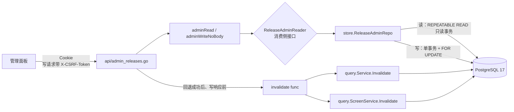

# admin-release 设计

Feature Name: admin-release
Spec Directory: 2026-11-14-admin-release
Updated: 2026-11-14

## Description

本 spec 交付管理端的版本只读视图与回退：五个 HTTP 端点、版本读取与大节折叠、两版差异的汇总与分页、回退事务、异常数据聚合、公开查询缓存失效钩子。数据来源是 `collect-pipeline` 已交付的发布事务写入的 `release` / `observation` / `release_room_building`，以及 `collect-runner` 写入的 `collect_run` / `collect_run_room`。

只做后端：不新增前端页面、不改表结构、不新增迁移、不新增索引、不改 `publish.Commit`。所有端点挂在管理端前缀下，复用 `admin-bootstrap` 的会话与 CSRF 中间件、`admin-settings-sync` 的分页与错误契约。

## 设计决策（已确认与本文件决策）

| 编号 | 决策 | 理由 |
|---|---|---|
| D1 | **不新建 `internal/adminrelease` 包**：HTTP 处理器放 `api`，SQL 与事务放 `store`；`api` 用消费侧接口 `ReleaseAdminReader` 依赖 `store` 的实现 | 仓库既有分层是「api 只做 HTTP/参数/形状，store 是唯一持 SQL 的层」（`admin_runs.go` + `store/runstatus.go` 是同一形状）。新建包要么把 SQL 留在 store、对比逻辑放新包造成两处分裂，要么让新包绕过 store 直持 pgx，与 `backend/.golangci.yml` 的 depguard 规则冲突 |
| D2 | **版本顺序用 `release.generated_at`**，`released_at` 从 `collect_run` 左连接补充（可空） | `release` 表没有 `released_at` 列（`migrations/0001_baseline.sql:85`）；「上一版」的既有口径就是 `generated_at` 次新（`store/publish.go:239` 的 `deleteOlderReleasesSQL`）。改用其它列会让列表顺序与发布事务的保留口径分叉 |
| D3 | **对比键加周**：`房号 × 周 × 星期 × 大节` | `observation.state_key` 是逐周存储的（PK 含 `week`），一个版本覆盖窗口内至多 4 周；只用三元组无法把 4 个周的状态压成一个标量。周加进键后，每个键在每个版本内唯一，差异才能是集合上的划分（CP3、CP4） |
| D4 | **大节折叠按各版本自己的 `axis_version`**，格状态取块内 `min(state_key)`；块内出现多个 `state_key` 时计入 `inconsistent_blocks`，不静默 | 发布侧按大节计数未知/复合（`publish/build.go:168`），异常视图必须同口径；正常数据块内一致（Requirement 7.6 的展开规则），异常时用 `min` 保证结果确定并把异常暴露给管理员 |
| D5 | **三类格差异之外，保留房间与归属两个小节**（`section=rooms|buildings`） | PRD 5.4 / 8.3 与原 spec Requirement 24.1 要求「房间新增/消失、归属变化」可查；只在汇总里给计数会让这两类无法定位到房号，因此在同一端点用 `section` 提供两个附加分页小节，默认仍是 `cells` |
| D6 | **分页用 `limit`/`offset`，`total` 由同一快照的汇总块推导**，明细语句不再算一次 `count(*)` | 与 `/api/query`、`/api/admin/runs` 的既有分页写法一致；汇总已在同一只读事务里算过三类计数，再算一次 count 等于把最重的折叠做第三遍 |
| D7 | **回退事务锁序固定为「当前版本行 → 目标版本行」**，唯一索引 `release_one_current` 兜底；`40P01` 映射 `40906`，`23505` 映射 `40904` | 发布事务的顺序是 demote 当前（`store/publish.go:215`）→ promote 新版本（`:222`）→ 删更早版本（`:239`）。回退先锁当前行与该顺序对齐，避免「回退持目标等当前、发布持当前等目标」的环；并发下仍可能死锁，交给 40906 让调用方重试 |
| D8 | **回退成功后清公开查询缓存**：`query.Service.Invalidate()` + `query.ScreenService.Invalidate()`，由 `api.WithReleaseAdmin` 的 `invalidate func()` 回调在写响应前调用 | 空教室与全天状态有 30 秒 TTL（`query/cache.go:10`、`:107`），大屏固定 30 秒（`query/screen.go:163`）。不清缓存时回退最多 30 秒后才对访客生效，违背 Requirement 24.3 / 6.1 |
| D9 | **新增业务码 `40904`（不可回退）、`40905`（跨学期）、`40906`（并发冲突）**；`40401` 复用 `api/admin_runs.go` 的数值但独立常量 | 409 家族已有 `40901`（同步进行中）、`40902`（已初始化）、`40903`（密钥文件已存在）；前端按码分支，不能把三种原因压成一个 |
| D10 | **不改表、不加索引、不新增迁移** | 既有主键前缀已覆盖全部访问路径：`observation(release_id, room_id, term, week, weekday, node)` 的前缀就是按版本扫描；`axis_node(axis_version, node)` 是主键；`release_room_building(release_id, room_id)` 是主键；`release` 行数上限 2，不需要额外索引 |
| D11 | **未归属教室清单不做** | 发布侧丢弃没有归属的格（`collector` 导出候选时的 `orphanCells`），`release` 内不会出现「有观测、无归属」的房号，清单恒为空。房间目录里的未归属记录属于另一条读取路径 |
| D12 | **异常计数按大节**，与 `collect_run.unknown_cells` 同口径 | `publish/build.go:716` 的大节计数是管理员已经在运行详情里看过的数字；异常视图改成小节计数会翻 2–3 倍，两个页面互相矛盾 |
| D13 | **版本 id 形状先校验**（`^\d{8}T\d{6}Z$`）再查库 | 形状与 `publish.releaseIdentifier` 的 `20060102T150405Z` 一致（`publish/commit.go:22`）；非法 id 不该打到数据库，也不该被 404 掩盖成「版本不存在」 |

## Architecture



两条路径：

- **读路径**（列表、详情、对比、异常）：`adminRead`（no-store → 会话 → 业务）→ 消费侧接口 → store。版本集合与统计来自同一个 `REPEATABLE READ` 只读事务：发布事务会删更早版本，多语句读若跨快照，可能出现「汇总里还有这一版、明细里已经没了」的半份结果。
- **写路径**（回退）：`adminWriteNoBody`（no-store → 会话 → CSRF → 业务）→ store 的回退事务 → 提交成功后调 `invalidate` → 写 200。回退不碰 `observation`、不改轮次、不删除版本。

## 依赖方向

沿用 `backend/.golangci.yml` 的现有规则，**不新增包规则**：

- `api` 允许 import `store`、`query`、`model`（既有规则已放行）。新文件只在 `api` 内新增消费侧接口与 DTO，不新增反向依赖。
- `store` 只 import `model`、`pgx`、`migrations`（既有规则）。
- `query` 只新增两个 `Invalidate` 方法，不新增 import。
- 装配在 `cmd/server/main.go`：`store.NewReleaseAdminRepo(pool)` → `api.WithReleaseAdmin(repo, func(){ queries.Invalidate(); screenService.Invalidate() })`。

编译期断言（写在 `main.go` 的装配段，与 `var _ auth.AdminStore = store.AdminRepo{}` 同风格）：

```go
var _ api.ReleaseAdminReader = store.ReleaseAdminRepo{}
```

`store` 不 import `api`：`api.ReleaseAdminReader` 靠方法集结构匹配，接口定义在消费侧。

## Components and Interfaces

### 目录结构（本轮新增与增量）

```text
backend/internal/store/
  releaseadmin.go              # 版本读取、大节折叠、差异聚合、异常聚合、回退事务
  releaseadmin_test.go         # 纯函数与 SQL 片段（替身 queryer）
  releaseadmin_integration_test.go  # 真实 PostgreSQL 17
backend/internal/api/
  admin_releases.go            # 5 个端点、参数门、DTO、错误映射、装配
  admin_releases_test.go       # 契约测试（替身 reader）
backend/internal/query/
  cache.go                     # ttlCache.clear()、Service.Invalidate()
  screen.go                    # ScreenService.Invalidate()
  cache_test.go                # clear 后同键重新查库
backend/internal/e2e/
  admin_release_test.go        # 真实库 + httptest：对比 → 回退 → 公开查询立即生效
backend/cmd/server/main.go     # 装配 ReleaseAdminRepo 与 invalidate 回调
```

### 接口签名

```go
// store/releaseadmin.go

type ReleaseSummary struct {
    ReleaseID       string
    Term            string
    GeneratedAt     time.Time
    ReleasedAt      *time.Time // collect_run.released_at；没有关联轮次时为 nil
    IsCurrent       bool
    HasAttrConflict bool
    WeekCount       int   // count(DISTINCT week)
    ObservationRows int64 // 小节粒度的观测行数
    Rooms           int   // release_room_building 行数
    DictVersion     int
    AxisVersion     int
}

type ReleaseStats struct {
    ObservationRows int64
    BlockCells      int // 该版格数：房号 × 周 × 星期 × 大节
    WeekCount       int
    Rooms           int
    Buildings       int
}

type ReleaseWeekCount struct {
    Week            int
    ObservationRows int64
    BlockCells      int
}

type ReleaseBuildingCount struct {
    BuildingID   string
    BuildingName string
    Rooms        int
}

// 名字避开 publish.go 里已占用的 ReleaseDetail（occupancy_detail 的一行）。
type ReleaseDetailView struct {
    Release        ReleaseSummary
    Stats          ReleaseStats
    WeekCounts     []ReleaseWeekCount    // 按 week 升序
    BuildingCounts []ReleaseBuildingCount // 按 building_id 升序
}

type DiffSection string

const (
    DiffSectionCells     DiffSection = "cells"
    DiffSectionRooms     DiffSection = "rooms"
    DiffSectionBuildings DiffSection = "buildings"
)

type DiffKind string

const (
    DiffKindAll     DiffKind = "all"     // 不做类别过滤
    DiffKindAdded   DiffKind = "added"
    DiffKindRemoved DiffKind = "removed"
    DiffKindChanged DiffKind = "changed"
)

type ReleaseDiffParams struct {
    From    string
    To      string
    Section DiffSection
    Kind    DiffKind
    Limit   int
    Offset  int
}

type ReleaseSide struct {
    ReleaseID       string
    Term            string
    GeneratedAt     time.Time
    DictVersion     int
    AxisVersion     int
    IsCurrent       bool
    HasAttrConflict bool
}

type DiffCellsSummary struct {
    Added   int
    Removed int
    Changed int
    Total   int
}

type DiffRoomsSummary struct {
    Added           int
    Removed         int
    Shared          int
    BuildingChanged int
}

type StateDelta struct {
    From  int
    To    int
    Delta int
}

type ReleaseDiffSummary struct {
    Cells              DiffCellsSummary
    Rooms              DiffRoomsSummary
    Unknown            StateDelta
    Composite          StateDelta
    InconsistentBlocks int
    SameTerm           bool
}

type DiffCellRow struct {
    Kind        DiffKind
    RoomID      string
    RoomName    string
    Week        int
    Weekday     int
    Block       string
    FromState   *string // 只出现在 to 时为 nil
    ToState     *string // 只出现在 from 时为 nil
    FromBuilding *string
    ToBuilding   *string
}

type DiffRoomRow struct {
    Kind         DiffKind // added / removed
    RoomID       string
    RoomName     string
    FromBuilding *string
    ToBuilding   *string
    FromBuildingName *string
    ToBuildingName   *string
}

type DiffBuildingRow struct {
    RoomID           string
    RoomName         string
    FromBuilding     string
    FromBuildingName string
    ToBuilding       string
    ToBuildingName   string
}

type ReleaseDiff struct {
    From      ReleaseSide
    To        ReleaseSide
    Summary   ReleaseDiffSummary
    Cells     []DiffCellRow     // section=cells 时填充，否则为空切片
    Rooms     []DiffRoomRow     // section=rooms
    Buildings []DiffBuildingRow // section=buildings
}

type StateRatio struct {
    Cells int
    Ratio float64 // 4 位小数，round(cells/blockCells, 4)
}

type ReleaseWindow struct {
    Start int
    End   int
}

type ConflictRoom struct {
    RoomID             string
    BuildingID         string
    ConflictBuildingID string
}

type ReleaseAnomaly struct {
    ReleaseID              string
    Term                   string
    GeneratedAt            time.Time
    IsCurrent              bool
    HasAttrConflict        bool
    Unknown                StateRatio
    Composite              StateRatio
    ObservedWeeks          []int
    WeekGaps               []int
    Window                 *ReleaseWindow
    ConflictRooms          []ConflictRoom
    ConflictRoomsTruncated bool
}

type RollbackResult struct {
    RolledBackFrom string // 原当前版本；库中没有当前版本时不会走到这里
    CurrentReleaseID string
    Term           string
}

// 回退的原因由哨兵区分，api 按错误码映射。
var (
    ErrReleaseNotFound       = errors.New("发布版本不存在")
    ErrReleaseNotRollbackable = errors.New("版本不可回退")
    ErrReleaseTermMismatch   = errors.New("回退目标与当前版本学期不同")
    ErrReleaseConflict       = errors.New("回退并发冲突")
)

type releaseAdminPool interface {
    BeginTx(ctx context.Context, tx pgx.TxOptions) (pgx.Tx, error)
    Query(ctx context.Context, sql string, args ...any) (pgx.Rows, error)
    QueryRow(ctx context.Context, sql string, args ...any) pgx.Row
}

type ReleaseAdminRepo struct{ /* 连接池 */ }

func NewReleaseAdminRepo(pool releaseAdminPool) ReleaseAdminRepo

func (r ReleaseAdminRepo) List(ctx context.Context) ([]ReleaseSummary, error)
func (r ReleaseAdminRepo) Detail(ctx context.Context, releaseID string) (ReleaseDetailView, bool, error)
func (r ReleaseAdminRepo) Diff(ctx context.Context, params ReleaseDiffParams) (ReleaseDiff, error)
func (r ReleaseAdminRepo) Anomalies(ctx context.Context) ([]ReleaseAnomaly, error)
func (r ReleaseAdminRepo) Rollback(ctx context.Context, targetID string) (RollbackResult, error)
```

```go
// api/admin_releases.go

// ReleaseAdminReader 是 api 对版本仓储的消费侧接口，方法集是 store.ReleaseAdminRepo 的子集。
type ReleaseAdminReader interface {
    List(ctx context.Context) ([]store.ReleaseSummary, error)
    Detail(ctx context.Context, releaseID string) (store.ReleaseDetailView, bool, error)
    Diff(ctx context.Context, params store.ReleaseDiffParams) (store.ReleaseDiff, error)
    Anomalies(ctx context.Context) ([]store.ReleaseAnomaly, error)
    Rollback(ctx context.Context, releaseID string) (store.RollbackResult, error)
}

// WithReleaseAdmin 装配版本仓储与回退后的缓存失效回调。
// invalidate 为 nil 时跳过失效（测试或未装配查询缓存的进程）；reader 为 nil 时
// 五个端点仍注册并按 50000 返回（与 WithRunStatus/WithAdminSettings 同口径）。
func WithReleaseAdmin(reader ReleaseAdminReader, invalidate func()) Option
```

```go
// query/cache.go、query/screen.go

// Invalidate 清空本服务的结果缓存。回退切换当前版本后由装配层的回调调用，
// 使下一次公开查询不命中旧版本的结果。
func (s *Service) Invalidate()
func (s *ScreenService) Invalidate()
```

错误码常量（`api/admin_releases.go`）：

```go
const (
    codeReleaseNotFound     = 40401 // 数值沿用 codeRunNotFound；独立常量，消息不同
    codeReleaseNotRollback  = 40904 // 已是当前 / 没有当前 / 并发后到
    codeReleaseTermMismatch = 40905 // 跨学期回退
    codeReleaseConflict     = 40906 // 40P01 死锁或 40001 序列化失败
)
```

### 管理 API 契约

统一响应仍是 `{code, message, data, request_id}`；时间 RFC3339 UTC；所有响应带 `Cache-Control: no-store`；`data` 在失败时恒为 `null`（沿用 `admin-bootstrap`）。

| 方法 | 路径 | 鉴权 | 参数 | 说明 |
|---|---|---|---|---|
| GET | `/api/admin/releases` | 会话 | — | 列表，`generated_at` 倒序 |
| GET | `/api/admin/releases/diff` | 会话 | `from`、`to` 必填；`section`、`kind`、`limit`、`offset` 可选 | 汇总 + 所选小节分页 |
| GET | `/api/admin/releases/{release_id}` | 会话 | 路径参数 | 详情 + 逐周/按楼统计 |
| POST | `/api/admin/releases/{release_id}/rollback` | 会话 + CSRF | 无请求体 | 200；不要求 `Content-Type` |
| GET | `/api/admin/anomalies` | 会话 | — | 每个在库版本的异常聚合 |

`GET /api/admin/releases` 成功响应：

```json
{
  "code": 0,
  "message": "success",
  "data": {
    "releases": [
      {
        "release_id": "20261114T030512Z",
        "term": "2026-2027-1",
        "generated_at": "2026-11-14T03:05:12Z",
        "released_at": "2026-11-14T03:06:40Z",
        "is_current": true,
        "has_attr_conflict": false,
        "week_count": 4,
        "observation_rows": 871320,
        "rooms": 2481,
        "dict_version": 1,
        "axis_version": 1
      },
      {
        "release_id": "20261028T041500Z",
        "term": "2026-2027-1",
        "generated_at": "2026-10-28T04:15:00Z",
        "released_at": "2026-10-28T04:16:22Z",
        "is_current": false,
        "has_attr_conflict": true,
        "week_count": 4,
        "observation_rows": 869904,
        "rooms": 2481,
        "dict_version": 1,
        "axis_version": 1
      }
    ],
    "total": 2
  },
  "request_id": "req_8a3c..."
}
```

`GET /api/admin/releases/20261114T030512Z` 成功响应：

```json
{
  "code": 0,
  "message": "success",
  "data": {
    "release": { "...": "同上单条" },
    "stats": {
      "observation_rows": 871320,
      "block_cells": 363050,
      "week_count": 4,
      "rooms": 2481,
      "buildings": 26
    },
    "week_counts": [
      { "week": 9, "observation_rows": 217830, "block_cells": 90762 }
    ],
    "building_counts": [
      { "building_id": "Q03", "building_name": "老文史楼", "rooms": 86 }
    ]
  },
  "request_id": "req_..."
}
```

`GET /api/admin/releases/diff?from=20261028T041500Z&to=20261114T030512Z` 成功响应（`section` 缺省 `cells`）：

```json
{
  "code": 0,
  "message": "success",
  "data": {
    "from": {
      "release_id": "20261028T041500Z", "term": "2026-2027-1",
      "generated_at": "2026-10-28T04:15:00Z", "dict_version": 1, "axis_version": 1,
      "is_current": false, "has_attr_conflict": true
    },
    "to": {
      "release_id": "20261114T030512Z", "term": "2026-2027-1",
      "generated_at": "2026-11-14T03:05:12Z", "dict_version": 1, "axis_version": 1,
      "is_current": true, "has_attr_conflict": false
    },
    "summary": {
      "cells": { "added": 120, "removed": 35, "changed": 2048, "total": 2203 },
      "rooms": { "added": 2, "removed": 1, "shared": 2478, "building_changed": 3 },
      "unknown": { "from": 12, "to": 0, "delta": -12 },
      "composite": { "from": 51, "to": 48, "delta": -3 },
      "inconsistent_blocks": 0,
      "same_term": true
    },
    "items": [
      {
        "kind": "changed",
        "room_id": "0899", "room_name": "F126",
        "week": 9, "weekday": 1, "block": "0102",
        "from_state": "free", "to_state": "class",
        "from_building": "Q10", "to_building": "Q10"
      }
    ],
    "total": 2203,
    "limit": 50,
    "offset": 0,
    "section": "cells",
    "kind": "all"
  },
  "request_id": "req_..."
}
```

`section=rooms` 的 `items`：

```json
[
  { "kind": "added", "room_id": "Q10-0999", "room_name": "F126",
    "from_building": null, "to_building": "Q10",
    "from_building_name": null, "to_building_name": "综合教学楼" },
  { "kind": "removed", "room_id": "Q03-0101", "room_name": "JA101",
    "from_building": "Q03", "to_building": null,
    "from_building_name": "老文史楼", "to_building_name": null }
]
```

`section=buildings` 的 `items`（`kind` 恒为 `changed`）：

```json
[
  { "kind": "changed", "room_id": "0899", "room_name": "F126",
    "from_building": "Q10", "from_building_name": "综合教学楼",
    "to_building": "Q03", "to_building_name": "老文史楼" }
]
```

`POST /api/admin/releases/20261028T041500Z/rollback` 成功响应：

```json
{
  "code": 0,
  "message": "success",
  "data": {
    "rolled_back_from": "20261114T030512Z",
    "current_release_id": "20261028T041500Z",
    "term": "2026-2027-1"
  },
  "request_id": "req_..."
}
```

失败响应举例：

```json
// 404：目标版本不存在
{ "code": 40401, "message": "发布版本不存在", "data": null, "request_id": "req_..." }

// 409：目标已是当前版本 / 没有当前版本
{ "code": 40904, "message": "目标版本已是当前版本，不能回退", "data": null, "request_id": "req_..." }

// 409：跨学期
{ "code": 40905, "message": "目标版本属于学期 2025-2026-2，与当前版本 2026-2027-1 不同，不能回退", "data": null, "request_id": "req_..." }

// 409：并发冲突
{ "code": 40906, "message": "回退与另一次版本变更并发冲突，请重试", "data": null, "request_id": "req_..." }
```

`GET /api/admin/anomalies` 成功响应：

```json
{
  "code": 0,
  "message": "success",
  "data": {
    "releases": [
      {
        "release_id": "20261114T030512Z",
        "term": "2026-2027-1",
        "generated_at": "2026-11-14T03:05:12Z",
        "is_current": true,
        "has_attr_conflict": false,
        "unknown": { "cells": 0, "ratio": 0 },
        "composite": { "cells": 48, "ratio": 0.0001 },
        "observed_weeks": [9, 10, 11, 12],
        "week_gaps": [],
        "window": { "start": 9, "end": 12 },
        "conflict_rooms": [],
        "conflict_rooms_truncated": false
      },
      {
        "release_id": "20261028T041500Z",
        "term": "2026-2027-1",
        "generated_at": "2026-10-28T04:15:00Z",
        "is_current": false,
        "has_attr_conflict": true,
        "unknown": { "cells": 12, "ratio": 0 },
        "composite": { "cells": 51, "ratio": 0.0001 },
        "observed_weeks": [5, 6, 7, 8],
        "week_gaps": [],
        "window": { "start": 5, "end": 8 },
        "conflict_rooms": [
          { "room_id": "0899", "building_id": "Q10", "conflict_building_id": "Q03" }
        ],
        "conflict_rooms_truncated": false
      }
    ]
  },
  "request_id": "req_..."
}
```

约束：

- 参数门在查库之前：`release_id` 形状、`from`/`to` 形状与不等、`section` 取值、`kind` 与 `section` 的匹配、`limit` 1–200、`offset ≥ 0`；任一不合规都是 400 + `40001`，仓储零调用。
- `section=buildings` 时 `kind` 只接受 `all` 与 `changed`；`section=rooms` 只接受 `all`、`added`、`removed`；`section=cells` 接受四个取值。
- `kind` 回显生效值：未过滤时回 `"all"`，过滤时回实际类别。
- 未装配 `WithReleaseAdmin` 时五个端点仍注册并按 `50000` 返回，避免 `main.go` 漏装配被 404 掩盖。
- 回退成功不额外写日志；若实现要补一条成功日志，字段严格限于五项白名单（`request_id`/方法/路径/状态码/业务码），不写版本 id、学期或任何表内容。
- `data` 键集合固定，新增字段必须先改本文件（CP13）。

## SQL 与索引

**不新增索引、不新增迁移。** 用到的既有对象与访问路径：

| 表 | 用到的列 | 访问方式 | 既有索引 |
|---|---|---|---|
| `release` | 全部 | 全表（≤2 行） | PK `release_id`、部分唯一索引 `release_one_current` |
| `observation` | `release_id, room_id, week, weekday, node, state_key` | 按 `release_id` 前缀扫 | PK `(release_id, room_id, term, week, weekday, node)` |
| `axis_node` | `axis_version, node, block` | 按 `(axis_version, node)` 点查 | PK `(axis_version, node)` |
| `release_room_building` | `release_id, room_id, building_id, building_name` | 按 `release_id` 前缀扫 | PK `(release_id, room_id)` |
| `room` | `room_id, name` | 按 `room_id` 点查 | PK `room_id` |
| `collect_run` | `release_id, released_at, window_start, window_end, run_id` | 按 `release_id` 过滤（≤ 数千行） | PK `run_id`；`release_id` 无索引，全表在管理端可接受 |
| `collect_run_room` | `run_id, room_id, conflict, building_id, conflict_building_id` | 按 `run_id` 前缀扫 | PK `(run_id, room_id)` |

### 版本列表

`released_at` 取该版本关联轮次的最大发布时刻（正常至多一轮；`max` 让手工修数据的重复关联也不产生多行）：

```sql
SELECT r.release_id, r.term, r.generated_at, r.dict_version, r.axis_version,
       r.has_attr_conflict, r.is_current,
       run.released_at,
       COALESCE(obs.observation_rows, 0), COALESCE(obs.week_count, 0),
       COALESCE(rooms.rooms, 0)
  FROM release r
  LEFT JOIN LATERAL (
        SELECT max(cr.released_at) AS released_at
          FROM collect_run cr
         WHERE cr.release_id = r.release_id
       ) run ON true
  LEFT JOIN LATERAL (
        SELECT count(*) AS observation_rows, count(DISTINCT o.week) AS week_count
          FROM observation o
         WHERE o.release_id = r.release_id
       ) obs ON true
  LEFT JOIN LATERAL (
        SELECT count(*) AS rooms
          FROM release_room_building b
         WHERE b.release_id = r.release_id
       ) rooms ON true
 ORDER BY r.generated_at DESC, r.release_id DESC
```

每个 LATERAL 都是「按 release_id 前缀扫一次 + 聚合」，两个版本共两次索引扫描；列表没有分页（`release` 上限 2 行，分页没有意义）。

### 版本详情

三条语句，包在一个 `REPEATABLE READ READ ONLY` 事务里（`release` 可能被并发发布删除）。头语句**不带**观测聚合：`week_count` / `observation_rows` / `block_cells` 由第 2 条算出，避免为同一个版本再扫一遍 87 万行：

```sql
-- 1) 头：release 列 + released_at + 归属快照房号数（都不碰 observation）
SELECT r.release_id, r.term, r.generated_at, r.dict_version, r.axis_version,
       r.has_attr_conflict, r.is_current, run.released_at,
       (SELECT count(*) FROM release_room_building b WHERE b.release_id = r.release_id) AS rooms
  FROM release r
  LEFT JOIN LATERAL (
        SELECT max(cr.released_at) AS released_at
          FROM collect_run cr WHERE cr.release_id = r.release_id
       ) run ON true
 WHERE r.release_id = $1;

-- 2) 逐周计数：一次扫出观测行数与大节格数
SELECT o.week,
       count(*) AS observation_rows,
       count(DISTINCT (o.room_id, o.weekday, an.block)) AS block_cells
  FROM observation o
  JOIN axis_node an ON an.axis_version = $2 AND an.node = o.node
 WHERE o.release_id = $1
 GROUP BY o.week
 ORDER BY o.week;

-- 3) 按楼计数：归属快照很小
SELECT b.building_id, b.building_name, count(*) AS rooms
  FROM release_room_building b
 WHERE b.release_id = $1
 GROUP BY b.building_id, b.building_name
 ORDER BY b.building_id;
```

`release.week_count` 与 `release.observation_rows` 也来自第 2 条：`stats.observation_rows` = `week_counts` 的 `observation_rows` 之和、`stats.block_cells` = `block_cells` 之和、`stats.week_count` = `len(week_counts)`、`release.observation_rows` 同上、`release.week_count` 同上；`stats.rooms` = 头语句的归属快照行数；`stats.buildings` = `len(building_counts)`。所有合计由两份结果拼出，不再发额外聚合语句。

`count(DISTINCT (a,b,c))` 是 PostgreSQL 的行构造去重：同一格内的 2–3 个小节只算一个格。

### 对比：两侧折叠

对比的基元是「每个版本各自的格集合」，用同一条 CTE 折叠。参数固定为 `$1` = `from` 的 `axis_version`、`$2` = `from` 的 `release_id`、`$3` = `to` 的 `axis_version`、`$4` = `to` 的 `release_id`；汇总、`cells` 分页与下文都沿用这一编号：

```sql
WITH f AS (
  SELECT o.room_id, o.week, o.weekday, an.block,
         min(o.state_key) AS state_key,
         max(o.state_key) AS max_state
    FROM observation o
    JOIN axis_node an ON an.axis_version = $1 AND an.node = o.node
   WHERE o.release_id = $2
   GROUP BY o.room_id, o.week, o.weekday, an.block
), t AS (
  SELECT o.room_id, o.week, o.weekday, an.block,
         min(o.state_key) AS state_key,
         max(o.state_key) AS max_state
    FROM observation o
    JOIN axis_node an ON an.axis_version = $3 AND an.node = o.node
   WHERE o.release_id = $4
   GROUP BY o.room_id, o.week, o.weekday, an.block
), j AS (
  SELECT COALESCE(f.room_id, t.room_id) AS room_id,
         COALESCE(f.week, t.week)       AS week,
         COALESCE(f.weekday, t.weekday) AS weekday,
         COALESCE(f.block, t.block)     AS block,
         f.state_key AS from_state,
         t.state_key AS to_state,
         CASE WHEN f.room_id IS NULL THEN 'added'
              WHEN t.room_id IS NULL THEN 'removed'
              WHEN f.state_key <> t.state_key THEN 'changed'
              ELSE 'same' END AS kind,
         (f.max_state IS NOT NULL AND f.max_state <> f.state_key)
           OR (t.max_state IS NOT NULL AND t.max_state <> t.state_key) AS inconsistent
    FROM f
    FULL JOIN t USING (room_id, week, weekday, block)
)
```

- 折叠键 `(room_id, week, weekday, block)` 在单个版本内唯一：`observation` 的 PK 含 `release_id` 与 `node`，一个 `node` 只属于一个 `block`，`term` 在一个版本内是常量。
- `min(state_key)` 是块的确定状态；`max_state <> state_key` 说明块内不一致，计入 `inconsistent_blocks`。正常数据下两者相等（发布侧展开保证），出现不一致时差异结果仍可复现。
- 两侧 `axis_version` 不同（轴改版）时仍按 `block` 编码比较，响应里回显两侧版本；块语义变化由管理员从 `axis_version` 看出。

### 对比：汇总

汇总与明细在同一个只读事务里执行；汇总**一条语句**算完三类格计数、不一致块、未知/复合与房间计数，`f` / `t` 各只折叠一次：

```sql
WITH f AS (...), t AS (...), j AS (...),          -- 与上文同一段折叠 CTE
     rf AS (SELECT room_id, building_id, building_name
              FROM release_room_building WHERE release_id = $2),
     rt AS (SELECT room_id, building_id, building_name
              FROM release_room_building WHERE release_id = $4),
     cells AS (
       SELECT count(*) FILTER (WHERE kind = 'added')   AS added,
              count(*) FILTER (WHERE kind = 'removed') AS removed,
              count(*) FILTER (WHERE kind = 'changed') AS changed,
              count(*) FILTER (WHERE inconsistent)     AS inconsistent_blocks
         FROM j),
     states AS (
       SELECT count(*) FILTER (WHERE state_key = 'unknown'   AND src = 'f') AS f_unknown,
              count(*) FILTER (WHERE state_key = 'composite' AND src = 'f') AS f_composite,
              count(*) FILTER (WHERE state_key = 'unknown'   AND src = 't') AS t_unknown,
              count(*) FILTER (WHERE state_key = 'composite' AND src = 't') AS t_composite
         FROM (SELECT 'f' AS src, state_key FROM f
               UNION ALL
               SELECT 't', state_key FROM t) u),
     rooms AS (
       SELECT count(*) FILTER (WHERE rf.room_id IS NULL) AS added,
              count(*) FILTER (WHERE rt.room_id IS NULL) AS removed,
              count(*) FILTER (WHERE rf.room_id IS NOT NULL AND rt.room_id IS NOT NULL) AS shared,
              count(*) FILTER (WHERE rf.room_id IS NOT NULL AND rt.room_id IS NOT NULL
                                 AND rf.building_id <> rt.building_id) AS building_changed
         FROM rf FULL JOIN rt USING (room_id))
SELECT cells.added, cells.removed, cells.changed, cells.inconsistent_blocks,
       states.f_unknown, states.f_composite, states.t_unknown, states.t_composite,
       rooms.added AS room_added, rooms.removed AS room_removed,
       rooms.shared AS room_shared, rooms.building_changed AS room_building_changed
  FROM cells CROSS JOIN states CROSS JOIN rooms;
```

`cells.total` = added + removed + changed；`unknown.delta` = to − from。`f` / `t` 是被多次引用的非递归 CTE，PostgreSQL 只物化一次；`states` 的 `UNION ALL` 让两侧未知/复合计数只扫一遍。整个汇总一条语句、一个快照。

### 对比：明细分页

`cells` 小节（沿用折叠的 `$1`–`$4`；`$5` 是 `kind`（`all` 表示不过滤）；`$6`/`$7` 是 `limit`/`offset`）：

```sql
WITH f AS (...), t AS (...), j AS (...)   -- 与汇总同一段 CTE
, page AS (
  SELECT kind, room_id, week, weekday, block, from_state, to_state
    FROM j
   WHERE kind <> 'same'
     AND ($5 = 'all' OR kind = $5)
   ORDER BY room_id, week, weekday, block
   LIMIT $6 OFFSET $7
)
SELECT p.kind, p.room_id, p.week, p.weekday, p.block, p.from_state, p.to_state,
       COALESCE(r.name, '') AS room_name,
       fb.building_id AS from_building,
       tb.building_id AS to_building
  FROM page p
  LEFT JOIN room r  ON r.room_id = p.room_id
  LEFT JOIN release_room_building fb ON fb.release_id = $2 AND fb.room_id = p.room_id
  LEFT JOIN release_room_building tb ON tb.release_id = $4 AND tb.room_id = p.room_id
 ORDER BY p.room_id, p.week, p.weekday, p.block
```

`rooms` 小节（独立语句：`$1` 是 `from`、`$2` 是 `to`、`$3` 是 `kind`、`$4`/`$5` 是 `limit`/`offset`）：

```sql
WITH f AS (SELECT room_id, building_id, building_name
             FROM release_room_building WHERE release_id = $1),
     t AS (SELECT room_id, building_id, building_name
             FROM release_room_building WHERE release_id = $2),
     page AS (
       SELECT CASE WHEN f.room_id IS NULL THEN 'added' ELSE 'removed' END AS kind,
              COALESCE(f.room_id, t.room_id) AS room_id,
              f.building_id AS from_building, f.building_name AS from_building_name,
              t.building_id AS to_building,   t.building_name AS to_building_name
         FROM f FULL JOIN t USING (room_id)
        WHERE (f.room_id IS NULL OR t.room_id IS NULL)
          AND ($3 = 'all'
               OR ($3 = 'added'   AND f.room_id IS NULL)
               OR ($3 = 'removed' AND t.room_id IS NULL))
        ORDER BY room_id
        LIMIT $4 OFFSET $5
     )
SELECT p.kind, p.room_id, COALESCE(r.name, '') AS room_name,
       p.from_building, p.from_building_name, p.to_building, p.to_building_name
  FROM page p LEFT JOIN room r ON r.room_id = p.room_id
 ORDER BY p.room_id
```

`buildings` 小节（独立语句：`$1`/`$2` 是两版、`$3`/`$4` 是 `limit`/`offset`；`kind` 恒为 `changed`）：

```sql
WITH f AS (SELECT room_id, building_id, building_name
             FROM release_room_building WHERE release_id = $1),
     t AS (SELECT room_id, building_id, building_name
             FROM release_room_building WHERE release_id = $2),
     page AS (
       SELECT f.room_id,
              f.building_id AS from_building, f.building_name AS from_building_name,
              t.building_id AS to_building,   t.building_name AS to_building_name
         FROM f JOIN t USING (room_id)
        WHERE f.building_id <> t.building_id
        ORDER BY room_id
        LIMIT $3 OFFSET $4
     )
SELECT p.*, COALESCE(r.name, '') AS room_name
  FROM page p LEFT JOIN room r ON r.room_id = p.room_id
 ORDER BY p.room_id
```

分页语义：

- 排序键 `(room_id, week, weekday, block)`（`rooms`/`buildings` 为 `room_id`）在差异集合内唯一，同一请求重复执行返回同一页。
- 明细分页不返回行数统计；`total` 从汇总推导：`cells` 取 `summary.cells` 的对应项（`all` 取 `total`），`rooms` 取 `added`/`removed`/两者之和，`buildings` 取 `building_changed`。汇总与明细同快照，推导值必然一致（CP6）。
- `offset` 超过末页时返回空 `items`，`total` 仍为真实值。

### 异常聚合

一条语句按版本 LATERAL 折叠（折叠用各版本自己的 `axis_version`），窗口从发布轮次取：

```sql
SELECT r.release_id, r.term, r.generated_at, r.is_current, r.has_attr_conflict,
       COALESCE(s.observation_rows, 0), COALESCE(s.block_cells, 0),
       COALESCE(s.unknown_cells, 0),    COALESCE(s.composite_cells, 0),
       COALESCE(s.observed_weeks, '{}'::int[]),
       w.window_start, w.window_end
  FROM release r
  LEFT JOIN LATERAL (
        SELECT sum(blk.node_rows)::bigint AS observation_rows,
               count(*)                   AS block_cells,
               count(*) FILTER (WHERE blk.state_key = 'unknown')   AS unknown_cells,
               count(*) FILTER (WHERE blk.state_key = 'composite') AS composite_cells,
               array_agg(DISTINCT blk.week::int ORDER BY blk.week::int) AS observed_weeks
          FROM (
                SELECT o.room_id, o.week, o.weekday, an.block,
                       min(o.state_key) AS state_key,
                       count(*) AS node_rows
                  FROM observation o
                  JOIN axis_node an ON an.axis_version = r.axis_version AND an.node = o.node
                 WHERE o.release_id = r.release_id
                 GROUP BY o.room_id, o.week, o.weekday, an.block
               ) blk
       ) s ON true
  LEFT JOIN LATERAL (
        SELECT cr.window_start, cr.window_end
          FROM collect_run cr
         WHERE cr.release_id = r.release_id
         ORDER BY cr.run_id DESC
         LIMIT 1
       ) w ON true
 ORDER BY r.generated_at DESC, r.release_id DESC
```

`sum(bigint)` 显式转回 `bigint`、`week` 先转 `int` 再聚合，扫描侧用 `[]int32` 接收后转 `[]int`（避免 `numeric` 与 `int2[]` 的扫描歧义）。`week_gaps` 由 Go 侧纯函数从 `observed_weeks` 算出（`[min, max]` 内缺的周），不用 `generate_series`，便于单测。

冲突清单单独一条（按 `has_attr_conflict` 过滤；每版最多取 201 条以识别截断）：

```sql
WITH ranked AS (
  SELECT r.release_id, crr.room_id, crr.building_id, crr.conflict_building_id,
         row_number() OVER (PARTITION BY r.release_id ORDER BY crr.room_id) AS rn
    FROM release r
    JOIN LATERAL (
          SELECT c.run_id FROM collect_run c
           WHERE c.release_id = r.release_id
           ORDER BY c.run_id DESC LIMIT 1
         ) pub ON true
    JOIN collect_run_room crr ON crr.run_id = pub.run_id AND crr.conflict
   WHERE r.has_attr_conflict
)
SELECT release_id, room_id, building_id, conflict_building_id, rn
  FROM ranked
 WHERE rn <= 201
 ORDER BY release_id, rn
```

Go 侧：`rn <= 200` 进 `conflict_rooms`；任一版本出现 `rn = 201` 时该版 `conflict_rooms_truncated = true`。`join LATERAL` 取 `run_id` 最大的一轮：正常一版只由一轮发布；重复关联时取最新一轮并保持确定性。

`ratio` = `round(cells / block_cells, 4)`；`block_cells = 0` 时 `ratio = 0`（空版本在发布侧不可达，仍按 0 处理）。

### 回退事务

```sql
BEGIN ISOLATION LEVEL READ COMMITTED;

-- 1) 先锁当前版本行。与发布事务的 demote 顺序对齐（store/publish.go:215）。
SELECT release_id, term FROM release WHERE is_current FOR UPDATE;

-- 2) 再锁目标版本行。
SELECT release_id, term, is_current FROM release WHERE release_id = $1 FOR UPDATE;

-- Go 侧判定（第 2 步之后、任何 UPDATE 之前）：
--   目标缺行            → ErrReleaseNotFound
--   目标 is_current     → ErrReleaseNotRollbackable
--   当前行缺行          → ErrReleaseNotRollbackable
--   两行 term 不同       → ErrReleaseTermMismatch

-- 3) 降原当前、抬目标；唯一索引保证两者之间不会出现两个 current。
UPDATE release SET is_current = false WHERE is_current;
UPDATE release SET is_current = true  WHERE release_id = $1 AND NOT is_current;

-- 4) 确认目标行数恰为 1，否则回滚。
COMMIT;
```

- 第 3 步的两条 UPDATE 在同一事务内，提交前对外不可见；`release_one_current` 是部分唯一索引，只约束 `is_current = true` 的行，因此「先降后抬」之间零个 current 是允许的。
- `UPDATE ... AND NOT is_current` 让目标行数必须为 1：0 行说明目标在锁与更新之间被改成 current（并发回退）或被删除，整个事务回滚并按 40904 / 40401 映射。
- 错误映射：SQLSTATE `23505`（`release_one_current` 冲突）→ `ErrReleaseConflict` → 40906；SQLSTATE `40P01`（死锁）与 `40001`（序列化失败，注意与业务码 40001 同名不同域）→ 40906；其余 → 包装 `model.ErrQueryFailed`，api 映射 50000。锁序见 CP8。
- 回退不写 `collect_run`：轮次记录的是「这一轮发布了哪一版」，回退是管理动作，不改历史。回退后 current 与「生成时间最新」可能不是同一行：列表首条仍是生成时间最新的版本，`is_current` 标在目标版本上。管理端按 `is_current` 判断当前版本，不能假定首条就是当前版本（CP1）。
- 提交成功后，handler 调 `invalidate`（空教室、全天状态、大屏三处缓存清空），再写 200；失效在响应写出之前完成（CP10）。

### 预算

- 单次 diff 请求执行「汇总」与「明细分页」两条各含两侧折叠的语句：每侧约 87 万观测行 → 约 36 万格。实测目标：单机 PostgreSQL 17、两版各 87 万行时，汇总 + 第一页 ≤ 2 秒；`rooms`/`buildings` 小节 ≤ 50 毫秒。
- 列表两次索引扫描（每版一次观测聚合）；详情一次折叠扫描；异常一次折叠扫描 + 一次冲突点查。
- 若实测超预算，优先把「汇总 + 明细分页」合并为单条语句（同一 CTE 物化一次，用 `to_jsonb(summary)` 随页行返回），不改契约。

## Data Models

**本 spec 不新增 migration。** `migrations/0001_baseline.sql` 与 `0002_collect_run_room.sql` 已提供全部列：

| 表 | 用到的列 | 用途 |
|---|---|---|
| `release` | `release_id, term, generated_at, dict_version, axis_version, has_attr_conflict, is_current` | 版本身份、排序、回退目标 |
| `observation` | `release_id, room_id, term, week, weekday, node, state_key` | 差异与异常的唯一数据源 |
| `axis_node` | `axis_version, node, block, block_ordinal` | 小节 → 大节折叠 |
| `release_room_building` | `release_id, room_id, building_id, building_name` | 房间增删与归属变化 |
| `room` | `room_id, name` | 明细里的房名 |
| `collect_run` | `run_id, release_id, released_at, window_start, window_end` | `released_at`、异常窗口 |
| `collect_run_room` | `run_id, room_id, building_id, conflict, conflict_building_id` | 房号级归属冲突清单 |

不写任何列。`observation.raw_text` 只在库内，任何端点都不返回（CP13）。

> **表名核对**：交接文档写的 `release_observation` / `release_week` 在本仓库不存在；实际表是 `observation`（逐格观测）与 `term_week`（学期日历）。本 spec 以代码与 migration 为准，不虚构表名（见「与既有文档的差异」）。

## Correctness Properties

- **CP1 版本顺序稳定**：列表顺序恒为 `generated_at DESC, release_id DESC`；同一数据两次请求顺序相同；`is_current = true` 的版本至多一条，且在同一次响应里出现一次；回退不改变排序，只移动 `is_current` 标记。
- **CP2 只读端点零写入**：`List` / `Detail` / `Diff` / `Anomalies` 的事务内只有 `SELECT`，不执行 `INSERT` / `UPDATE` / `DELETE`；`Detail` / `Diff` / `Anomalies` 的多语句查询使用 `REPEATABLE READ READ ONLY` 事务，结束时不产生任何写入。
- **CP3 折叠唯一**：同一版本内 `(room_id, week, weekday, block)` 唯一；折叠结果的格数等于 `count(DISTINCT (room_id, week, weekday, block))`，与 `week_counts` 求和一致。
- **CP4 三类差异是划分**：每个差异格恰好属于 `added` / `removed` / `changed` 之一；`summary.cells.total = added + removed + changed`；`cells` 小节在 `kind=all` 时返回的条数（不受分页截断时）等于 `total`。
- **CP5 差异对称**：交换 `from` 与 `to` 后，`added` 与 `removed` 互换、`changed` 不变、`unknown`/`composite` 的 `from`/`to` 互换且 `delta` 取反；`rooms.added` 与 `rooms.removed` 互换，`shared` 与 `building_changed` 不变（以同一份数据为前提）。
- **CP6 分页确定且 total 同源**：排序键唯一，同一 `(section, kind, limit, offset)` 重复请求返回同一页；相邻页无重复、无遗漏；`total` 恒等于汇总里对应类别的计数，`offset` 超末页时 `items` 为空而 `total` 不变。
- **CP7 快照一致**：同一请求的汇总与明细来自同一只读事务；并发发布删掉较旧版本时，请求要么整体看到它、要么在事务开始时返回 40401，不出现半份结果。
- **CP8 回退原子与锁序**：回退事务先锁当前行、再锁目标行；任一步失败后 `is_current` 与 `release` 行数保持操作前的状态；成功提交后恰有一个 current，且等于目标版本。
- **CP9 回退不重建、不删除**：回退前后 `release` 行数、`observation` 行数、`release_room_building` 行数不变；`collect_run.release_id` 与 `released_at` 不变；版本集合仍满足「current + previous」。
- **CP10 缓存失效先于响应**：回退成功的响应写出之前，三处公开缓存已清空；回退成功后的第一次 `/api/query` 读到新当前版本的结果（不只是 30 秒后）；失效回调失败不改变成功响应（回调不返回错误）。
- **CP11 异常口径一致**：`unknown_cells` / `composite_cells` 按「房号 × 周 × 星期 × 大节」计数，同一大节的小节只计一次；`ratio` 分母为该版 `block_cells`，与 `publish` 写入 `collect_run` 的口径同源。
- **CP12 鉴权先于仓储**：缺失会话时仓储零调用；回退缺 CSRF 时仓储零调用；参数非法时仓储零调用。三条都由中间件顺序与 handler 入口的顺序保证，不靠每个方法自查。
- **CP13 响应键封闭**：五个端点的 `data` 只含本文件声明的键；任何响应与日志都不含 `observation.raw_text`、账号、密码、会话、页面正文；回退成功的日志字段不超过五项白名单。
- **CP14 id 形状先校验**：`release_id` 不匹配 `^\d{8}T\d{6}Z$` 时返回 40001，不进入仓储；路径参数不做 URL 解码后的二次解析。
- **CP15 装配缺失可观测**：`reader == nil` 时五个端点返回 50000（不是 40401）；`invalidate == nil` 时回退照常成功，只是不清缓存。

## Error Handling

| 场景 | HTTP | 业务码 | 处理 |
|---|---|---|---|
| 读端点无会话 | 401 | 40101 | `withSession` 拦截，仓储零调用 |
| 回退无会话 | 401 | 40101 | `withSession` 拦截 |
| 回退缺/错 CSRF | 403 | 40301 | `withCSRF` 拦截 |
| `release_id` 形状非法 | 400 | 40001 | handler 在查库前返回；不调仓储 |
| `from`/`to` 缺失、相同、形状非法 | 400 | 40001 | 同上 |
| `section`/`kind`/`limit`/`offset` 非法 | 400 | 40001 | 同上 |
| 目标版本不存在 | 404 | 40401 | `ErrReleaseNotFound` |
| 目标已是当前版本 / 没有当前版本 | 409 | 40904 | `ErrReleaseNotRollbackable` |
| 目标 `term` 与当前不同 | 409 | 40905 | `ErrReleaseTermMismatch` |
| 回退与另一次版本变更并发冲突（SQLSTATE `23505` / `40P01` / `40001`） | 409 | 40906 | `ErrReleaseConflict`；响应文案提示重试。同一目标的并发回退后到者通常走 40904 |
| 回退事务其它失败 | 500 | 50000 | 事务已回滚，原 current 不动 |
| 仓储未装配 | 500 | 50000 | 五个端点都返回，不回落 404 |
| 查询/统计失败（读端点） | 500 | 50000 | 不返回半份结果 |

细节：

- 回退走 `adminWriteNoBody`：链路是 no-store → 会话 → CSRF，不装体门、不要求 `Content-Type`，请求体被忽略（与 `POST /api/admin/sync` 同口径）。
- `Diff` 的「版本不存在」在事务内先读两侧头信息判定，早于任何重查询；返回的错误包装 `ErrReleaseNotFound`，消息带上缺失的一侧（`from` / `to`），handler 输出固定文案 `发布版本不存在`（不暴露 id 细节以外的内容）。
- 回退的 40904 与 40905 的消息要点名目标版本与两侧学期（版本 id 与学期都不是秘密，且是排障必需）。
- 50000 的响应文案固定为 `内部错误`，SQL 细节与 pg 错误码只进日志（不进响应）。
- 回退成功但 `invalidate` 为 nil：不是错误，响应照常 200；这是「未装配查询缓存」的合法状态（CP15）。

## Test Strategy

- **纯函数（无库无网）**：
  - `releaseIDValid`：`20261114T030512Z` 通过；`2026-11-14`、`20261114T030512`、`20261314T030512Z`、空串都拒绝。
  - `weekGaps`：`[9,10,11,12]` → 空；`[9,10,12]` → `[11]`；`[9]` → 空；`[]` → 空。
  - `ratioOf(cells, blockCells)`：`0/0 → 0`、`48/363050 → 0.0001`、`12/363050 → 0.0000`、四舍五入边界（`0.00005 → 0.0001`）。
  - 参数门：`section` 与 `kind` 的允许组合矩阵；`limit=0/201`、`offset=-1` 拒绝；`offset=0` 与缺省等价。
- **api 契约测试（替身 `ReleaseAdminReader`）**：
  - 五个端点的成功响应逐层断言键名与类型；`items` 空时为 `[]` 而非 `null`；`released_at`、`from_state`、`to_state`、`from_building` 为 `null` 的形状。
  - 错误路径：无会话 40101、缺 CSRF 40301、非法参数 40001（且替身零调用）、40401、40904、40905、40906、50000。
  - 所有响应（含错误）带 `Cache-Control: no-store`；回退成功后 `invalidate` 被调用且只调用一次；回退失败时 `invalidate` 零调用。
  - 日志：捕获 `slog`，断言字段只有 `request_id`/`method`/`path`/`status`/`code`。
- **store 集成（真实 PostgreSQL 17，`KJS_TEST_DSN` 未设置则跳过，必须 `-p 1`）**：
  - 夹具：`term` + `term_week`、`dict` v1、`axis` v1（12 节点 5 大节）、`room`、两个 `release`（新旧、current 标记）与 `collect_run`（含 `released_at`、`window_start/end`）、`collect_run_room`（一条 `conflict=true`）。
  - 列表：两行、`generated_at` 倒序、`released_at` 来自轮次、`week_count`/`observation_rows`/`rooms` 与夹具一致；无版本时空数组。
  - 详情：`week_counts` 升序、`block_cells` 与手工折叠一致、`building_counts` 升序、不存在返回 `(zero,false,nil)`。
  - 对比：构造「新增格 / 消失格 / 状态变化 / 未变格 / 一房两楼归属变化」五类夹具，逐类断言计数与明细行；交换 `from`/`to` 断言 CP5；同一请求两次断言 CP6；`section=rooms|buildings` 的条数与字段；不同 `term` 的 `same_term=false`；缺一版返回 `ErrReleaseNotFound`。
  - 折叠不变量：同一格内 2–3 个小节状态一致时计 1 格；人为写一个不一致的块，断言 `inconsistent_blocks=1` 且格状态取 `min`。
  - 异常视图：`unknown`/`composite` 按大节计数（与手工数一致）、`ratio` 4 位小数、`week_gaps` 命中缺周、`window` 来自轮次、冲突清单与 `truncated`（造 201 条冲突）。
  - 回退：成功时 current 交换、行数不变、`collect_run` 不变；目标已 current → `ErrReleaseNotRollbackable`；跨学期 → `ErrReleaseTermMismatch`；目标不存在 → `ErrReleaseNotFound`；事务中途失败（用可注入的错误或违反唯一索引）后 current 不变。
  - 并发：两个 goroutine 同时回退同一目标，恰好一个成功；后到者通常看到目标已是 current → 40904，只有撞上发布事务的数据库层冲突才是 40906，最终恰有一个 current。
- **公开查询缓存失效（真实库 + 真实 query 服务）**：先查两次 `/api/query` 预热缓存，回退，再查同一参数，断言结果来自新 current（不等待 30 秒）；`ScreenService.Invalidate` 同理断言新版本标识。
- **端到端（真实库 + `httptest`，`e2e/admin_release_test.go`）**：init → login → 列表 → 对比 → 回退 → 公开查询立即生效 → 列表两版仍在 → 响应 `no-store`。装配照抄 `cmd/server/main.go`，包含 `queries.Invalidate()` 与 `screenService.Invalidate()` 的真实回调。
- **性能（手工/带夹具的集成用例）**：用 `COPY` 造两版各 87 万观测行，量汇总 + 首页与 `section=rooms` 的耗时，结果记回本文件的「预算」；超 2 秒时按预算段的备选方案合并语句。
- **门禁**：`go build ./...`、`go vet ./...`、`go test -count=1 ./...`、`go test -p 1 -count=1 ./...`（带 `KJS_TEST_DSN`）、`golangci-lint run`、`go test -race -count=1 ./internal/api ./internal/store ./internal/query` 全部 0 退出；`go.mod` 不变（不新增依赖）。

## 需求覆盖地图

| 需求 | 端点 | 主要实现 | 关键性质 |
|---|---|---|---|
| Requirement 1 版本列表 | `GET /api/admin/releases` | `ReleaseAdminRepo.List` + 列表 SQL | CP1、CP13 |
| Requirement 2 版本详情 | `GET /api/admin/releases/{release_id}` | `Detail`（头 + 逐周 + 按楼） | CP3、CP7 |
| Requirement 3 对比汇总 | `GET /api/admin/releases/diff` | `Diff` 的汇总语句（两侧折叠） | CP4、CP5、CP7 |
| Requirement 4 对比明细 | `GET /api/admin/releases/diff` | `Diff` 的 `section` 分页语句 | CP6 |
| Requirement 5 一键回退 | `POST /api/admin/releases/{release_id}/rollback` | `Rollback` 事务 | CP8 |
| Requirement 6 回退可见性 | 同上 | 提交后 `invalidate` + 版本保留 | CP9、CP10 |
| Requirement 7 异常视图 | `GET /api/admin/anomalies` | `Anomalies`（折叠 + 冲突清单） | CP11 |
| Requirement 8 访问与装配 | 五个端点 | `adminRead` / `adminWriteNoBody` / `WithReleaseAdmin` | CP12–CP15 |

## 与既有文档的差异

| 位置 | 旧口径 | 本 spec | 原因 |
|---|---|---|---|
| 交接文档与任务书的表名 `release_observation` / `release_week` | 视为已存在的发布表 | 实际是 `observation`（逐格观测）与 `term_week`（学期日历），`release_week` 不存在 | 以代码与 `migrations/0001_baseline.sql` 为准；不虚构表名 |
| 任务书「按 `released_at` 倒序列出 release」 | 版本表有 `released_at` | `release` 只有 `generated_at`；排序用它，`released_at` 从 `collect_run` 左连接补充并可空 | 与 `publish` 的「上一版」口径同源；不新增列 |
| 任务书「维度（房号 × 星期 × 大节）」 | 三元组 | 四元组，加周 | 状态逐周存储，4 周窗口无法压成一个标量（见待确认 1） |
| 原 spec Requirement 24.1「房间增删、格子变化、未知复合增减、归属变化」 | 一个对比接口全部给出 | 汇总全部给出；明细按 `section` 分成三节分页 | 保留 PRD 8.3 的能力，同时让默认分页仍是任务书要求的三类格差异 |
| 原 spec Requirement 24.2「只允许在当前版本与上一版本之间切换」 | 严格两版互换 | 允许任意非当前、同 `term` 的版本回退 | 任务书的前提；当前库上限 2 行，两者实际等价 |
| 原 spec Requirement 24.3「回退完成，公开查询立即读取新当前版本」 | 未定义缓存处理 | 新增 `query.Service.Invalidate` / `ScreenService.Invalidate`，回退后写响应前清缓存 | 30 秒 TTL 会让「立即」变成「最多 30 秒后」（见待确认 4） |
| 原 spec Requirement 25.1「未归属教室、归属冲突、未知/复合清单」 | 三块都要 | 只做归属冲突（版本 + 房号级）、未知/复合、周覆盖缺口；未归属教室不做 | 发布侧丢弃无归属格，`release` 内清单恒空（见待确认 6） |
| 原 spec Requirement 25.2「以当前版本与最近轮次为数据来源」 | 只看当前版本 | 对每个在库版本聚合 | 回退后「当前版本」可能不是最近轮次发布的版本；只列当前版本会让旧版的异常数据无处可查 |
| 交接文档的任务编号 `10.5 / 10.6 / 14.6 / 14.7` | 旧需求编号 | 对应重写 spec 的 Requirement 24 / 25 | 文档版本漂移；本文件记录映射，不改旧文件 |
| `admin-settings-sync` 的 `40901`–`40903` | 已占用 | 新增 `40904`/`40905`/`40906` | 同一 409 家族，前端按码分支 |

## 待确认事项（需用户拍板）

1. **对比键是否必须含周**：本文件按「房号 × 周 × 星期 × 大节」设计。若要严格按任务书的三元组，需要先定义「同一房号同一星期同一大节在 4 个周里状态不同时怎么合并」（取最差？取最新一周？还是变成多值），这会改变 `changed` 的语义与 `total` 的口径。默认按四元组。
2. **版本排序字段**：默认 `generated_at`。若要按「实际发布时刻」排序，需要给 `release` 加 `released_at` 列（迁移 + 发布事务改写），与本 spec「不迁移」的前提冲突。
3. **回退范围**：默认「任意非当前、同 `term` 的版本」。若要收紧成「只能在当前与上一版之间互换」（原 spec 24.2 的字面口径），实现等价，但要求里要加「目标必须是生成时间次新的非当前版本」。
4. **缓存失效钩子要改 `query` 包**：`query.Service` 与 `ScreenService` 各加一个 `Invalidate()`，`ttlCache` 加 `clear()`。这是本 spec 唯一触及其他包的代码改动；若不愿动 `query`，Requirement 6.1 只能降级成「30 秒内生效」。
5. **房间与归属两个小节是否保留**：PRD 5.4/8.3 要求可对比房间增删与归属变化，任务书只列了三类格差异。默认保留（`section=rooms|buildings`），若不要可以删掉这两节，但 PRD 8.3 的验收会缺口。
6. **未归属教室清单**：默认不做（发布侧丢弃无归属格）。若「异常视图必须有未归属教室」是硬验收，需要另开一条读取 `room` 目录的查询。
7. **`40906`（并发冲突）是否接受**：替代方案是把死锁/唯一索引冲突统一折成 `50000`，前端提示「内部错误」；本文件选 40906 是为了让「重试」成为可操作的提示。

## References

[^1]: [requirements.md](requirements.md) - 本 spec 的 8 条 EARS 需求
[^2]: [specs/2026-10-27-classroom-availability-rewrite/requirements.md](../2026-10-27-classroom-availability-rewrite/requirements.md) - Requirement 24（版本对比与回退）、25（异常数据视图）、27（时间口径）
[^3]: [specs/2026-10-27-classroom-availability-rewrite/design.md](../2026-10-27-classroom-availability-rewrite/design.md) - 管理 API 表、错误码表、`release` / `observation` / `collect_run` 数据模型、CP7 / CP8
[^4]: [specs/2026-11-03-collect-pipeline/design.md](../2026-11-03-collect-pipeline/design.md) - `publish.Commit` 的事务顺序、保留两版、`released_at` 守卫
[^5]: [specs/2026-11-05-admin-bootstrap/design.md](../2026-11-05-admin-bootstrap/design.md) - 会话、CSRF、`no-store`、错误码
[^6]: [specs/2026-11-08-admin-settings-sync/design.md](../2026-11-08-admin-settings-sync/design.md) - 管理 API 契约、分页参数门、装配缺失按 50000
[^7]: [specs/2026-11-09-collect-runner/design.md](../2026-11-09-collect-runner/design.md) - 发布接线与 `collect_run_room` 冲突快照
[^8]: [backend/migrations/0001_baseline.sql](../../backend/migrations/0001_baseline.sql#L85) - `release`、`release_room_building`、`observation`、`axis_node`、`collect_run`
[^9]: [backend/migrations/0002_collect_run_room.sql](../../backend/migrations/0002_collect_run_room.sql#L15) - 每轮归属快照与冲突标记
[^10]: [backend/internal/store/publish.go](../../backend/internal/store/publish.go#L209) - `insertReleaseSQL` / `demoteCurrentSQL` / `promoteCurrentSQL` / `deleteOlderReleasesSQL`
[^11]: [backend/internal/publish/commit.go](../../backend/internal/publish/commit.go#L22) - 版本 id 的 `20060102T150405Z` 形状
[^12]: [backend/internal/publish/build.go](../../backend/internal/publish/build.go#L168) - 未知/复合按大节计数
[^13]: [backend/internal/api/admin_runs.go](../../backend/internal/api/admin_runs.go#L38) - 管理端分页边界与 DTO 写法
[^14]: [backend/internal/api/api.go](../../backend/internal/api/api.go#L147) - 路由注册与 `adminRead` / `adminWriteNoBody`
[^15]: [backend/internal/query/cache.go](../../backend/internal/query/cache.go#L44) - `ttlCache` 与 30 秒 TTL
[^16]: [backend/internal/query/screen.go](../../backend/internal/query/screen.go#L155) - 大屏 30 秒缓存
[^17]: [docs/prd.md](../../docs/prd.md) - 4.5 发布门槛、5.4 版本对比与回退、5.5 管理面板、8.3 / 8.5 验收
