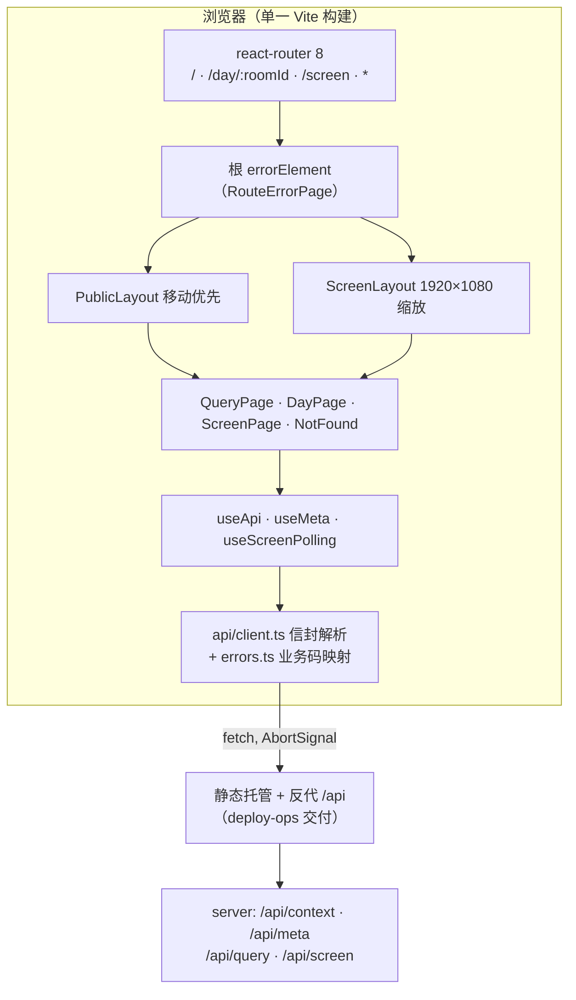

# public-web 设计

Feature Name: public-web
Spec Directory: 2026-11-15-public-web
Updated: 2026-11-15

## Description

交付 `easy-qfnu-kjs` 的公开前端：一个 Vite 构建、两个页面族（公开查询页 `/`、全天状态 `/day/:roomId`，数据大屏 `/screen`），外加共享骨架（antd 主题、API 客户端、路由、错误边界）。数据来源全部是已上线的四个公开接口，本 spec **不新增后端接口、不改后端代码、不含管理面板、不含容器编排**。

产品口径见 [docs/prd.md](../../docs/prd.md) 3.7 / 6.2 / 6.4 与 [重写 spec 的 requirements.md](../2026-10-27-classroom-availability-rewrite/requirements.md) 的 Requirement 15–19、26–27、33；接口形状以 [重写 spec 的 design.md](../2026-10-27-classroom-availability-rewrite/design.md) 为准，并用已落地的 `internal/query` 类型逐字段核对（见下文「接口契约快照」）。需求条目见同目录 [requirements.md](requirements.md)。

## 设计决策

| 编号 | 决策 | 理由与取舍 |
|---|---|---|
| D1 | **URL 是筛选条件的单一事实来源**：日期偏移、教学楼、节次区间、关键词、页码全部写进 `searchParams`，组件只读 URL | 刷新、后退、分享链接、从全天状态返回都自然成立；代价是每次改筛选都要 `setSearchParams`，用一层 `useQueryFilters` 收敛，不让组件各写一套 |
| D2 | **不引入全局状态库**（不用 redux / zustand / react-query）：页面级 `useApi` + 一个 `MetaProvider` + `useScreenPolling` | 两个页面、四个端点、无写操作，请求状态跟随组件生命周期；react-query 会自带一套缓存与重试语义，与「大屏 30 秒由后端缓存」的口径打架（D9） |
| D3 | **前端不推算教学周次与星期**：日期项只产 `date_offset`，目标日期的周次/星期一律取查询响应里的 `week`/`weekday` | PRD 7.1 与 design.md 明确「周次与星期由服务端按学期日历解析」；前端一旦自己算，学期日历边界与放假周会两处不一致 |
| D4 | **日期选择用 11 个横滑日期项，不用 `DatePicker` / `Calendar`** | 接口只有 `date_offset` 0..10（`backend/internal/api/params.go:24`），日历控件会给出无法查询的日期，还要把「今天」映射回偏移；日期项直接等于偏移，无效组合从交互上消失 |
| D5 | **公开页用 3 档媒体查询 + antd `Row/Col`**；大屏**不用断点**，用固定设计稿等比缩放（D6） | PRD 6.4 要求大屏在窗口变化时「等比缩放、不打乱布局」，断点重排正好是它禁止的行为；两个目标不共用一套断点 |
| D6 | **大屏等比缩放用 `transform: scale()`**：内层固定 `1920×1080`，缩放系数 `min(vw/1920, vh/1080)`，`transform-origin: top left` 并居中留边 | 16:9 视口恰好铺满，非 16:9 留黑边而不重排；不用 CSS `zoom`（Firefox/Safari 实现差异大），也不用 `vh` 单位重算字号（会破坏内层排版） |
| D7 | **占用热力图自绘 SVG**，不用图表库、不用 antd 组件 | antd 6.7 没有热力图；7×5 只需 `rect` + 色阶，引入 ECharts 等于为一个组件加 300KB 运行时且主题不可控。SVG 可被 antd token 着色、可被读屏读取 |
| D8 | **时间格式化单点收敛到 `lib/datetime.ts`**：入参一律 RFC3339 UTC，出参一律 `Asia/Shanghai`（`Intl.DateTimeFormat`） | 只有一处 `timeZone`，避免每个组件各写一次；不引 dayjs 插件，原生 `Intl` 够用 |
| D9 | **30 秒轮询自己写 `setInterval` + `visibilityState`**，不叠 SWR 缓存 | 后端 `/api/screen` 已缓存 30 秒（design.md CP15），前端再加一层 TTL 会让「失败保留旧数据」变得不可判定；自写轮询只有 30 行、可被 fake timer 直接测 |
| D10 | **错误文案只映射后端已有的业务码**（`40001`/`40401`/`42901`/`50000`），未知码兜底「服务异常」+ `request_id` | 复用后端 envelope 与错误码，不在前端重新定义一套；未知码不猜含义，只保证有兜底 |
| D11 | **状态名与节次名只来自元数据**（`meta.dict.states`、`meta.axis.nodes/blocks`），缺键时回退显示键本身 | PRD 3.4 / 6.2 要求字典可整体升级；回退显示键是为了字典升级间隙不白屏 |
| D12 | **大屏额外请求一次 `/api/screen` 之外的 `/api/meta`**（只取 `axis`），首屏与 screen 并行、之后不再刷新 | `/api/screen` 的 `occupancy.by_weekday_block` 只有数字矩阵，列头「第几节到第几节」必须来自轴定义；不取 meta 就只能硬编码，与 PRD 6.2 冲突。轮询仍只打 `/api/screen`，不放大后端压力 |
| D13 | **首页与空教室查询页合并为 `/` 一页**（首屏即查询） | PRD 6.2 列出的「首页与查询入口」与「空教室」在 6.1「一屏完成主要操作」下合并更省一次跳转；404 独立，全天状态独立 |
| D14 | **不做 SSR / 预渲染 / i18n** | 校内使用、无 SEO 需求、单一语言；多一层构建链路没有收益 |

技术栈按 [react-frontend.md](../../../ai-kit/docs/dev-conventions/stacks/react-frontend.md)：React 19 + antd 6.7（启用官方 MCP server）+ `react-router` 8 + Vite 8 + TypeScript + Vitest；Node 24 LTS；Tailwind 4 只在 antd 表达不了的自定义布局（大屏分区骨架、热力图容器）按需引入。

## 接口契约快照

四项均已上线，形状取自 `backend/internal/query` 的类型定义；`request_id` 前缀 `req_`，时间 RFC3339 UTC，统一信封见 `backend/internal/api/response.go:11`。

**信封**：`{code, message, data, request_id}`，`code=0` 为成功；失败时 `data` 为 `null`。公开路由在 `backend/internal/api/api.go:137-140`：`/api/context`、`/api/meta`、`/api/query`、`/api/screen`。

**`GET /api/context`** → `data`（`internal/query/query.go:20`）：`{date: "YYYY-MM-DD", term, week, weekday, in_calendar}`；非教学周时 `term` 为空、`week`/`weekday` 为 0。

**`GET /api/meta`** → `data`（`internal/query/meta.go:80`）：

```json
{
  "release": { "release_id": "20261023T071012Z", "generated_at": "2026-10-23T07:10:12Z" },
  "dict": { "version": 1, "states": { "free": { "label": "空闲", "available": true } } },
  "axis": { "version": 1, "blocks": ["0102", "030405"], "nodes": [{ "node": "01", "ordinal": 1, "block": "0102", "block_ordinal": 1 }] },
  "buildings": [{ "building_id": "Q10", "name": "综合教学楼" }],
  "weeks": [{ "week": 5, "published": true, "last_success_at": "2026-10-23T07:10:12Z", "stale": false }],
  "empty": false
}
```

无当前版本时 `release`/`dict`/`axis` 为 `null`、`weeks` 为空数组、`empty` 为 `true`，仍返回 200；`weeks` 覆盖整个学期（`1..total_weeks`），不是采集窗口。

**`GET /api/query?view=availability`** → `data`（`internal/query/availability.go:59`）：`{total, items: [{room_id, name, building_id, building_name}], date, term, week, weekday, hint}`。参数：`date_offset` 0..10、`building`（空为全部）、`start_node`/`end_node`（01..12，起点不晚于终点，**省略时默认 01..11**）、`keyword`（≤32 字，服务端归一）、`limit` 1..200 默认 50、`offset ≥ 0`。

**`GET /api/query?view=day`** → `data`（`internal/query/day.go:41`）：`{room_id, name, building_id, building_name, date, term, week, weekday, nodes: [{node, block, state_key, label, available, has_data}], hint}`。参数：`date_offset`、**`room_id` 必填**（trim 后非空、≤32 字，`internal/api/params.go:134-139`）、可选 `building`；该视图不接受 `keyword`/分页参数。

**`GET /api/screen`** → `data`（`internal/query/screen.go:80`）：`{scale, release, weeks, last_run, anomalies, occupancy, traffic, leaderboard, peaks, trend, node_distribution, empty}`。本 spec 只用前六块（`traffic` 之后的访问统计块不在本次范围，见「待确认 2」）：

```json
{
  "scale": { "rooms": 2481, "buildings": 26, "term": "2026-2027-1", "week": 5, "window": [5, 8] },
  "release": { "release_id": "20261023T071012Z", "generated_at": "2026-10-23T07:10:12Z" },
  "weeks": [{ "week": 5, "published": true, "last_success_at": "...", "stale": false }],
  "last_run": { "status": "partial", "started_at": "...", "duration_ms": 1830000, "attr_conflict": true },
  "anomalies": { "unknown_cells": 12, "composite_cells": 51, "attr_conflicts": 2 },
  "occupancy": {
    "by_building": [{ "building_id": "Q10", "name": "综合教学楼", "cells": 14700, "occupied": 3821, "rate": 0.26 }],
    "by_weekday_block": [[0.42, 0.38, 0.31, 0.22, 0.11], "...共 7 行 × 5 列"]
  },
  "empty": false
}
```

`release` 为 `null` / `empty` 为 `true` 表示无当前版本（Requirement 6.6）；`window` 为空数组表示没有可用采集窗口；`last_run` 为 `null` 表示还没有轮次；`duration_ms` 为 `null` 表示没有结束时刻。响应**只含状态、时间与计数**，没有 `error_code`、错误原文与账号（design.md CP13）。

## Architecture



图渲染不出来时看这段同义结构：

```text
浏览器 ──> react-router ──> 根 errorElement ──┬──> PublicLayout ──> QueryPage / DayPage / NotFound
                                                └──> ScreenLayout ──> ScreenPage
页面 ──> hooks(useApi/useMeta/useScreenPolling) ──> api/client.ts ──> fetch(/api/*) ──> 反代 ──> server
```

数据流是单向的：URL → 筛选参数 → `useApi` 发请求 → 信封解析 → 页面渲染；页面不写回任何全局状态，只写回 URL。大屏多一条时钟分支：`useScreenPolling` 每 30 秒发一次请求，失败只更新「离线」局部状态，不动已渲染的数据。

开发期 `vite.config.ts` 把 `/api` 代理到 `http://127.0.0.1:18080`（后端默认监听 `:18080`，本机用 `127.0.0.1:18080` 访问，见 `backend/internal/config/config.go:27`）；生产期由 `web` 容器托管 `dist/` 并反代 `/api`，属于 `deploy-ops`，本 spec 只保证 `pnpm build` 产出 `frontend/dist`。

## Components and Interfaces

### 目录结构

```
frontend/
  package.json              脚本：dev / build / preview / test（一次性）/ test:watch（交互）/ lint / type-check / format；packageManager 钉 pnpm
  vite.config.ts            @vitejs/plugin-react、/api 代理、vitest 配置（environment: jsdom, setupFiles）
  tsconfig.json             strict、禁止隐式 any
  eslint.config.js          flat config；prettier 作为格式化
  index.html                lang="zh-CN"、viewport、主题色
  README.md / .prettierignore  工程文件：命令说明与目录约定；prettier 忽略 node_modules、dist、coverage 与 lockfile
  src/main.tsx              createRoot + App
  src/App.tsx               路由表、ConfigProvider、根 errorElement
  src/theme/index.ts        antd 主题：品牌色 #884F22、大屏暗色算法、状态视觉映射
  src/api/client.ts         信封解析、超时、AbortSignal、ApiError
  src/api/errors.ts         业务码 → 文案（只映射后端已有码）
  src/api/types.ts          上下文 / 元数据 / 查询 / 大屏的 TypeScript 类型
  src/api/public.ts         getContext / getMeta / queryAvailability / queryDay / getScreen
  src/hooks/useApi.ts       通用请求状态：data / error / loading / abort / 依赖键
  src/hooks/useMeta.ts      元数据加载与缓存（页面级一次）
  src/hooks/useScreenPolling.ts  30 秒轮询 + 可见性 + 离线标记
  src/hooks/useQueryFilters.ts   URL ↔ 筛选参数的唯一读写点
  src/lib/datetime.ts       RFC3339 UTC → Asia/Shanghai 展示
  src/lib/dateOffset.ts     日期项文案：偏移 0/1 → 今天/明天，其余目标日的 M-D（纯日历日加减，不碰时区）
  src/lib/nodes.ts          时段默认区间、小节标签、大节列头（从轴定义派生）
  src/lib/roomName.ts       同名房间追加房间标识后缀
  src/lib/scale.ts          大屏缩放系数计算（纯函数，可单测）
  src/components/StateViews.tsx   LoadingView / EmptyView / ErrorView / StaleBanner / OfflineBadge
  src/components/StatusCell.tsx   单小节状态格（文字 + 图标 + 颜色）
  src/components/NodeGrid.tsx     12 小节网格
  src/components/OccupancyHeatmap.tsx  7×5 SVG 热力图 + 图例
  src/components/PageFooter.tsx   数据来源 / 更新频率 / 仅供参考
  src/components/RouteErrorPage.tsx  根路由 errorElement：渲染失败时显示错误页而非白屏
  src/layouts/PublicLayout.tsx    公开页壳：单列优先、页脚、底部主操作区
  src/layouts/ScreenLayout.tsx    大屏壳：暗色、无导航、等比缩放
  src/pages/public/QueryPage.tsx
  src/pages/public/DayPage.tsx
  src/pages/public/ScreenPage.tsx
  src/pages/public/NotFoundPage.tsx
  src/test/setup.ts         jest-dom、matchMedia 与 ResizeObserver 垫片
  src/test/msw.ts           setupServer + 四个端点的默认 handler
  src/test/fixtures/*.json  与后端类型逐字段对齐的响应夹具
```

与重写 spec 的目录约定一致（`frontend/src/{api,lib,components,layouts,pages,theme}`）；本次只落 `pages/public`，`pages/admin` 留给管理面板 spec。测试与被测模块同目录（`:*.test.tsx`），符合前端规范。

### 路由

| 路径 | 页面 | 说明 |
|---|---|---|
| `/` | `QueryPage` | 空教室查询：筛选 + 结果 + 分页，首屏即入口（D13） |
| `/day/:roomId` | `DayPage` | 全天状态；`date_offset` / `building` 从 `searchParams` 读，缺省 `0` / 全部 |
| `/screen` | `ScreenPage` | 数据大屏，暗色、无导航、30 秒轮询 |
| `*` | `NotFoundPage` | 404，给出回查询页的入口 |

`createBrowserRouter` 的根路由把 `RouteErrorPage` 挂成 `errorElement`，渲染失败时显示错误页而不是白屏；`NotFoundPage` 与错误页共用同一套 `Result` 结构。

### API 客户端

```ts
// 形状约定（非实现代码）
type Envelope<T> = { code: number; message: string; data: T | null; request_id: string };
class ApiError extends Error { code: number; requestId: string; retriable: boolean }
```

- `request<T>(path, { query, signal })`：拼 query（camelCase → snake_case 由调用点显式给出键名，不做自动转换）、`fetch` + `AbortSignal`、非 2xx 也尝试解析信封、`code !== 0` 抛 `ApiError`、未知 `code` 走兜底文案。
- 每个端点一个薄函数（`queryAvailability` / `queryDay` / …），页面不直接 `fetch`。
- `errors.ts` 只导出四类文案：`40001`「参数有误」、`40401`「数据不存在」、`42901`「请求过于频繁，请稍后重试」、`50000`「服务异常」；`message` 仅在兜底时展示，`request_id` 始终附在错误态。
- 超时：15 秒，由客户端自己用 `AbortController` + `setTimeout` 手动合并「超时」与筛选切换的 `signal`（调用方 signal 与超时各挂一个 listener，请求结束后 `clearTimeout` 并解绑 listener）；`AbortError` 不进入错误态（D1 + Requirement 1.5）。
- 浏览器支持基线：**Chrome 116+ / Safari 17.4+ / Firefox 124+**（`AbortSignal.any` 的落地版本）。低于此版本用 `AbortController` 手动合并兜底：实现不依赖 `AbortSignal.any`，也不依赖 `AbortSignal.timeout`（Safari 16+），缺失这两个静态方法时超时与取消照常工作。

### 状态管理（尽量轻）

| 状态 | 存放位置 | 理由 |
|---|---|---|
| 筛选条件、页码 | URL `searchParams`（`useQueryFilters`） | 可刷新、可后退、可分享（D1） |
| 上下文与元数据 | `MetaProvider`（页面级 Context，一次加载） | 字典、轴、教学楼列表在多个块共用，页面内只取一次 |
| 请求结果 | `useApi` 的局部 state | 生命周期跟随页面，跨页无复用价值 |
| 大屏数据与离线标记 | `useScreenPolling` 局部 state | 轮询是页面级行为（D9） |
| 主题与暗色 | `ConfigProvider` | antd 自带，无需自建 |

### 组件树

```text
App（ConfigProvider + RouterProvider + 根 errorElement）
├─ PublicLayout
│  ├─ QueryPage
│  │  ├─ ContextBar（今天 / 第几周 / 星期 / 是否教学周）
│  │  ├─ FilterPanel（日期项 ×11 · 教学楼下拉 · 节次区间 · 关键词 · 查询按钮）
│  │  ├─ StaleBanner / EmptyView / ErrorView / LoadingView
│  │  ├─ ResultList（房间行 → 「看全天状态」）
│  │  ├─ Pagination
│  │  └─ PageFooter
│  ├─ DayPage
│  │  ├─ RoomHeader（房名 · 房号 · 楼名 · 日期）
│  │  ├─ StaleBanner / EmptyView / ErrorView / LoadingView
│  │  ├─ NodeGrid → StatusCell ×12
│  │  └─ PageFooter
│  └─ NotFoundPage
└─ ScreenLayout
   └─ ScreenPage
      ├─ ScreenHeader（标题 · 最后刷新时间 · OfflineBadge）
      ├─ ScaleBlock（房间数 · 教学楼数 · 学期 · 当前周 · 采集窗口）
      ├─ ReleaseBlock（版本标识 · 生成时间） + WeekFreshnessTable（逐周发布/最近成功/过期）
      ├─ RunBlock（最近一轮状态 · 开始时间 · 耗时） + AnomalyBlock（未知/复合/归属冲突）
      ├─ OccupancyHeatmap（7×5 SVG · 图例） + BuildingOccupancyList（按楼占用率）
      └─ EmptyState（empty=true 时各区块标题 + 「暂无数据」）
```

### 组件说明

- `QueryPage`：`now?: Date` 是**测试注入点**——按本地时间预填节次区间要能对齐 11:59/12:00/17:59/18:00 三档边界，测试注入固定时刻；生产不传，默认 `new Date()`。预填区间在页面打开时算一次并冻结，之后换日期（含非当天）沿用当前时段，页面停留跨档也不会换掉用户正在看的区间。
- `FilterPanel`：关键词是唯一不逐字写进 URL 的输入，只留本地草稿；后退/前进（`location.key` 变化的 POP 导航）时清空草稿，让 URL 上的已提交关键词优先，URL 仍是单一事实来源（D1）。

### 响应式断点

两个目标各走一套，不互相复用：

| 目标 | 断点 | 布局 |
|---|---|---|
| 公开查询页（移动优先） | `< 600px` | 单列：筛选堆叠、结果单列、查询按钮固定在底部安全区（44px 高），结果区可滚动 |
| | `600–1024px` | 双列：筛选左、结果右；按钮回到筛选区内 |
| | `≥ 1024px` | 三列：筛选 1 列 + 结果 2 列（antd `Row/Col`，gutter 16），一屏内筛选与结果同屏 |
| 数据大屏（大屏优先） | 无断点 | 固定 1920×1080 设计稿 + `scale(min(vw/1920, vh/1080))`，非 16:9 留黑边居中；手机可打开但不保证排版（PRD 6.4） |

触控目标统一 `min-height: 44px`（查询按钮、日期项、楼层下拉、房间行的「看全天状态」）；`prefers-reduced-motion` 下关闭过渡。

### 大屏布局

1920×1080 画布，12 列 × 8 行网格，间距 24px，外边距 40px：

```text
┌──────────────────────────────────────────────────────────────┐
│ ScreenHeader：站点标题 · 最后刷新时间 · 离线徽标              │ 1 行
├───────────────────────┬──────────────────────────────────────┤
│ ScaleBlock 站点规模    │ ReleaseBlock 版本 + 生成时间          │
│ (房间数/楼数/学期/周)  │ WeekFreshnessTable 逐周新鲜度（窗口内）│ 3 行
├───────────────────────┼──────────────────────────────────────┤
│ RunBlock 最近一轮      │ OccupancyHeatmap 7 天 × 5 大节        │
│ + AnomalyBlock 计数    │ + 图例 + BuildingOccupancyList        │ 4 行
└───────────────────────┴──────────────────────────────────────┘
```

- 暗色：`ConfigProvider` 的 `theme.darkAlgorithm` + 品牌色 `#884F22` 派生；大屏不用 antd 默认浅底。
- 数字用等宽字体、单位小字；所有时间带「`Asia/Shanghai`」标注（Requirement 6.2）。
- `empty=true` 时各区块保留标题、正文显示「暂无数据」，不清空页面（Requirement 6.6）。
- 不展示任何错误码、错误原文、账号（Requirement 7.6；`last_run` 只有 `status`/`started_at`/`duration_ms`/`attr_conflict`）。

### 占用热力图实现

- **自绘 SVG**（D7）：`viewBox="0 0 700 420"`，7 行（周一…周日）× 5 列（大节 1..5），每格 `rect` + 4px 圆角，格间 6px 间距；行头用「周一…周日」，列头由 `meta.axis` 派生为「第 01–02 节」这样的区间。
- 色阶：占用率 `0 → token.colorBgContainer`，`→ 1` 映射品牌色的 5 档透明度；`rate` 为 0 或该格无观测时用中性底色，与「低占用」区分开。
- 图例：5 个色块 + 刻度（0、25%、50%、75%、100%），文字说明「未知与复合占用计入已占用」。
- 可访问性：`role="img"` + `aria-label` 概述（「占用热力图：7 天 5 大节，最高 42%」），每格 `<title>` 给「周三 第 3–4 节 38%」这样的可读文本；不用颜色承载唯一信息，鼠标悬停给 antd `Tooltip`。
- 按楼占用率用 antd `List`/`Progress` 呈现 `by_building`（楼名 + 占用率百分比 + 已占/总格数），不放热力图里。

### 四态

| 态 | 触发 | 表现 |
|---|---|---|
| 加载 | 首次加载、翻页、改筛选 | 结果区 antd `Skeleton`；筛选控件保持可用；按钮 `loading`；不整页遮罩 |
| 空 | `hint.code` 为 `no_match` / `no_data` / `week_no_schedule` / `day_no_data`；或 `meta.empty` | antd `Empty` + 按标记选文案 + 一句「换个日期或楼试试」的可操作建议；`week_no_schedule` 用置顶 `Alert`（结果照常展示） |
| 过期 | 查询响应的 `week` 命中 `meta.weeks[].week` 且 `stale=true`；或 `context.in_calendar=false` | 结果上方 `Alert type="warning"`，文案含该周最近成功时间；数据照常展示，不隐藏 |
| 错误 | 网络失败、`ApiError` 非 0、解析失败 | antd `Result status="warning"` + 分类文案 + 「重试」按钮 + `request_id`（小字，可复制）；错误态不显示上一次结果 |

大屏另有两态：**离线**（轮询失败 → 顶栏 `OfflineBadge` + 最后成功时间，数据保持）与**无数据**（`empty=true` → 各区块「暂无数据」）。

## Correctness Properties

1. **URL 单一事实来源**：任一筛选组合刷新页面后，发出的请求参数与刷新前完全一致。
2. **节次语义只在前端默认值**：前端把预填区间原样作为 `start_node`/`end_node` 发送，任何前端逻辑都不改变服务端对区间的判定。
3. **周次来源唯一**：页面上出现的教学周次与星期只来自 `/api/context` 或查询响应的 `week`/`weekday`，前端不存在第二套周历换算。
4. **名称来源唯一**：状态名、小节名、大节列头只来自 `meta.dict`/`meta.axis`；键缺失时回退显示键或编号，不出现写死的中文名。
5. **大屏无敏感运维信息**：`/screen` 渲染树中不出现业务码、`message`、`error_code`、账号与上游细节。
6. **大屏无前端缓存**：每次轮询都真实发出 `/api/screen` 请求；同一轮询周期内不读任何前端 TTL 缓存（D9）。
7. **时间口径统一**：所有时间展示走 `lib/datetime.ts`，输入按 UTC 解析、输出按 `Asia/Shanghai` 格式化，页面内不存在第二种格式化路径。
8. **布局不重排**：视口从 1920×1080 变到 2560×1440 或 1280×1024 时，大屏各区块的相对位置与顺序不变，只改变缩放系数。
9. **失败可定位**：任一错误态都带 `request_id`，且请求失败不会把上一次的列表数据残留在页面上。

## Error Handling

| 场景 | 前端表现 |
|---|---|
| 网络不可达 / 请求超时 | 错误态「网络异常，请检查连接」+ 重试 + `request_id`（超时由前端生成占位） |
| `code=40001` | 「参数有误」；同时把 URL 里的非法参数回退到默认值，提示后允许重查 |
| `code=40401` | 「数据不存在」（当前公开端点按空态返回，此处仅兜底） |
| `code=42901` | 「请求过于频繁，请稍后重试」；查询按钮禁用 3 秒后恢复 |
| `code=50000` | 「服务异常」+ 重试 + `request_id` |
| 未知 `code` | 兜底「服务异常」；`message` 只作副标题，不当作可依赖文案 |
| 信封解析失败（非 JSON） | 与 `50000` 同路径，`request_id` 记「未知」 |
| 筛选切换时的中断 | 静默丢弃，不计入错误态，不闪错误页 |
| `/api/meta` 失败 | 页面级错误态（缺少字典与楼列表无法查询），带重试 |
| 大屏轮询失败 | 保留上次数据 + `OfflineBadge` + 最后成功时间；下次成功自动清除 |
| 大屏首屏失败 | 各区块 `Skeleton` → 错误占位 + 「重试」；不显示空态（与 `empty` 区分） |

## Test Strategy

- **工具**：Vitest + `@testing-library/react` + `@testing-library/jest-dom`；HTTP 用 **MSW v2**（`msw/node` 的 `setupServer`），handler 从 `src/test/fixtures` 读与后端类型逐字段对齐的夹具；`jsdom` 环境，`src/test/setup.ts` 补 `matchMedia`、`ResizeObserver`、`AbortSignal.timeout` 垫片。
- **纯函数单测**（最优先）：`lib/nodes.ts` 三档时段默认（11:59 / 12:00 / 17:59 / 18:00 边界）、`lib/roomName.ts` 同名后缀、`lib/datetime.ts` UTC→Asia/Shanghai（含跨日）、`lib/scale.ts` 缩放系数（16:9、更宽、更高）。
- **客户端**：信封成功/非 0/非 JSON/HTTP 500 四条路径；`AbortError` 不进错误态；`42901` 文案与按钮禁用；`request_id` 出现在错误态。
- **页面组件测试**（不用快照）：
  - `QueryPage`：默认区间三档、日期项 11 个且点击写 `date_offset`、楼下拉含「全部」与白名单、回车与点击同请求、分页参数、空态三档文案；
  - `DayPage`：12 格渲染、`has_data=false` 显示「无数据」且不是可用样式、`day_no_data` 置顶提示、缺 `roomId` 的空态；
  - `ScreenPage`：规模/版本/逐周/最近一轮/异常计数五块渲染、`empty=true` 各块「暂无数据」、页面内不出现错误码与错误原文（用 `queryByText` 断言敏感串缺席）；
  - 轮询：`vi.useFakeTimers()` 推进 30 秒断言多一次请求、失败后保留旧数据并出现离线徽标、`visibilitychange` 暂停/恢复。
- **契约守卫**：夹具 JSON 与 `src/api/types.ts` 通过 `satisfies` 常量断言形状；新增字段不破坏既有用例，删字段即编译失败。
- **可访问性**：断言 `aria-live` 区域在结果更新时文本变化、查询按钮具名、状态格有可读 `title`、焦点在查询后仍留在触发控件。
- **门禁**：`task frontend:lint`（eslint + `tsc --noEmit`）、`task frontend:test`、`task frontend:build`，三者进 `task gate`；禁 `any`，禁 `console.log` 进产物。

## 构建与产物

- 脚本（对齐根 `Taskfile.yml` 已有的 `frontend:*`）：`dev`、`build`（`tsc --noEmit && vite build`）、`preview`、`test`（`vitest`）、`lint`、`type-check`、`format`；`package.json` 写 `packageManager` 钉 pnpm 版本。
- 产物：`frontend/dist/`，`base: '/'`，资源带内容哈希；`build.target` 与 Node 24 LTS 对齐。
- 开发期 `/api` 代理到 `http://127.0.0.1:18080`；生产反代、缓存头与 `Dockerfile.frontend` 属于 `deploy-ops`（本 spec 只保证 `pnpm build` 可产出）。
- 不引 ECharts/dayjs/react-query/swr；新增依赖只允许 antd 6.7 生态、react-router 8、vitest/RTL/MSW 测试链（评审时逐项说明理由）。

## 待确认

1. **日期选择口径**：任务书写的是「本周/下周」，接口只有 `date_offset` 0..10 且 `/api/context` 不返回窗口。本设计按 11 个日期项实现（D4）。若要「本周/下周」分组，需要定义跨周标签由谁计算（前端用 `context.week` 推算 vs 后端补字段）。
2. **「占用热力图 7×24」与现有数据不符**：占用率只有 `occupancy.by_weekday_block`（7 天 × 5 大节），没有逐小时占用；7×24 的只有 `peaks.heatmap`，那是**访问量**而非占用。本设计按 7×5 占用 + 按楼占用率实现（Requirement 6.5）。若必须 7×24，等于增加「访问统计」区块，超出本次范围清单，需另立需求。
3. **「按校区归属展示」缺字段**：`/api/meta` 的 `buildings[]` 只有 `building_id` 与 `name`，没有校区字段。本设计不做校区分组（楼名可自带前缀）。若必须分组，需后端加字段，本 spec 不改后端。
4. **全天状态的房间入口**：`view=day` 必填 `room_id`，但没有「按楼列出全部教室」的接口。本设计只允许从空教室结果点入（Requirement 3.4），意味着某天没有任何空教室时看不到任何房间的全天状态。若需要独立房间选择器，需另开 spec 加房间目录接口。
5. **`design.md`（重写 spec）的 `/api/query` 参数表缺 `room_id`**，且未给 availability / day 的响应体形状；本 spec 以实现为准并在上文「接口契约快照」记录，建议由该 spec 维护者回填。
6. **大屏是否允许第二个请求 `/api/meta`**（D12，只为首屏取轴定义）。若不允许，列头只能硬编码「大节 1..5」，与 PRD 6.2「节次名取自数据版本」冲突。
7. **分页形态**：移动端用 antd `Pagination` 页码还是「加载更多」列表。本设计取 `Pagination`（可测、可用键盘），如要「加载更多」需追加 `IntersectionObserver` 与滚动位置恢复。

## References

[^1]: [docs/prd.md](../../docs/prd.md) - 产品基线：3.7 数据大屏、6.2 公开查询页、6.4 数据大屏页、7.1 时间口径
[^2]: [specs/2026-10-27-classroom-availability-rewrite/design.md](../2026-10-27-classroom-availability-rewrite/design.md) - 公开 API 契约与 envelope
[^3]: [specs/2026-10-27-classroom-availability-rewrite/requirements.md](../2026-10-27-classroom-availability-rewrite/requirements.md) - Requirement 15–19、26–27、33
[^4]: [specs/2026-11-03-easy-qfnu-kjs/roadmap.md](../2026-11-03-easy-qfnu-kjs/roadmap.md) - `public-web` 在交付顺序中的位置
[^5]: [backend/internal/query/screen.go](../../backend/internal/query/screen.go) - 大屏响应类型
[^6]: [backend/internal/query/availability.go](../../backend/internal/query/availability.go) - 空教室结果与提示标记
[^7]: [backend/internal/api/params.go](../../backend/internal/api/params.go) - 查询参数边界与 `room_id` 必填
[^8]: [react-frontend.md](../../../ai-kit/docs/dev-conventions/stacks/react-frontend.md) - 前端选型与质量门禁
